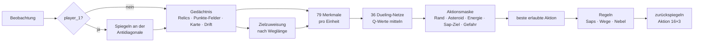

# Sherlock – RL-Agent für Lux AI Season 3

**HTW Berlin · Anwendungen der KI · WS 26/27**
Team 15 (Moodle-Gruppe `15`) · Mahmoud El-Hassan, Moayed Shawesh · Agent **Sherlock** (`agents/sherlock/`, Klasse `Agent_x`)

Lux AI Season 3 ist ein Zwei-Spieler-Strategiespiel auf einer 24×24-Karte mit Nebel, wandernden Asteroiden und versteckten Punkte-Feldern rund um Relics. Im Kurs besteht ein Spiel aus 3 Matches à 100 Schritte; jede Seite steuert bis zu 16 Einheiten. Viele Spielparameter (Sichtweite, Sap-Kosten, Streuschaden, Nebel-Abzug …) werden pro Spiel zufällig gezogen und sind nicht direkt sichtbar.

Sherlock ist ein **Ensemble aus 36 Double-DQN-Netzen mit Dueling-Kopf**, das für jede Einheit einzeln entscheidet. Davor stehen ein **Gedächtnis**, das Relics und unsichtbare Punkte-Felder erschließt, eine **Zielzuweisung** und **Aktionsmasken**. Danach prüfen **Regeln** wenige, aber wichtige Fälle. Ein Netz genügt für beide Seiten, weil `player_1` in einen gespiegelten, kanonischen Raum übersetzt wird.

## Auf einen Blick (Stand 31.10.2026)

| | |
|---|---|
| **Aktuelle Abgabe** | **V12 `v12_fog`** seit 31.10.2026, 17:07 · [Übernahmebericht](experiments/analysis/release_20261031_v12/RELEASE.md) |
| Gegen Solution_92 | **94,4 %** (1.600 Spiele auf 800 frischen Karten, beide Seiten) |
| Mittel über 6 starke Gegner | **87,1 %** (Vorgänger V11 auf denselben Karten: 81,2 %) |
| Gegen `default` | 99,9 % |
| DQN-Beispiel des Profs, Rush-Bot, Zufallsspieler | je **600 von 600** gewonnen (Entwicklungskarten) |
| Entscheidungen | 91 % wie die Netze, Regeln ändern 8 % |
| Battle-Abgabe 06.11. | `Gruppe15.zip` (22,2 MB), gebaut mit `python -m scripts.build_submission --battle` |
| Tests | 604 (`python -m pytest -q`) |

## Inhalt

- [Fortschritt gegen Solution_92](#fortschritt-gegen-solution_92)
- [Ergebnisse der Abgabe V12](#ergebnisse-der-abgabe-v12)
- [Wie Sherlock entscheidet](#wie-sherlock-entscheidet)
- [Training](#training)
- [Wie wir testen](#wie-wir-testen)
- [Projektstruktur](#projektstruktur)
- [Installation](#installation)
- [Nutzung](#nutzung)
- [Abgabe](#abgabe)
- [Grenzen und nächste Schritte](#grenzen-und-nächste-schritte)
- [Historische Ergebnisse](#historische-ergebnisse)
- [Dokumentation und Zusammenarbeit](#dokumentation-und-zusammenarbeit)
- [Quellen](#quellen)

## Fortschritt gegen Solution_92

`Solution_92_Kaggle` ist ein starker regelbasierter Agent aus dem Kaggle-Wettbewerb und unser wichtigster Prüfstein. Jede Version wurde vor der Übernahme auf einem eigenen, vorher unbenutzten Kartenblock gegen ihren Vorgänger gemessen, jede Karte von beiden Seiten.

| Datum | Version | Was neu war | Solution_92 | Vorgänger, gleiche Karten | Karten |
|---|---|---|---:|---:|---|
| 16.10. | `old3_sym3` (Review) | 6 Netze, Spiegelsymmetrie, Erkundungsgedächtnis | 46,7 % | – | 30 Testkarten |
| 20.10. | V3 `all18_v3` | 18 Netze, frühe Punkte-Feld-Inferenz, Regeln `far_opp`, `far_cand`, `pt_sap` | 78,25 % | 42,5 % | 200 |
| 22.10. | V7 `v7_Bsnpd` | Artillerie-Sap, weiche Nebel-Meidung, Nebel-Inferenz, Drift-Verfolgung, Wegkorrektur | 83,5 % | 76,5 % | 400 |
| 22.10. | V10 `v10_V8st` | Ziele nach Weglänge, keine Mehrfach-Saps, sichere Züge, Kollisionsschutz, Halter schießen nur auf stehende Gegner | 90,3 % | 82,8 % | 800 |
| 30.10. | V11 `v11_mix36c_as` | 36 Netze (18 davon nachtrainiert), Streuschaden-Saps bei Streufaktor 1,0 | 94,1 % | 89,6 % | 800 |
| 31.10. | **V12 `v12_fog`** | **Nebel-Sap** auf unsichtbare Halter, Halbstreuung bei Streufaktor 0,5 | **94,4 %** | 93,0 % | 800 |

Die Zeilen stammen aus verschiedenen Kartenblöcken und sind untereinander nur grob vergleichbar. Belastbar ist jeweils der gepaarte Vergleich mit dem Vorgänger auf denselben Karten. Die 46,7 % des Reviews beruhen auf 60 mehrfach verwendeten Testspielen. Von V3 bis V10 blieben die 18 Netze gleich: Der Sprung von 78 auf 90 % kam allein aus Korrekturen an Gedächtnis, Wegfindung, Zielwahl und Sap-Regeln.

## Ergebnisse der Abgabe V12

Battle-Bestätigung auf 800 frischen Karten **808000–808799**, beide Seiten, je Gegner 1.600 Spiele, gepaart gegen V11:

| Gegner | Art | V11 | **V12** | Δ (pp) |
|---|---|---:|---:|---:|
| Solution_92 | regelbasierter Kaggle-Agent | 93,0 % | **94,4 %** | +1,4 |
| `sol92_sq` | Solution_92, schießt im ganzen Sap-Quadrat | 85,1 % | **89,3 %** | +4,2 |
| V3 | unsere Abgabe vom 20.10. | 83,4 % | **88,9 %** | +5,5 |
| V7 | unsere Abgabe vom 22.10. | 70,6 % | **79,8 %** | +9,2 |
| `league_nets6` | zurückgehaltenes RL-Ensemble (6 Netze, V10-Regeln) | 66,4 % | **77,3 %** | +10,9 |
| `threat6` | zurückgehaltenes RL-Ensemble (6 Gefahr-Netze) | 88,8 % | **93,0 %** | +4,2 |
| **Mittel über die 6** | | **81,2 %** | **87,1 %** | **+5,9** [+4,75; +7,08] |
| `default` | schwacher Beispielagent der Vorlage | 99,9 % | 99,9 % | ±0 |

- **Direkt gegen V11:** 61,0 % [57,75; 64,38] aus 800 Spielen (Karten 808800–809199).
- **Nach Sichtweite** (Mittel über die 6 Gegner, V11 → V12): 1: 77,2 → 85,6 %, 2: 79,7 → 86,4 %, 3: 82,8 → 88,1 %, 4: 84,7 → 88,2 %. Der Nebel-Sap hilft vor allem bei schlechter Sicht.
- **Einfachere Gegner** (Entwicklungskarten 800000–800299, je 600 Spiele, nur Information): DQN-Beispiel der Kursvorlage, Rush-Bot und Zufallsspieler je 600/600, `sol92_sqweak` 90,2 %.
- Die beiden RL-Ensembles waren nie Trainingsgegner und wurden nur zum Testen verwendet.

**Was der Nebel-Sap macht:** Der Gegner punktet oft auf Feldern, die wir gerade nicht sehen. Steigt seine Punktzahl, obwohl auf keinem sichtbaren Punkte-Feld ein Gegner steht, muss ein Halter auf einem unsichtbaren Punkte-Feld stehen. Sherlock schießt dann in Reichweite auf das wahrscheinlichste dieser Felder. Die Regel gab es schon seit dem 22.10., aber ein Fehler machte sie fast wirkungslos: Mit der Spiegelsymmetrie galten die gegnerischen Punkte-Felder als „gesehen und leer“. Die Behebung (`fog_v2`) brachte +5,9 Punkte im Mittel.

## Wie Sherlock entscheidet



Alle 36 Netze bewerten in jedem Schritt jede Einheit; es gibt kein Netz pro Match oder pro Seite. Gemessen in 10 Diagnosespielen gegen Solution_92 mit 36.204 Einzelentscheidungen (`scripts/decision_trace.py`, [Rohdaten](experiments/analysis/decision_trace_20261031_v12.json)):

- In **91 %** der Entscheidungen bleibt die Wahl der Netze unverändert, Regeln ändern **8 %**.
- Alle 36 Netze sind sich in 33 % der Fälle einig; im Mittel wählen 27,6 von 36 Netzen einzeln dieselbe Aktion wie das Ensemble.
- In 22 % verbietet die Maske die Lieblingsaktion der Netze, dann gilt die beste erlaubte.

Ausführliche Erklärung mit Beispielen: [Wie Sherlock entscheidet](Sherlock_Entscheidungsprozess.md) · [interaktive Darstellung](docs/presentation/Sherlock_Entscheidungsablauf.html).

### Bausteine

| Baustein | Datei | Aufgabe |
|---|---|---|
| Spiegelung | `geometry.py` | Die Karte ist symmetrisch zur Antidiagonale, `M(x,y) = (23-y, 23-x)`. `player_1` wird gespiegelt, der eigene Spawn liegt immer bei (0,0). |
| Gedächtnis | `belief.py` | Merkt sich Relics über alle Matches. Punkte-Felder werden aus „Punktezuwachs gegen besetzte Felder“ abgeleitet. Dazu Spiegelsymmetrie, Erkundungsgedächtnis sowie Nebel- und Drift-Verfolgung, weil Asteroiden und Nebel wandern. |
| Parameter-Schätzung | `param_est.py` | Schätzt versteckte Spielparameter aus Beobachtungen, z. B. Nebel-Energieabzug und Sap-Streufaktor. Mehrere Regeln schalten erst bei einer sicheren Schätzung um. |
| Merkmale und Ziele | `features.py` | 79 Zahlen pro Einheit: Lage und Energie, Punktestand, nächstes Punkte-, Kandidaten-, Relic-, unerkundetes und zugewiesenes Ziel, Nachbarfelder, nächster Gegner, Zähler. Ziele werden nach echter Weglänge verteilt. |
| Netz | `model.py` | MLP 79 → 256 → 256, Dueling-Kopf: V (128 → 1) und A (128 → 6), `Q = V + A − mean(A)`. Aktionen: stehen, 4 Richtungen, Sap. |
| Ensemble | `main.py`, `scripts/build_ensemble.py` | Mittelwert der Q-Werte aus 36 Netzen. |
| Aktionsmaske | `main.py` | Sperrt Rand, Asteroiden, Züge ohne Energie und Sap ohne Ziel, dazu tödliche Felder (`safe_moves`) und Kollisionen mit stärkeren Gegnern (`collision_guard`). |
| Regeln | `main.py`, `rules.py` | Siehe nächste Tabelle. |

### Regeln der Abgabe V12

| Regel | Was sie tut |
|---|---|
| `pt_sap` + `sap_still` | Eine Einheit auf einem Punkte-Feld bleibt stehen und schießt, wenn sie einen stehenden Gegner direkt trifft. |
| `sap_still_splash` | Bei sicher geschätztem Streufaktor ≥ 0,5 auch auf ziehende Gegner: Der Streuschaden trifft sie nach einem Schritt trotzdem. |
| `art_sap` + `art_splash` | „Artillerie“: Einheiten ohne eigenes Punkte-Feld schießen aus sicherer Entfernung in Gegnergruppen, ab 3 Treffern im 3×3-Feld, bei sicherem Streufaktor ≥ 0,5 schon ab 2. |
| `fog_sap` + `fog_v2` | Nebel-Sap auf unsichtbare gegnerische Halter, erschlossen aus dem Punktezuwachs des Gegners. |
| `sap_no_overkill` | Kein Schuss auf Gegner, die durch schon geplante Schüsse sterben. |
| `reach_assign` | Ziele nach echter Weglänge statt Luftlinie verteilen. |
| `path_fix` | Züge korrigieren, die in Sackgassen führen. |
| `nebula_avoid` | Ist der geschätzte Energieabzug im Nebel hoch (ab 25), umgehen Einheiten Nebel-Felder ohne Punkte-Feld oder verlassen sie. |
| `scripted_explore` | Erkunder laufen direkt zu ihrem Erkundungsziel. |

Beim Sap entscheidet das Netz, **ob** geschossen wird; **wohin**, berechnet eine Formel (größte getroffene Gegnerenergie inklusive Streuung). Alle Schalter stehen mit Erläuterung in `agents/sherlock/config.py` (`AgentConfig`). Beim Laden gelten die im Checkpoint gespeicherten Einstellungen.

## Training

Die 36 Netze haben dieselbe Bauart und dasselbe Verfahren. **18 Grundnetze** stammen aus drei Gruppen (`rules6`, `sol70`, `opp`) mit unterschiedlichen Gegner-Mischungen, Zufallsstarts und Trainingskarten; ihre Quellläufe dokumentieren 66.000 Trainingsspiele. Die anderen **18 Netze** sind dieselben Grundnetze nach je 5.500 Spielen Nachtraining, bei dem alle V10-Regeln aktiv waren (`battle_ft3_18`). Das Mitteln gleicht die starken Schwankungen einzelner DQN-Checkpoints aus.

```text
für jedes Spiel:
    belief <- leer
    für jeden Schritt t:
        belief.observe(obs_t)                       # Relics, Karte, Punkte-Felder
        ctx   <- make_context(obs_t, belief)        # Zielzuweisung, Gegner, Karten
        für jede lebende Einheit u:
            s_u    <- build_features(ctx, u)
            mask_u <- erlaubte Aktionen (Rand/Asteroid/Energie/Sap-Ziel)
            a_u    <- ε-greedy( argmax_a Q(s_u, a) über mask_u )
        env.step(actions)
        r_u <- shaped_reward(ctx, ctx')             # pro Einheit, jeden Schritt
        Buffer <- (s_u, a_u, r_u, s'_u, done_u, mask'_u)
        alle 2 Schritte, sobald mindestens 5000 Einheiten-Übergänge im Buffer liegen:
            Batch ziehen
            y = r + γ (1-done) Q_target(s', argmax über erlaubte a von Q_online(s', a))
            minimiere Huber(Q_online(s,a), y); Target alle 500 Lernschritte syncen
```

- **Belohnung** (`reward.py`) pro Einheit und Schritt, nicht nur am Ende: + Halten eines bewiesenen Punkte-Felds, − Stapeln, + Potential-Shaping zum zugewiesenen Ziel (Ng et al. 1999), + Erkundung und Entdeckung, + Energie, − Tod, ± Sap-Treffer, ± Matchergebnis.
- **Lernen** (`main.py`, `replay_buffer.py`): Double DQN, Replay Buffer mit 300.000 Übergängen, Target-Netz, Huber-Loss, Gradient Clipping, ε linear 1,0 → 0,05 über 60.000 Schritte. 70 % der Explorationszüge gehen heuristisch zum zugewiesenen Ziel (geführte Exploration, off-policy erlaubt).
- **Eigenes Trainingsskript:** Der Kurs-Runner (`lux/runner.py`) erzeugt die Agenten in jedem Spiel neu und ruft `save_agent()` vor dem Spiel auf, Gelerntes würde nie gespeichert. `scripts/train.py` und `scripts/finetune.py` nutzen das Env direkt; zur Abgabe bleibt der Agent voll runner-kompatibel (`tests/test_runner.py`).
- **Ohne Gewinn untersucht:** Self-Play und Gegner-Pool, CNN mit PPO, weitere Nachtrainings-Runden und mehr als 36 Netze. Das sind Ergebnisse unserer Versuche, keine allgemeinen Aussagen über diese Verfahren.

## Wie wir testen

- **Feste Karten, beide Seiten, ohne Lernen:** Jede Karte (Seed) wird von beiden Seiten gespielt, ε = 0. `scripts/par_eval.py` verteilt die Spiele auf mehrere Prozesse.
- **Vorab festgelegt:** Kandidaten, Kartenblöcke und Hürden stehen vor jeder Messung im [Plan der Battle-Woche](docs/superpowers/plans/2026-10-29-battle-push.md).
- **Zwei Stufen:** Ein Screen auf Entwicklungskarten (Dev A, 800000–800299) wählt aus. Danach gibt es genau eine Battle-Bestätigung auf einem frischen Kartenblock: 800 Karten × 2 Seiten gegen 7 Gegner, dazu 800 Direktspiele gegen die bisherige Abgabe.
- **Statistik:** gepaarter Bootstrap über ganze Karten (5.000 Ziehungen), `scripts/league_gates.py`.
- **Hürden der Bestätigung:** Mittel über die 6 Gegner ≥ +1,0 Punkte **und** untere 95-%-Grenze > 0; Solution_92 ≥ −0,5 Punkte und untere Grenze > −2,5; `default` ≥ 99 %; direkt gegen die bisherige Abgabe untere Grenze > 50 %.
- **Übernahme:** `scripts/release_candidate.py` sichert die alten Gewichte mit Hash unter `experiments/releases/`, installiert die neuen, prüft den Kurs-Runner und schreibt ein Manifest. Danach Testsuite, neue Zip und Nachspielen unter Python 3.10.
- **Nicht jede Idee besteht:** Am 31.10. traf eine bessere Zielwahl im Nebel offline 7 Punkte häufiger, brachte im Spiel aber nur +0,08 Punkte und wurde nicht übernommen.

## Projektstruktur

```text
.
├── README.md, CLAUDE.md, AGENTS.md   Überblick; gemeinsame Regeln für Claude Code und Codex
├── agents/
│   ├── sherlock/                 unser Agent
│   │   ├── main.py               Agent_x: act/update/save/load, Ensemble, Masken, Regeln, Lernschritt
│   │   ├── belief.py             Gedächtnis: Relics, Punkte-Feld-Inferenz, Karte, Drift
│   │   ├── features.py           79 Merkmale pro Einheit, Zielzuweisung
│   │   ├── rules.py              Regel-Bausteine (Nebel-Sap, Wege, Saps)
│   │   ├── param_est.py          Schätzung versteckter Spielparameter
│   │   ├── opp_model.py          Gegnermodell (Ausweichen, nicht aktiv in V12)
│   │   ├── reward.py             Reward Shaping pro Einheit
│   │   ├── model.py              Dueling-Q-Netz
│   │   ├── replay_buffer.py      Ringpuffer mit Aktionsmasken
│   │   ├── geometry.py           Spiegelung echt ↔ kanonisch
│   │   ├── config.py             alle Schalter und Hyperparameter (AgentConfig)
│   │   ├── cnn_model.py, ppo_agent.py   CNN/PPO-Versuche
│   │   ├── agents.yaml           Import-/Lade-Pfade (Folie 51)
│   │   └── weights/              Abgabe-Gewichte agent_p0.pth / agent_p1.pth (V12)
│   ├── DQN/                      Baseline des Dozenten (unverändert)
│   ├── default/                  schwacher Benchmark-Gegner
│   └── Solution_92_Kaggle/       starker regelbasierter Gegner
├── scripts/
│   ├── train.py, finetune.py     Training (eigene Run-Ordner, Abgabe geschützt)
│   ├── par_eval.py               parallele Bewertung auf festen Karten
│   ├── league_gates.py           Hürden und gepaarter Karten-Bootstrap
│   ├── screen_table.py, compare_report.py   Auswertung von Screens und Vergleichen
│   ├── battle_*.sh, pipeline_battle_*.sh    Abläufe der Battle-Woche (Screen, Bestätigung, Nachtraining)
│   ├── release_candidate.py      Übernahme mit Sicherung und Prüfung
│   ├── build_ensemble.py         Ensemble aus Einzelnetzen bauen
│   ├── build_submission.py       agent.zip bzw. Gruppe15.zip bauen und prüfen
│   ├── xversion_replay.py        Zip unter anderen Python-/torch-Versionen nachspielen
│   ├── decision_trace.py         Anteile von Netz, Maske und Regeln messen
│   ├── mechanism_probe.py        Energiebilanz je Match (Sap, Kollision, Tod)
│   ├── style_opponents.py        Testgegner (sol92_sq, sol92_weak, Rush-Bot)
│   ├── play_and_view.py, demo_server.py   Spiel ansehen, Demo-Seite
│   └── common.py, metrics.py, protocol.py, …   Spiel-Schleife, Kennzahlen, Seeds
├── tests/                        pytest (604 Tests)
├── experiments/
│   ├── compare/                  Ergebnisse je Spiel als CSV
│   ├── analysis/                 Auswertungen, Übernahmeberichte (release_*/RELEASE.md)
│   ├── releases/                 gesicherte frühere Abgaben mit Rückweg
│   └── runs/                     ein Ordner pro Trainingslauf (Gewichte nicht versioniert)
├── docs/
│   ├── ARBEITSSTAND.md           Übergabe: Änderungen, Prüfungen, offene Aufgaben (neueste oben)
│   ├── EXPERIMENT_PROTOKOLL.md   alle Versuche und Entscheidungen
│   ├── superpowers/plans/        vorab festgelegte Testpläne
│   └── presentation/             Präsentationen und Bilder
├── lux/                          Runner und Spielregeln des Kurses (nicht ändern)
├── main.py                       ein Spiel über den Kurs-Runner (mit Replay)
├── Paths.csv                     Moodle-Gruppe → Import- und Lade-Pfade
└── requirements.txt
```

## Installation

Benötigt Python 3.10 oder neuer (entwickelt mit 3.14 auf macOS; die Battle-Zip ist zusätzlich unter Python 3.10 geprüft).

```bash
python3 -m venv .venv
source .venv/bin/activate              # Windows: .venv\Scripts\activate
python -m pip install -r requirements.txt
python -m scripts.set_match_count      # Kursregel: 3 Matches pro Spiel in luxai_s3/params.py
python -m pytest -q                    # alles grün?
```

`set_match_count` ändert `match_count_per_episode` in der installierten `luxai_s3/params.py` von 5 auf 3. Mit `--check` wird nur geprüft.

## Nutzung

Alle Befehle aus dem Projektordner mit aktiviertem venv.

| Zweck | Befehl |
|---|---|
| Ein Spiel über den Kurs-Runner mit Replay (Gruppe 15 gegen 2, siehe `main.py`) | `python main.py` → `replays/15_vs_2/*.json` |
| Spiel spielen und sofort im Browser ansehen (Viewer braucht Internet) | `python -m scripts.play_and_view` (Optionen `--gegner default\|solution\|dqn`, `--seite 1`) |
| Demo-Seite mit Gegnerwahl und eingebettetem Viewer | `python -m scripts.demo_server --open` → <http://127.0.0.1:8615/> |
| Bewertung auf festen Karten (`--first` = erster Seed − 500000) | `python -m scripts.par_eval --weights agents/sherlock/weights/agent_p0.pth --first 300000 --n 50 --workers 8 --opponents solution92,default --out ergebnis.csv` |
| Anteile von Netz, Maske und Regeln messen | `python -m scripts.decision_trace --out trace.json` |
| Einzelnetz trainieren (neuer Run-Ordner) | `python -m scripts.train --games 400 --opponent default` |
| Battle-Zip bauen und prüfen | `python -m scripts.build_submission --battle` |
| Battle-Zip unter einer anderen Python-Version prüfen | `python scripts/xversion_replay.py record Gruppe15.zip spiel.pkl --seed 4242`, dann `/pfad/zu/python3.10 -I scripts/xversion_replay.py replay Gruppe15.zip spiel.pkl` |
| Tests | `python -m pytest -q` |

**Replays ansehen:** <https://s3vis.lux-ai.org/> öffnen und eine JSON-Datei aus `replays/` hochladen. `scripts.play_and_view` erzeugt stattdessen eine HTML-Datei mit eingebettetem Replay.

**Sicher trainieren:** `scripts.train` legt für jeden Aufruf einen neuen Ordner unter `experiments/runs/` an; ein vorhandener `--output-dir` wird abgewiesen. `--resume` liest einen Einzelnetz-Checkpoint nur und schreibt in einen neuen Lauf; Ensembles werden abgewiesen. Training und Paketbau überschreiben nie die Abgabe-Gewichte. `main.py` für Vorführungen mit `train=False` betreiben und anderen Schreibwerkzeugen nie die Abgabe-Gewichte als Ausgabe geben.

## Abgabe

### Battle am 06.11.

- **Format laut Prof-Mail:** `Gruppe15.zip` mit Ordner `Gruppe15/`, Agent-Klasse `Gruppe15.main.Agent_x`, Gewichte `Gruppe15/agent.pth` (eine Datei für beide Seiten). Upload auf Moodle bis Mittwoch, 04.11., nachts.
- **Bauen:** `python -m scripts.build_submission --battle` erzeugt `Gruppe15.zip` im Projektordner (nicht im Repository). In der mitgelieferten `agent.pth` ist `frozen=True` gesetzt: Auch wenn der Kurs-Runner mit `train=True` startet, lernt Sherlock nichts und überschreibt keine Datei. Das Skript prüft das Paket in einer frischen Kursvorlage, einmal unter `agents/` und einmal in der Projektwurzel („Check ok“).
- **Absturzschutz:** Der Kurs-Runner fängt Fehler des Agenten nicht ab. Nur in der eingefrorenen Abgabe fängt Sherlock deshalb Fehler in `act()` und `update()` ab; die Einheiten bleiben dann einen Schritt stehen, und das Spiel läuft weiter. In Training und Messungen bleiben Fehler sichtbar.
- **Andere Python-Versionen:** Mit `scripts/xversion_replay.py` aufgezeichnete Spiele spielt die Zip unter Python 3.10 mit torch 2.2/numpy 1.26 und mit torch 2.14/numpy 2.2 ohne eine einzige abweichende Aktion nach.
- **Falls Moodle 22 MB ablehnt:** `python -m scripts.build_submission --battle --half` speichert die Gewichte als float16 (10,7 MB). In drei nachgespielten Spielen wich dabei 1 von 1.818 Zügen ab.

### Finale am 27.11.

Vorgaben laut Kursfolie 51: Ordner mit Teamnamen, leere `__init__.py`, `main.py` mit Klasse `Agent_x`, Methoden `act`, `update`, `set_to_eval_mode`, `set_env_cfg`, `save_agent`, `load_agent`, trainierte `.pth`, `agents.yaml` und `paths.csv`. `python -m scripts.build_submission` baut daraus `dist/agent.zip` und prüft es im Kurs-Runner. `--from-run experiments/runs/<lauf>` verpackt die Gewichte eines Laufs, ohne die Abgabe-Gewichte zu ersetzen.

## Grenzen und nächste Schritte

Stand **31.10.2026**:

- **Die Gegner im Battle sind unbekannt.** Gemessen wurde gegen Solution_92 und zwei Varianten, gegen unsere früheren Abgaben, zwei zurückgehaltene RL-Ensembles und einfache Agenten. Für deutlich stärkere Agenten, etwa die Spitzenlösungen von Kaggle, gibt es keine Messung.
- **100 % sind nicht erreichbar:** Karten und Spielparameter sind zufällig, vieles ist verborgen. Am schwächsten ist Sherlock bei Sichtweite 1 (85,6 % im Mittel über die 6 Gegner) und beim Streufaktor 0,25 gegen RL-Gegner (`league_nets6` 65,5 %). Bei 0,25 ist das Schussduell ausgeglichen. Alle naheliegenden Gegenmittel wurden getestet und haben dort geschadet.
- Sap-Ziele, Zielzuweisung und Regeln sind Heuristiken; die Netze entscheiden die Art der Aktion.
- **In Prüfung:** Nebel-Sap ohne Energiereserve (`v13r0`, direkt 58,5 % gegen V12 auf Entwicklungskarten) in der Battle-Bestätigung auf frischen Karten, danach die neue Regel „Restenergie am Matchende verschießen“ (`end_sap`). Übernommen wird nur, was die Hürden besteht; der aktuelle Stand steht im [Arbeitsstand](docs/ARBEITSSTAND.md).
- **Termine:** Zwischenpräsentation und Battle am 06.11., Finale mit Turnier am 27.11.

## Historische Ergebnisse

### Review am 16.10. (`old3_sym3`)

| Gegner | Gewonnene Spiele | Siegquote |
|---|---|---|
| `default` | 60 von 60 | 100,0 % |
| `Solution_92_Kaggle` | 28 von 60 | 46,7 % |

30 Karten-Seeds (900000–900029) × beide Seiten je Gegner, ohne Lernen, ε = 0 ([Einzelspiele](experiments/compare/TEST_old3_sym3.csv)). Die Karten wurden während der Entwicklung mehrfach ausgewertet; es ist ein wiederholt verwendeter Benchmark, kein unberührter Abschlusstest. Erste Präsentation laut Moayed mit Note **1,3**.

### Einzelnetz-Ablation vom 10.10.

Gemessen auf 30 Test-Seeds × 2 Seiten (60 Spiele pro Gegner und Trainingsstart), 3 Trainingsstarts à 3.000 Spiele, ε = 0. Winrate mit 95-%-Bootstrap-KI, in Klammern die Standardabweichung über die Starts.

| Agent | gegen `default` | gegen `Solution_92_Kaggle` |
|---|---|---|
| **`full` (Einzelnetz, drei Starts)** | **87,8 %** [76,7; 96,7] (± 3,5) | **18,9 %** [8,3; 31,7] (± 3,5) |
| Prof-DQN, mitgelieferte Gewichte | 0,0 % | 0,0 % |
| Prof-DQN, gleich lang neu trainiert | 0,0 % | 0,0 % |


- **Gedächtnis in den Netzmerkmalen** war der größte Hebel: ohne diese Merkmale −32 Punkte gegen `default` und −17 gegen Solution_92.
- **Reward Shaping** stabilisiert das Training: Ohne Shaping kollabierte einer von drei Starts.
- **Sap** brachte gegen Solution_92 +16 Punkte.
- Für kanonische Koordinaten und geführte Exploration zeigte diese Ablation keinen eindeutigen Effekt; das beweist keine Wirkungslosigkeit.

[Details und Einordnung](docs/ERGEBNISSE_20261010.md) · [automatisch erzeugte Tabellen](docs/report/tabellen.md).

**Messgrenzen:** CSVs ohne `point_counting_version` lassen den letzten Punktezuwachs vor dem Match-Reset aus; neue Messungen mit `point_counting_version=2` zählen ihn mit. Siegquoten sind davon nicht betroffen. `compare_report.py` nutzt einen gepaarten Bootstrap über ganze Karten; ältere Konfidenzintervalle dieses Skripts sind historisch ([Statistikprüfung](docs/STATISTIK_20261014.md)).

## Dokumentation und Zusammenarbeit

- [CLAUDE.md](CLAUDE.md): gemeinsame Regeln und fachlicher Überblick für Claude Code und Codex; [AGENTS.md](AGENTS.md) verweist Codex darauf.
- [Arbeitsstand](docs/ARBEITSSTAND.md): jede abgeschlossene Arbeit mit Grund, Prüfungen und offenen Punkten, neueste oben.
- [Experimentprotokoll](docs/EXPERIMENT_PROTOKOLL.md): alle Versuche und Auswahlentscheidungen.
- [Plan der Battle-Woche](docs/superpowers/plans/2026-10-29-battle-push.md): vorab festgelegte Tests und Hürden.
- Übernahmeberichte: [V3](experiments/analysis/autonomous_20261020/RELEASE.md) · [V7](experiments/analysis/release_20261022_v7/RELEASE.md) · [V10](experiments/analysis/release_20261022_v10/RELEASE.md) · [V11](experiments/analysis/release_20261030_v11/RELEASE.md) · [V12](experiments/analysis/release_20261031_v12/RELEASE.md).
- Präsentationen: Review 16.10. ([PowerPoint](docs/presentation/Sherlock_Review_16-10-2026.pptx), [PDF](docs/presentation/Sherlock_Review_16-10-2026.pdf)) · 23.10. ([HTML](docs/presentation/Sherlock_Review_23-10-2026.html)) · Battle 06.11. ([HTML](docs/presentation/Sherlock_Battle_06-11-2026.html), [Stichpunkte](Sherlock_Stichpunkte_06-11-2026.md)).

## Quellen

- Lux AI Season 3, Repository: <https://github.com/Lux-AI-Challenge/Lux-Design-S3>
- Spielregeln: [`lux/specs.md`](lux/specs.md) (Original: <https://github.com/Lux-AI-Challenge/Lux-Design-S3/blob/main/docs/specs.md>), Beobachtungen und Aktionen: [`lux/Instructions.md`](lux/Instructions.md)
- Sutton, R. S., & Barto, A. G. (2018). *Reinforcement Learning: An Introduction* (2. Aufl.). MIT Press.
- Mnih, V. et al. (2015). Human-level control through deep reinforcement learning. *Nature* 518, 529–533.
- van Hasselt, H., Guez, A., & Silver, D. (2016). Deep Reinforcement Learning with Double Q-learning. *AAAI*.
- Wang, Z. et al. (2016). Dueling Network Architectures for Deep Reinforcement Learning. *ICML*.
- Ng, A. Y., Harada, D., & Russell, S. (1999). Policy invariance under reward transformations: Theory and application to reward shaping. *ICML*.
- Kursmaterial HTW Berlin, Anwendungen der KI (Folien „Reinforcement Learning“, Interface-Beschreibung `Interface_runner_Agent.pdf`).
