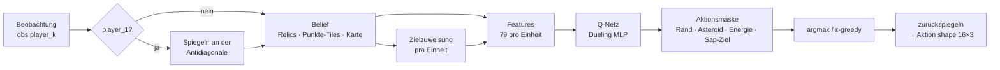

# Sherlock – RL-Agent für Lux AI Season 3

**HTW Berlin · Anwendungen der KI · WS 26/27**
Team 15 · Moodle-Gruppe `15` · Agent **Sherlock** (`agents/sherlock/`, Name `Sherlock Agent_X`)

Lux AI Season 3 ist ein Zwei-Spieler-Strategiespiel auf einer 24×24-Karte mit Nebel, driftenden Asteroiden und versteckten Punkte-Tiles rund um Relic-Nodes. Ein Spiel besteht aus 3 Matches à 100 Steps; jede Seite steuert bis zu 16 Einheiten.

Unser Agent ist ein **Double-DQN mit Dueling-Kopf**, das pro Einheit entscheidet. Die Eingabe kommt aus einem **Gedächtnis (Belief)**, das Relics über Matches behält und die unsichtbaren Punkte-Tiles aus dem Punktezuwachs ableitet. Dazu kommen **Reward Shaping** pro Einheit, **Aktionsmasken** und eine **Spiegelung in einen kanonischen Raum**, sodass ein Netz für beide Seiten genügt.

## Inhalt

- [Ergebnisse](#ergebnisse)
- [Architektur](#architektur)
- [Projektstruktur](#projektstruktur)
- [Installation](#installation)
- [Nutzung](#nutzung)
- [Experimente](#experimente)
- [Abgabe (agent.zip)](#abgabe-agentzip)
- [Grenzen und nächste Schritte](#grenzen-und-nächste-schritte)
- [Quellen](#quellen)

## Ergebnisse

<!-- ERGEBNISSE:START -->
Gemessen auf 30 Test-Seeds × 2 Seiten (60 Spiele pro Gegner und Trainingsstart), ε = 0, 3 Trainingsstarts à 3000 Spiele. Angegeben sind die Winrate mit 95-%-Bootstrap-KI und in Klammern die Standardabweichung über die Starts. Batch vom 10.10.2026.

| Agent | gegen `default` | gegen `Solution_92_Kaggle` | Punkte pro Spiel (vs. default / vs. Sol92) |
|---|---|---|---|
| **`full` (unser Agent)** | **87,8 %** [76,7; 96,7] (± 3,5) | **18,9 %** [8,3; 31,7] (± 3,5) | 541 : 142 / 497 : 993 |
| Prof-DQN, mitgelieferte Gewichte | 0,0 % [0; 0] | 0,0 % [0; 0] | 5 : 268 / 4 : 1655 |
| Prof-DQN, gleich lang neu trainiert | 0,0 % [0; 0] | 0,0 % [0; 0] | 4 : 269 / 3 : 1654 |


Wichtigste Erkenntnisse aus der Ablation ([Details und Einordnung](docs/ERGEBNISSE_20261010.md)):

- **Gedächtnis (Belief)** ist der größte Hebel: ohne Gedächtnis −32 Prozentpunkte gegen `default` und −17 gegen Solution_92, beides belegt.
- **Reward Shaping** stabilisiert das Training: Ohne Shaping kollabiert einer von drei Starts.
- **Sap** bringt gegen Solution_92 +16 Prozentpunkte.
- Für **Spiegelung** und **geführte Exploration** ist kein Effekt belegt; die KIs schließen 0 ein.
- Mehr Training allein macht den Prof-DQN **nicht** besser. Der Vorsprung kommt von der Methode.

Die Abgabe-Gewichte in `agents/sherlock/weights/` stammen vom Start `full_s0`, ausgewählt nach dem Validierungs-Score und nicht nach den Testzahlen.
<!-- ERGEBNISSE:END -->

## Architektur

### Ablauf pro Step



### Pseudocode

```text
für jedes Spiel:
    belief <- leer
    für jeden Step t:
        belief.observe(obs_t)                       # Relics, Karte, Punkte-Tiles
        ctx   <- make_context(obs_t, belief)        # Zielzuweisung, Gegner, Karten
        für jede lebende Einheit u:
            s_u    <- build_features(ctx, u)
            mask_u <- legale Aktionen (Asteroid/Rand/Energie/Sap-Ziel)
            a_u    <- ε-greedy( argmax_a Q(s_u, a) über mask_u )
        env.step(actions)
        r_u <- shaped_reward(ctx, ctx')             # pro Einheit
        Buffer <- (s_u, a_u, r_u, s'_u, done_u, mask'_u)
        alle 2 Steps:
            Batch ziehen
            y = r + γ (1-done) Q_target(s', argmax_a Q_online(s', a))   # Double DQN
            minimiere Huber(Q_online(s,a), y); Target alle 500 Lernschritte syncen
```

### Bausteine

| Baustein | Datei | Kurz |
|---|---|---|
| Spiegelung | `agents/sherlock/geometry.py` | Die Karte ist symmetrisch zur Antidiagonale, `M(x,y) = (23-y, 23-x)`. player_1 wird so gedreht, dass der eigene Spawn immer bei (0,0) liegt. Dadurch gibt es ein Netz für beide Seiten, und jedes Spiel liefert Erfahrung für beide. |
| Belief | `agents/sherlock/belief.py` | Merkt sich Relics über alle 3 Matches. Punkte-Tiles werden per Constraint-Propagation aus „Punktezuwachs vs. besetzte Tiles“ abgeleitet, erst ab `match_step ≥ 50`, weil Relics vorher noch spawnen. Dazu kommen Karte, Energie und erkundete Tiles. |
| Features | `agents/sherlock/features.py` | 79 Werte pro Einheit: eigene Lage und Energie, Punktestand, nächstes Punkte-, Kandidaten-, Relic-, unerkundetes und zugewiesenes Ziel, aktuelles Tile, 5 Nachbarfelder × 6 Kanäle, nächster Gegner, globale Zähler. Namen in `FEATURE_NAMES`. |
| Netz | `agents/sherlock/model.py` | MLP 79 → 256 → 256, dann Dueling: V (128 → 1) und A (128 → 6), `Q = V + A − mean(A)`. |
| Aktionen | `agents/sherlock/main.py` | 0 stay, 1–4 Bewegung, 5 Sap. Das Netz entscheidet nur, **ob** gesapt wird; das Ziel wählt eine Heuristik (maximale Gegnerenergie im 3×3-Bereich). Masken sperren Rand, Asteroiden, Züge ohne Energie und Sap ohne Ziel. |
| Reward | `agents/sherlock/reward.py` | Pro Einheit: + Eigentümer eines bewiesenen Punkte-Tiles, − Stacking, + Potential-Shaping zum zugewiesenen Ziel (Ng et al. 1999), + Erkundung und Entdeckung, + Energie, − Tod, ± Sap-Treffer, ± Matchergebnis (aus Δ `team_wins`). |
| Lernen | `agents/sherlock/main.py`, `replay_buffer.py` | Double DQN, Replay Buffer (300 000 Übergänge, je Einheit und Step einer), Target-Netz, Huber-Loss, Gradient Clipping, ε linear 1,0 → 0,05 über 60k Env-Steps. 70 % der Explorationszüge gehen heuristisch Richtung zugewiesenes Ziel (geführte Exploration, off-policy erlaubt). |

Alle Hyperparameter stehen an einer Stelle: `agents/sherlock/config.py` (`AgentConfig`).

## Projektstruktur

```text
.
├── agents/
│   ├── sherlock/                 unser Agent (Abgabe-Ordner)
│   │   ├── main.py               Klasse Agent_x: act/update/save/load, DQN-Lernschritt, Masken
│   │   ├── belief.py             Gedächtnis: Relics, Punkte-Tile-Inferenz, Karte
│   │   ├── features.py           Feature-Vektor pro Einheit + Zielzuweisung
│   │   ├── reward.py             Reward Shaping pro Einheit
│   │   ├── model.py              Dueling-Q-Netz
│   │   ├── replay_buffer.py      Ringpuffer mit Aktionsmasken
│   │   ├── geometry.py           Spiegelung echt ↔ kanonisch
│   │   ├── config.py             alle Hyperparameter und Ablations-Schalter
│   │   ├── agents.yaml           Import-/Lade-Pfade (Folie 51)
│   │   └── weights/              trainierte Gewichte agent_p0.pth / agent_p1.pth
│   ├── DQN/                      Baseline des Dozenten (unverändert)
│   ├── default/                  schwacher Benchmark-Gegner
│   └── Solution_92_Kaggle/       starker regelbasierter Gegner
├── scripts/
│   ├── train.py                  Agent trainieren (Env direkt, speichert korrekt)
│   ├── evaluate.py               Winrate gegen festen Gegner, beide Seiten
│   ├── experiment.py             ein Experiment-Lauf: Training → Lernkurve → Test → Manifest
│   ├── run_experiments.py        alle Varianten × Starts parallel
│   ├── report.py                 Tabellen, Bootstrap-KIs, Diagramme
│   ├── record_replay.py          bestimmtes Testspiel als Replay aufzeichnen
│   ├── build_submission.py       agent.zip bauen und prüfen
│   ├── set_match_count.py        params.py auf 3 Matches setzen
│   ├── protocol.py               Seed-Mengen und Curriculum
│   ├── variants.py               Varianten-Registry + Adapter für den Prof-DQN
│   ├── metrics.py                Kennzahlen pro Spiel (agentenunabhängig)
│   └── common.py                 Spiel-Schleife, Gegner-Fabrik
├── tests/                        pytest: Spiegelung, Maske, Belief, Reward, Persistenz, Runner
├── experiments/runs/             ein Ordner pro Lauf (CSV, manifest.json; .pth nicht versioniert)
├── docs/
│   ├── EXPERIMENT_PROTOKOLL.md   Versuchsplan, vor dem Training festgelegt
│   ├── ERGEBNISSE_*.md           Auswertung mit Einordnung
│   ├── report/                   von report.py erzeugte Tabellen und Diagramme
│   └── presentation/replays/     ausgewählte Replays für die Präsentation
├── lux/                          Runner + Spielregeln des Kurses (nicht ändern)
├── main.py                       ein Spiel über den Kurs-Runner (mit Replay)
├── Paths.csv                     Moodle-Gruppe → Import- und Lade-Pfade
└── requirements.txt
```

## Installation

Benötigt Python 3.10+ (getestet mit 3.14 auf macOS).

```bash
python3 -m venv .venv
source .venv/bin/activate              # Windows: .venv\Scripts\activate
python -m pip install -r requirements.txt
python -m scripts.set_match_count      # Kursregel: 3 Matches pro Spiel in luxai_s3/params.py
python -m pytest -q                    # alles grün?
```

`set_match_count` ändert `match_count_per_episode` in der installierten `luxai_s3/params.py` von 5 auf 3. Mit `--check` wird nur geprüft.

## Nutzung

Alle Befehle aus dem Projekt-Root mit aktiviertem venv.

| Zweck | Befehl |
|---|---|
| Ein Spiel mit Replay über den Kurs-Runner (Gruppe 15 vs. 2, siehe `main.py`) | `python main.py` → `replays/15_vs_2/*.json` |
| Training (Agent wird einmal erzeugt, Gewichte nach `agents/sherlock/weights/`) | `python -m scripts.train --games 400 --opponent default` |
| Training fortsetzen gegen den starken Gegner | `python -m scripts.train --games 300 --opponent solution92 --resume` |
| Evaluation (N Seeds × beide Seiten, ε = 0) | `python -m scripts.evaluate --games 20 --opponent solution92` |
| Ein Experiment-Lauf | `python -m scripts.experiment --variant full --run-seed 0 --games 3000` |
| Kompletter Batch (alle Varianten × 3 Starts) | `python -m scripts.run_experiments --games 3000 --workers 11` |
| Report (Tabellen + Diagramme nach `docs/report/`) | `python -m scripts.report` |
| Replay eines Testspiels aufzeichnen | `python -m scripts.record_replay --run experiments/runs/<lauf> --pick best` |
| Tests | `python -m pytest -q` |
| Abgabe bauen | `python -m scripts.build_submission` |

> **Achtung:** `scripts.train` schreibt nach `agents/sherlock/weights/` und überschreibt damit die Abgabe-Gewichte. Ohne `--resume` beginnt es mit einem frischen Netz. Für Experimente besser `scripts.experiment` nutzen; das schreibt in einen eigenen Run-Ordner. Zurückholen geht mit `git checkout agents/sherlock/weights/`.

**Replays ansehen:** <https://s3vis.lux-ai.org/> öffnen und die JSON-Datei hochladen, z. B. aus `replays/` oder `docs/presentation/replays/`.

> Warum ein eigenes `train.py`? Der Kurs-Runner (`lux/runner.py`) erzeugt die Agenten in jedem Spiel neu und ruft `save_agent()` vor dem Spiel auf. Gelerntes würde damit nie gespeichert. Unsere Skripte nutzen das Env direkt; zur Abgabe bleibt der Agent trotzdem voll runner-kompatibel (`tests/test_runner.py`).

## Experimente

Wir wollen belegen, welche Änderung wie viel bringt, und zwar im Vergleich zur DQN-Baseline des Dozenten. Kurzfassung des Protokolls (vollständig in [`docs/EXPERIMENT_PROTOKOLL.md`](docs/EXPERIMENT_PROTOKOLL.md), festgelegt vor dem Training):

- **Varianten**:
  - `baseline_prof`: Prof-DQN mit mitgelieferter `agent.pth`
  - `baseline_prof_retrained`: Prof-Code unverändert, aber gleich lang trainiert wie unsere Varianten (trennt „mehr Training“ von „bessere Methode“)
  - `full`
  - fünf Ablationen, die sich jeweils in **genau einem** `AgentConfig`-Schalter von `full` unterscheiden: `no_belief`, `no_shaping`, `no_sap`, `no_guided_explore`, `no_canonical`
- **Seeds**: drei disjunkte Mengen (Training, 8 Validierungs-Seeds, 30 Test-Seeds). Test-Seeds werden nur einmal am Ende gespielt.
- **Evaluation**: jedes Spiel von beiden Seiten, gegen `default` und `Solution_92_Kaggle`, ε = 0.
- **Statistik**: 3 Trainingsstarts pro Variante (Mittel ± SD). 95-%-Bootstrap-KIs mit zwei Ebenen (Starts × Seeds) und gepaarter Bootstrap für Differenzen zu `full`.
- **Reproduzierbarkeit**: Jeder Lauf schreibt `manifest.json` mit Config, Seeds, Git-Commit und Laufzeit.

Ergebnisse und ehrliche Einordnung: [`docs/ERGEBNISSE_20261010.md`](docs/ERGEBNISSE_20261010.md), automatisch erzeugte Tabellen: [`docs/report/tabellen.md`](docs/report/tabellen.md), Rohdaten: `experiments/runs/`.

## Abgabe (agent.zip)

Vorgaben laut Kursfolie 51: Ordner mit Teamnamen, leere `__init__.py`, `main.py` mit Klasse `Agent_x` (`name='Team Name Agent_X'`), Methoden `act`, `update`, `set_to_eval_mode`, `set_env_cfg`, `save_agent`, `load_agent`, trainierte `.pth`, `agents.yaml` und `paths.csv`.

```bash
# Gewichte eines Experiment-Laufs übernehmen und Zip bauen + prüfen
python -m scripts.build_submission --from-run experiments/runs/<lauf> --team-name sherlock --group 15
# nur bauen mit den Gewichten aus agents/sherlock/weights/
python -m scripts.build_submission
```

Ergebnis ist `dist/agent.zip`. Das Skript entpackt das Zip anschließend in eine frische Kopie mit `lux/`. Dort lädt es den Agenten über `lux.runner.load_class_from_path`, prüft die Pflichtmethoden, lädt die Gewichte beider Seiten und führt einen Aktionsschritt aus. Weil das Paket relative Imports nutzt, funktioniert `--team-name` mit jedem Ordnernamen.

## Grenzen und nächste Schritte

Ehrlicher Stand: **10.10.2026**.

- Gegen `Solution_92_Kaggle` gewinnt `full` nur knapp jedes fünfte Spiel (18,9 %) und holt etwa halb so viele Punkte wie der Gegner.
- Die geführte Exploration (Heuristik) bringt laut Ablation nichts Messbares und kann entfallen.
- „Sap-Treffer“ wird nur über sichtbare Gegner im Zielbereich gezählt; den tatsächlichen Energieschaden messen wir noch nicht.
- Das Sap-Ziel wählt eine Heuristik; das Netz entscheidet nur, ob gesapt wird.
- Das MLP sieht nur lokale Ausschnitte und Distanzen, keine Karte. Ein CNN auf Kartenkanälen oder PPO mit Action-Masking ist für Phase 3 geplant.
- Statistik: 3 Starts × 30 Seeds lösen Unterschiede unter etwa 10 Prozentpunkten nicht sicher auf. Es gibt keine Korrektur für Mehrfachvergleiche.
- Self-Play bzw. ein Gegner-Pool ist noch nicht Teil des Protokolls.

## Quellen

- Lux AI Season 3, Repository: <https://github.com/Lux-AI-Challenge/Lux-Design-S3>
- Spielregeln: [`lux/specs.md`](lux/specs.md) (Original: <https://github.com/Lux-AI-Challenge/Lux-Design-S3/blob/main/docs/specs.md>), Beobachtungen/Aktionen: [`lux/Instructions.md`](lux/Instructions.md)
- Sutton, R. S., & Barto, A. G. (2018). *Reinforcement Learning: An Introduction* (2. Aufl.). MIT Press.
- Mnih, V. et al. (2015). Human-level control through deep reinforcement learning. *Nature* 518, 529–533.
- van Hasselt, H., Guez, A., & Silver, D. (2016). Deep Reinforcement Learning with Double Q-learning. *AAAI*.
- Wang, Z. et al. (2016). Dueling Network Architectures for Deep Reinforcement Learning. *ICML*.
- Ng, A. Y., Harada, D., & Russell, S. (1999). Policy invariance under reward transformations: Theory and application to reward shaping. *ICML*.
- Kursmaterial HTW Berlin, Anwendungen der KI (Folien „Reinforcement Learning“, Interface-Beschreibung `Interface_runner_Agent.pdf`).
