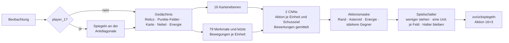
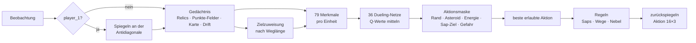
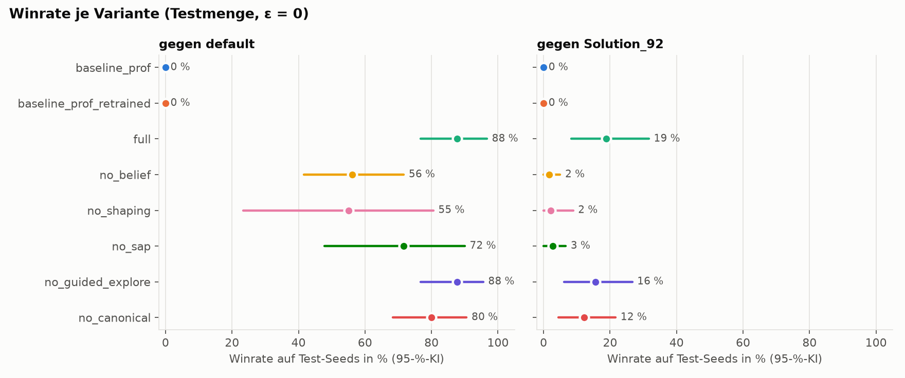

# Sherlock – Agent für Lux AI Season 3

**HTW Berlin · Anwendungen der KI · WS 26/27**
Team 15 (Moodle-Gruppe `15`) · Mahmoud El-Hassan, Moayed Shawesh · Agent **Sherlock** (`agents/sherlock/`, Klasse `Agent_x`)

Lux AI Season 3 ist ein Zwei-Spieler-Strategiespiel auf einer 24×24-Karte mit Nebel, wandernden Asteroiden und versteckten Punkte-Feldern rund um Relics. Im Kurs besteht ein Spiel aus 3 Matches à 100 Schritte; jede Seite steuert bis zu 16 Einheiten. Viele Spielparameter (Sichtweite, Sap-Kosten, Streuschaden, Nebel-Abzug …) werden pro Spiel zufällig gezogen und sind nicht direkt sichtbar.

## Auf einen Blick (Stand 17.11.2026)

| | |
|---|---|
| **Aktuelle Abgabe** | **Sherlock V16** seit 17.11.2026, 23:24 (Teamentscheidung Mahmoud und Moayed) · [Release](experiments/releases/20261117_sherlock_v16/README.md) |
| Was der Agent ist | zwei CNNs (0,7 und 1,8 Millionen Parameter), die durch Nachahmung und sechs DAgger-Runden vom öffentlichen Kaggle-Drittplatzierten gelernt haben, dazu Sherlocks Gedächtnis, Aktionsmasken und drei feste Spielschalter |
| Direkt gegen die vorige Abgabe R3 | **194 von 200 Spielen gewonnen** (400 frische Karten) |
| Gegen den Kaggle-Drittplatzierten | 20/800 statt 10/800 Spiele, **216 statt 76 von 2.400 Matches**, Punkteanteil 39,3 statt 33,4 % |
| Gegen Solution_92 | 787/800 wie R3; auf einem weiteren frischen Kartensatz 778 statt 789/800 |
| Gegen Battle-Sherlock V14 | 48/50 (R3 34/50); gemessen mit demselben Netz bei Stay-Bias 1,5 |
| Gegen `default`, Zufall, Rush-Bot, Solution-Variante, DQN der Vorlage | je 50/50 (ebenso) |
| Abgabedatei | `dist/agent.zip`, 9,5 MB, SHA-256 `0c59706b…6099`; im unveränderten Kursrunner unter Python 3.14 und 3.10 geprüft (8/8 ganze Spiele, ein Zug im Median 5–6 ms) |
| Gespielte Spiele bisher | **rund 1,54 Millionen**: 662.504 Trainingsspiele, 66.912 Zwischenprüfungen, 806.616 Bewertungsspiele und 5.928 Spiele für die Nachahmung ([Zahlen und Fakten](#zahlen-und-fakten)) |
| Termine | Review 16.10. (Note 1,3) · Battle 06.11. (Platz 3 mit V14) · **Finale mit Turnier am 27.11.** ([Folien](Sherlock_Finale_27-11-2026.pdf), [Stichpunkte](Sherlock_Stichpunkte_27-11-2026.md)) |

Gegen den Kaggle-Drittplatzierten verliert auch der neue Sherlock weiterhin die meisten Spiele: Er holt etwa 40 % der Punkte und gewinnt rund jedes zehnte Match.

## Inhalt

- [Wie der neue Sherlock entscheidet](#wie-der-neue-sherlock-entscheidet)
- [Wie er gelernt hat](#wie-er-gelernt-hat)
- [Ergebnisse auf frischen Karten](#ergebnisse-auf-frischen-karten)
- [Getestet und verworfen: Handtaktiken](#getestet-und-verworfen-handtaktiken)
- [Entwicklung von Sherlock](#entwicklung-von-sherlock) · [Zahlen und Fakten](#zahlen-und-fakten)
- [Abgabe](#abgabe)
- [Installation](#installation) · [Nutzung](#nutzung) · [Wie wir testen](#wie-wir-testen) · [Projektstruktur](#projektstruktur)
- [Grenzen und nächste Schritte](#grenzen-und-nächste-schritte)
- [Historie: DQN-Sherlock bis V14 und R3](#historie-dqn-sherlock-bis-v14-und-r3)
- [Dokumentation und Zusammenarbeit](#dokumentation-und-zusammenarbeit) · [Quellen](#quellen)

## Wie der neue Sherlock entscheidet



- **Gedächtnis** (`belief.py`): merkt sich Relics über alle Matches, erschließt unsichtbare Punkte-Felder aus dem Punktezuwachs, nutzt die Spiegelsymmetrie der Karte und verfolgt wandernden Nebel und Asteroiden. Diesen Teil hat der neue Sherlock vom DQN-Sherlock übernommen.
- **Netze** (`imitation_net.py`, `imitation_agent.py`): Zwei CNNs sehen die ganze Karte als 16 Ebenen und für jede Einheit 79 Merkmale plus ihre letzten Bewegungen. Sie geben für jede Einheit Wahrscheinlichkeiten für Stehen, vier Richtungen und Schießen aus. Ein eigener Zielkopf wählt das Feld, auf das geschossen wird. Die Bewertungen beider Netze werden gemittelt, gespielt wird die beste erlaubte Aktion.
- **Aktionsmaske** (`main.py`): sperrt Rand, Asteroiden, Züge ohne Energie, Felder mit stärkeren Gegnern (`safe_moves`) und wahrscheinliche Zusammenstöße mit stärkeren Gegnern (`collision_guard`).
- **Drei feste Spielschalter:** `imit_stay_bias=1.0` (weniger stehen bleiben), `imit_unstack` (höchstens eine stehende Einheit je Feld), `imit_hold_points` (Halter auf Punktefeldern werden nicht zum Weiterziehen gedrängt).
- **Absturzschutz:** In der Abgabe fängt Sherlock Fehler in `act()` und `update()` ab; die Einheiten bleiben dann einen Schritt stehen.
- Derselbe Gewichtssatz spielt beide Seiten, weil `player_1` in einen gespiegelten, kanonischen Raum übersetzt wird.

## Wie er gelernt hat

- **Lehrer:** der öffentlich freigegebene Kaggle-Drittplatzierte ([lux3-bot 0.4.8](https://github.com/andreyd41/lux3-bot/releases/tag/0.4.8), Apache-2.0). Er dient nur als Lehrer und Testgegner. **Der Kaggle-Code ist nicht im Abgabepaket**; Sherlock spielt mit eigenen Gewichten.
- **Nachahmung** (`scripts/imitate.py`): Das Netz bekommt genau die Eingaben, die er auch im Spiel sieht, und lernt für jede Einheit die Aktion und das Schussziel des Lehrers.
- **DAgger, sechs Runden:** Sherlock spielt selbst, und der Lehrer sagt in jeder Lage, was er getan hätte. So lernt das Netz auch Lagen, in die nur Sherlock selbst gerät. Zusammen bis zu rund 19 Millionen Einheitsentscheidungen.
- **Netze:** Ensemble aus v9 (64 Kanäle, 6 Blöcke) und v8L (96 Kanäle, 8 Blöcke).
- **Wie genau er nachahmt:** Auf frischen Spielen wählt das Ensemble in 87 % der Lehrer-Lagen und 82 % der eigenen Lagen dieselbe Aktion wie der Lehrer. Am schwersten sind Schüsse: Nur etwa jeden zweiten Lehrerschuss erkennt er (36–50 %).
- **Verlauf:** Umbau auf Nachahmung am 15.11., DAgger-Runden 3–6 am 16./17.11., Auswahl und Bestätigungen am 17.11. Eine siebte DAgger-Runde (v10) brachte keinen messbaren Fortschritt mehr.

## Ergebnisse auf frischen Karten

Jede Prüfung lief auf vorher unbenutzten Karten, jede Karte von beiden Seiten, mit vorab festgelegter Regel und gepaart nach Karte ausgewertet (10.000 Ziehungen):

| Prüfung | Karten | Solution (Sherlock / R3) | Kaggle-Spiele | Kaggle-Matches | Punkteanteil gegen Kaggle, Δ zu R3 | direkt gegen R3 |
|---|---|---:|---:|---:|---:|---:|
| Bestätigung 2 (gleiches Netz, Stay-Bias 1,5) | 7260000–7260399 | 789 / 787 von 800 | 28 / 16 | 236 / 90 | +4,02 [+3,10; +4,92] | 192/200 |
| **Bestätigung 3 (Abgabe)** | 7261000–7261399 | 787 / 787 von 800 | **20 / 10** | **216 / 76** | **+5,51 [+4,66; +6,34]** | **194/200** |
| Dev G | 7264000–7264199 | 395 / 393 von 400 | 10 / 6 | 100 / 34 | +5,02 [+3,92; +6,12] | – |
| Bestätigung 5 (zur Information) | 7267000–7267399 | 778 / 789 von 800 | 34 / 18 | 238 / 98 | +4,49 [+3,66; +5,34] | – |

[Bestätigung 2](experiments/analysis/deve_20261117/BESTAETIGUNG_ERGEBNIS.md) · [Bestätigung 3](experiments/analysis/devf_20261117/BESTAETIGUNG3_ERGEBNIS.md) · [Dev G](experiments/analysis/devg_20261117/ERGEBNIS.md) · [Bestätigung 5](experiments/analysis/devh_20261117/ERGEBNIS.md) · [Robustheit](experiments/analysis/robust_p9_20261117/ERGEBNIS.md) · [Python 3.10](experiments/analysis/deve_20261117/PY310_ERGEBNIS.md)

**Was sich gegenüber R3 geändert hat** (engine-genaue Nachrechnung von je 180 Matches gegen Kaggle, [Diagnose](experiments/analysis/deve_20261117/DIAGNOSE.md)): Kaggle holt gegen den neuen Sherlock etwa 300 statt 377 Punkte je Match. Sherlock verliert 17 statt 24 Einheiten je Match, schießt so oft wie Kaggle und trifft dreimal so oft direkt wie R3. Am Matchende besetzt Kaggle aber weiter mehr Punktefelder (8 gegen 3).

## Getestet und verworfen: Handtaktiken

Am 17.11. liefen auf 200 unbenutzten Karten (Dev H) 17 Varianten des neuen Sherlock mit eingebauten Taktiken, je 800 Spiele. Alle Taktiken stecken als Schalter im Code und sind in der Abgabe **aus**:

| Taktik (Schalter) | Punkteanteil gegen Kaggle, Δ zur Abgabe |
|---|---:|
| Granaten mit Streuschaden (`imit_tactics=granate`) | −0,66 |
| Nebel-Schüsse auf unsichtbare Halter (`granate+nebel`) | −0,67 |
| gemeinsame sichere Abschüsse (`focus_sap`) | −0,67 |
| Ausweichen vor Sog und Zusammenstößen (`sog`) | −0,43 |
| ohne die Sicherheitsmasken | −0,71 |
| Sparen, Restenergie verschießen, Tarnung | −0,10 bis +0,01 |
| Matchende-Sturm in drei Versionen (`imit_end_fill`) | +0,01 bis +0,26 |
| Halterwechsel, Tanken, Erobern | +0,17 bis +0,35 |
| öfter schießen (`imit_sap_bias`) | +0,52, in der frischen Bestätigung nur +0,13 |
| **alles gleichzeitig** | **−1,64** (Kaggle-Siege 7 statt 24 von 400) |

Das Netz hat Schießen, Zielen und Ausweichen bereits vom Lehrer gelernt; Handregeln obendrauf stören ihn eher. [Dev H und Bestätigung 5](experiments/analysis/devh_20261117/ERGEBNIS.md)

## Entwicklung von Sherlock

| Datum | Version | Kern | Beleg |
|---|---|---|---|
| 10.10. | `full_s0` | erstes eigenes DQN-Netz mit Gedächtnis und Reward Shaping | Ablation unten |
| 16.10. | `old3_sym3` (Review, Note 1,3) | 6 Netze, Spiegelsymmetrie, Erkundungsgedächtnis | 46,7 % gegen Solution_92 |
| 20.10.–01.11. | V3 bis V14 | 18, später 36 DQN-Netze, dazu Regeln für Saps, Nebel und Wege | 78 → 95 % gegen Solution_92 |
| 06.11. | V14 im Battle | Platz 3 aller Teams | [Battle-Folien](Sherlock_Battle_06-11-2026.pdf) |
| 16.11. | R3 | V14 plus nachgeahmter Bewegungsberater | 788/800 gegen Solution_92 |
| **17.11.** | **V16** | **Nachahmung und DAgger vom Kaggle-Drittplatzierten** | **siehe oben** |

Die DQN-Versionen sind unter [Historie](#historie-dqn-sherlock-bis-v14-und-r3) beschrieben; alle früheren Abgaben liegen mit Rückweg unter `experiments/releases/`.

## Zahlen und Fakten

Spiele: Stand 17.11.2026, aus den Dateien im Repository nachgezählt mit `python experiments/analysis/count_games.py`.

### Spiele

| Art | Spiele |
|---|---:|
| Neue DQN-Netze trainiert (Ablation, Grundnetze, weitere Versuche) | 337.904 |
| Nachtraining vorhandener DQN-Netze | 278.400 |
| Prof-DQN zum Vergleich gleich lang neu trainiert | 9.000 |
| DQN-Läufe ohne Angabe der Art | 1.600 |
| CNN mit PPO | 35.600 |
| **Training zusammen** (272 DQN-Läufe, 7 PPO-Läufe) | **662.504** |
| Zwischenprüfungen während des Trainings | 66.912 |
| Nachahmung: Lehrerspiele des Kaggle-Drittplatzierten (9,2 Mio. aufgezeichnete Einheitsentscheidungen) | 1.800 |
| Nachahmung: DAgger-Runden 1–7 (13,5 Mio. Einheitsentscheidungen) | 4.000 |
| Nachahmung: Prüf- und Testspiele (0,5 Mio. Einheitsentscheidungen) | 128 |
| Bewertungsspiele (Vergleiche, Screens, Bestätigungen, Diagnosen) | 806.616 |
| **Alle Spiele zusammen** | **1.541.960** |

- **Trainings:** 272 DQN-Läufe und 7 CNN/PPO-Läufe bis zum Battle; seit dem 15.11. 13 nachgeahmte Netze (v1 bis v10, dazu v5c, v7L und v8L) und 5 Ensembles aus zusammen 23,3 Millionen aufgezeichneten Einheitsentscheidungen.
- **In V16 stecken** 1.800 Lehrerspiele und 3.400 Spiele aus den DAgger-Runden 1–6 mit 20,7 Millionen aufgezeichneten Einheitsentscheidungen; im Training verwendet wurden bis zu rund 19 Millionen. In den 36 Netzen von V14 steckten 165.000 Trainingsspiele (66.000 der 18 Grundnetze und 18 × 5.500 Spiele Nachtraining).
- Jede Zeile in `experiments/runs/*/train.csv` ist ein Trainingsspiel, jede Zeile der Ergebnisdateien unter `experiments/compare/` und `experiments/analysis/` ein Bewertungsspiel. Zeilen, die in allen Spalten einschließlich der Laufzeit einer anderen gleichen, zählen nur einmal (10.700 Zeilen); darunter sind auch verschiedene Läufe mit genau gleichem Spielverlauf, die Zahl ist also eher zu niedrig. Die Nachahmungsspiele stammen aus `collect.json` je Datensammlung. Ein Spiel hat 3 Matches à 100 Schritte.

### Rechenzeit (Stand 01.11.)

| | Prozess-Stunden |
|---|---:|
| Training DQN | 558 |
| Training CNN/PPO | 29 |
| Bewertung | 780 |
| **Zusammen** | **rund 1.370** |

Summe der Spielzeiten je Prozess (Spalte `secs`). Meist liefen 12 bis 14 Prozesse gleichzeitig, die echte Laufzeit war also viel kürzer.

### Karten und Gegner

- **33.005 verschiedene Karten** (Seeds) wurden in Bewertungen gespielt (Stand 17.11.), jede Karte meist von beiden Seiten.
- **Gegner** (bis 01.11. 25 verschiedene, seit dem 15.11. zusätzlich der Kaggle-Drittplatzierte, R3 und die Varianten von V16): Solution_92 und drei Varianten (`sol92_sq` schießt im ganzen Sap-Quadrat, `sol92_weak` zielt auf den schwächsten Gegner, `sol92_sqweak` beides), `default`, das DQN-Beispiel des Profs, ein Rush-Bot, ein Zufallsspieler, ein CNN-PPO-Agent und 16 eigene frühere Stände, darunter die zurückgehaltenen RL-Ensembles `league_nets6` und `threat6`.

### Agent und Code (Stand 17.11.)

| | |
|---|---|
| Netze der Abgabe | 2 CNNs mit 0,70 + 1,81 = **2,5 Millionen Parametern** (V14: 36 × 152.967 = 5,5 Millionen) |
| Eingabe und Ausgabe | 16 Kartenebenen, je Einheit 79 Merkmale und 5 Bewegungsmerkmale; 6 Aktionen (stehen, 4 Richtungen, Sap) und ein Schussziel |
| Einstellungen | 190 in `AgentConfig`, davon 109 Schalter; in der Abgabe sind 3 Spielschalter gesetzt |
| Agent (`agents/sherlock/`) | 25 Python-Dateien, 7.495 Zeilen |
| Skripte (`scripts/`) | 241 Python-Dateien mit 54.630 Zeilen, 48 Shell-Skripte |
| Tests (`tests/`) | 209 Dateien mit 34.066 Zeilen, **3.298 Tests** |

### Versionen und Verlauf (Stand 17.11.)

- **11 Abgabe-Stände** seit dem 10.10.: `full_s0`, `old3_sym3`, V3, V7, V10, V11, V12, V13, V14, R3 und V16. Alle Abgaben ab `old3_sym3` sind unter `experiments/releases/` gesichert, `full_s0` als Git-Tag `abgabe-review-full_s0`.
- **922 Commits** seit dem 10.10.2026 (Moayed 507, Mahmoud 415).
- **Dokumentation:** 427 Einträge im Arbeitsstand; jede Auswahl und Bestätigung seit der Battle-Woche mit vorab festgelegtem Plan.

## Abgabe

### Finale am 27.11.

Vorgaben laut Kursfolie 51: Ordner mit Teamnamen, leere `__init__.py`, `main.py` mit Klasse `Agent_x`, Methoden `act`, `update`, `set_to_eval_mode`, `set_env_cfg`, `save_agent`, `load_agent`, trainierte `.pth`, `agents.yaml` und `paths.csv`.

```sh
python -m scripts.build_submission   # kopiert das Release nach dist/agent.zip und prüft beide Seiten im Kursrunner
shasum -a 256 dist/agent.zip         # 0c59706b6af1c2cd74819a4b13269b69cb55786e07e3daaa2d6e6547a6b86099
```

| Angabe für den Kursrunner | Wert |
|---|---|
| Gruppe | 15 |
| Agentenklasse | `agents.sherlock.main.Agent_x` |
| Gewichte für beide Spieler | `agents/sherlock/weights/agent.pth` |

**Falls der Prof wieder das Format der Battle-Mail verlangt** (`Gruppe15/`, `Gruppe15.main.Agent_x`, `Gruppe15/agent.pth`): `python -m scripts.build_submission --battle` verpackt dasselbe Release bytegleich nach `dist/Gruppe15.zip` (SHA-256 `8347ea2b…ae95`; Kursrunner-Prüfung unter `agents/` und in der Projektwurzel bestanden, zwei ganze Spiele mit 0 abweichenden Aktionen gegenüber `dist/agent.zip`). Die alte V14-Datei `Gruppe15.zip` im Projektordner bleibt unverändert.

In der mitgelieferten `agent.pth` ist `frozen=True` gesetzt: Auch wenn der Kursrunner mit `train=True` startet, lernt Sherlock nichts und überschreibt keine Datei. **Rückweg zu R3:** In `scripts/build_submission.py` `FINAL_RELEASE`/`FINAL_ZIP_SHA256` auf `R3_RELEASE`/`R3_ZIP_SHA256` setzen und neu bauen ([R3-Release](experiments/releases/20261116_r3_finale/README.md)). `--from-run experiments/runs/<lauf>` verpackt die Gewichte eines Laufs, ohne die Abgabe zu ersetzen; `scripts/build_student_package.py` baut Pakete aus nachgeahmten Netzen im selben Format.

## Installation

Benötigt Python 3.10 oder neuer (entwickelt mit 3.14 auf macOS; die Abgabe ist zusätzlich unter Python 3.10 geprüft).

```bash
python3 -m venv .venv
source .venv/bin/activate              # Windows: .venv\Scripts\activate
python -m pip install -r requirements.txt
python -m scripts.set_match_count      # Kursregel: 3 Matches pro Spiel in luxai_s3/params.py
python -m pytest -q                    # alles grün?
```

`set_match_count` ändert `match_count_per_episode` in der installierten `luxai_s3/params.py` von 5 auf 3. Mit `--check` wird nur geprüft. Unter Python 3.10 auf macOS brauchte die Prüfumgebung scipy 1.14.1 (1.15.3 ließ sich dort nicht laden).

## Nutzung

Alle Befehle aus dem Projektordner mit aktiviertem venv.

| Zweck | Befehl |
|---|---|
| Ein Spiel über den Kurs-Runner mit Replay (Gruppe 15 gegen 2, siehe `main.py`) | `python main.py` → `replays/15_vs_2/*.json` |
| Spiel spielen und sofort im Browser ansehen (Viewer braucht Internet) | `python -m scripts.play_and_view` (Optionen `--gegner default\|solution\|dqn`, `--seite 1`) |
| Abgabepaket gegen Solution und Kaggle auf festen Karten spielen | `python -m scripts.par_eval --weights "r3zip:experiments/releases/20261117_sherlock_v16/agent.zip" --opponents solution92,kaggle3 --seed-list KARTEN.json --workers 10 --out ergebnis.csv` |
| Netz mit Schaltern spielen (Gewichte lokal unter `experiments/imitation/students/`) | `python -m scripts.par_eval --weights experiments/imitation/students/ens_v9_v8L.pth --set imit_stay_bias=1.0 --set imit_unstack=true --set imit_hold_points=true --opponents solution92,kaggle3 --seed-list KARTEN.json --out ergebnis.csv` |
| Kurspaket aus einem nachgeahmten Netz bauen | `python -m scripts.build_student_package --student ens9 --set imit_stay_bias=1.0 --set imit_unstack=true --set imit_hold_points=true --out PAKET.zip` |
| Abgabe bauen und prüfen | `python -m scripts.build_submission` |
| Paket unter einer anderen Python-Version prüfen | `python scripts/xversion_replay.py record PAKET.zip spiel.pkl --seed 4242`, dann `/pfad/zu/python3.10 -I scripts/xversion_replay.py replay PAKET.zip spiel.pkl` |
| Kandidat im unveränderten Kursrunner prüfen (8 ganze Spiele) | `python -m scripts.check_candidate_runner --weights …/sherlock/weights/agent.pth --out bericht.json` |
| Tests | `python -m pytest -q` |

**Replays ansehen:** <https://s3vis.lux-ai.org/> öffnen und eine JSON-Datei aus `replays/` hochladen. `scripts.play_and_view` erzeugt stattdessen eine HTML-Datei mit eingebettetem Replay.

**Sicher arbeiten:** Training und Paketbau schreiben nie in die Abgabe. `scripts/build_student_package.py` verweigert Ausgaben nach `dist/agent.zip`, `Gruppe15.zip`, `experiments/releases/` und `agents/sherlock/`. Läufe starten aus einer eingefrorenen Kopie des Quellstands (`git archive`), damit spätere Codeänderungen sie nicht beeinflussen.

## Wie wir testen

- **Feste Karten, beide Seiten, ohne Lernen:** Jede Karte (Seed) wird von beiden Seiten gespielt. `scripts/par_eval.py` verteilt die Spiele auf mehrere Prozesse (auf Mahmouds Rechner 10).
- **Vorab festgelegt:** Kandidaten, Karten und Regeln stehen in einem Plan mit Commit, bevor das erste Spiel läuft. Spätere Ergänzungen kommen als datierter Nachtrag vor ihren Spielen hinzu.
- **Zwei Stufen:** Ein Vergleich auf 200 unbenutzten Entwicklungskarten wählt aus (Dev E bis Dev H). Danach muss der Gewinner eine frische Bestätigung auf 400 weiteren unbenutzten Karten bestehen. Karten, die für eine Auswahl benutzt wurden, gelten danach als verbraucht.
- **Statistik:** gepaarter Bootstrap über ganze Karten (beide Seiten zusammen), 10.000 Ziehungen, Seed 2711. Hauptmaß ist der Punkteanteil gegen den Kaggle-Drittplatzierten, dazu gewonnene Spiele gegen Solution und Kaggle und gewonnene Matches gegen Kaggle.
- **Paketprüfung:** Ein Kandidatenpaket muss genau wie die gemessene Variante spielen (16 Vergleichsspiele), im unveränderten Kursrunner 8 ganze Spiele bestehen und unter Python 3.10 Zug für Zug gleich nachspielen.
- **Übernahme nur mit Teamentscheidung:** Ein Wechsel der Abgabe braucht das ausdrückliche Ja von Mahmoud und Moayed.
- **Nicht jede Idee besteht:** Am 17.11. half keine der 17 Handtaktiken; „öfter schießen“ bestand die Auswahl knapp und fiel in der frischen Bestätigung durch.

## Projektstruktur

```text
.
├── README.md, CLAUDE.md, AGENTS.md   Überblick; gemeinsame Regeln für Claude Code und Codex
├── agents/
│   ├── sherlock/                 unser Agent
│   │   ├── main.py               Agent_x: Kursschnittstelle, Absturzschutz, delegiert Checkpoints der nachgeahmten Netze an imitation_agent.py
│   │   ├── imitation_agent.py    neuer Sherlock: Netze, Spielschalter, Matchende-Sturm, Taktikschicht (Schalter)
│   │   ├── imitation_net.py      CNN mit Aktions- und Zielkopf
│   │   ├── prev_move.py          Eingabe „letzte eigene Bewegungen“
│   │   ├── tactics_layer.py      Handtaktiken als Schalter (Granaten, Nebel, Sog, Erobern …; in der Abgabe aus)
│   │   ├── belief.py             Gedächtnis: Relics, Punkte-Feld-Inferenz, Karte, Drift
│   │   ├── features.py           79 Merkmale pro Einheit, Zielzuweisung
│   │   ├── param_est.py          Schätzung versteckter Spielparameter
│   │   ├── geometry.py           Spiegelung echt ↔ kanonisch
│   │   ├── config.py             alle Schalter und Hyperparameter (AgentConfig)
│   │   ├── model.py, rules.py, reward.py, replay_buffer.py   DQN-Sherlock bis V14
│   │   ├── cnn_model.py, ppo_agent.py, hybrid_agent.py       CNN/PPO-Versuche und Hybride aus V14 und nachgeahmtem Netz
│   │   ├── agents.yaml           Import-/Lade-Pfade (Folie 51)
│   │   └── weights/              V14-Referenzgewichte agent_p0.pth / agent_p1.pth (nicht die Abgabe)
│   ├── sherlock_r3t/             R3 mit Taktikschicht und nachgeahmtem Netz (Versuch vom 17.11.)
│   ├── DQN/                      Baseline des Dozenten (unverändert)
│   ├── default/                  schwacher Benchmark-Gegner
│   └── Solution_92_Kaggle/       starker regelbasierter Gegner
├── scripts/
│   ├── imitate.py                Nachahmen, DAgger-Daten sammeln, Ensembles bauen
│   ├── par_eval.py               parallele Bewertung auf festen Karten
│   ├── build_submission.py       dist/agent.zip aus dem Release bzw. Gruppe15.zip bauen und prüfen
│   ├── build_student_package.py  Kurspakete aus nachgeahmten Netzen im Abgabeformat
│   ├── check_candidate_runner.py Kandidat im unveränderten Kursrunner prüfen
│   ├── xversion_replay.py        Paket unter anderen Python-/torch-Versionen nachspielen
│   ├── train.py, finetune.py     DQN-Training (eigene Run-Ordner, Abgabe geschützt)
│   └── common.py, metrics.py, …  Spiel-Schleife, Kennzahlen, Gegner
├── tests/                        pytest (3.298 Tests, Stand 17.11.)
├── experiments/
│   ├── analysis/                 Auswertungen je Studie (Pläne, Ergebnisse, Rohdaten), z. B. deve/devf/devg/devh_20261117
│   ├── candidates/               geprüfte Kandidatenpakete
│   ├── releases/                 alle Abgaben mit Rückweg, aktuell 20261117_sherlock_v16
│   ├── opponents/                Kaggle-Drittplatzierter als Lehrer und Testgegner (nicht in der Abgabe)
│   └── imitation/students/       Gewichte der nachgeahmten Netze (lokal, nicht im Repository)
├── docs/
│   ├── ARBEITSSTAND.md           Übergabe: Änderungen, Prüfungen, offene Aufgaben (neueste oben)
│   ├── TAGESBERICHT_20261117.md  Bericht zum Wechsel auf V16
│   └── presentation/             Präsentationen und Bilder
├── lux/                          Runner und Spielregeln des Kurses (nicht ändern)
├── main.py                       ein Spiel über den Kurs-Runner (mit Replay)
├── Paths.csv                     Moodle-Gruppe → Import- und Lade-Pfade
└── requirements.txt
```

## Grenzen und nächste Schritte

Stand **17.11.2026**:

- **Kaggle bleibt klar stärker.** Der neue Sherlock holt gegen den Kaggle-Drittplatzierten etwa 40 % der Punkte und gewinnt rund jedes zehnte Match, aber nur 2–4 % der ganzen Spiele. Am Matchende besetzt Kaggle mehr Punktefelder.
- **Gegen Solution_92 liegen R3 und der neue Sherlock nahe beieinander:** 787 zu 787 von 800 (Bestätigung 3), 395 zu 393 von 400 (Dev G), 778 zu 789 von 800 (Bestätigung 5). Über beide Gegner zusammen liegt der neue Sherlock gleichauf bis leicht vorn.
- **Die Gegner im Finale sind unbekannt.** Gemessen wurde gegen Solution_92 und Varianten, den Kaggle-Drittplatzierten, unsere früheren Abgaben und einfache Agenten. Windows und das Zeitlimit des Kurses sind nicht geprüft; ein Zug dauert lokal 5–6 ms.
- **Nachahmung ist weitgehend ausgereizt:** Eine siebte DAgger-Runde, ein Dreier-Ensemble, andere Schalterwerte und 17 Handtaktiken brachten keinen weiteren Gewinn. Mögliche größere Schritte: ein größeres Netz, Schüsse im Training gezielter lernen oder Weiterlernen durch eigenes Spielen (RL). Vor dem Finale werden sie nur nach festem Plan geprüft; die Abgabe bleibt bis dahin unverändert.
- **Termine:** Review Session 20.11., Upload der Präsentation bis 23.11., Finale mit Turnier am 27.11.

## Historie: DQN-Sherlock bis V14 und R3

Bis zum 16.11. war Sherlock ein Ensemble aus Double-DQN-Netzen mit Dueling-Kopf, das für jede Einheit einzeln entschied, mit Gedächtnis, Zielzuweisung, Aktionsmasken und nachgelagerten Regeln. Die folgenden Abschnitte beschreiben diese Versionen mit ihren damaligen Zahlen.

### Verlauf vom 01.11. bis 17.11.

- **01.11.:** V14 `v14_rescue` wird Abgabe (Teamentscheidung, Kandidaten-Rettung) · [Übernahmebericht](experiments/analysis/release_20261101_v14/RELEASE.md)
- **01.–04.11.:** Nachtprüfung, Studie P und finaler Durchlauf mit FT18; kein Kandidat qualifiziert, V14 bleibt · [Nacht 01./02.11.](experiments/analysis/night_20261101/DECISION.md) · [P](docs/MORGENBERICHT_20261103.md) · [FT18](docs/MORGENBERICHT_20261104.md)
- **04.11.:** Schüler-/Reward-, Aktionsschüler- und Lehreranker-Studien; V14 bleibt · [Schüler/Reward](docs/SCHUELERNETZ_REWARD_20261104.md) · [Aktionsschüler](docs/AKTIONSSCHUELER_20261104.md) · [Lehreranker](docs/A2_LEHRERANKER_20261104.md) · [Netzbreite](docs/ABSCHLUSSBERICHT_20261104_NETZE.md)
- **06.11.:** Battle mit V14: **Platz 3** aller Teams, im Halbfinale 0:3 gegen den späteren Zweiten
- **08.–11.11.:** größere Ensembles und mehrere Lernpiloten; kein bestätigter Nachfolger · [Ensemble-Abschluss](docs/ENSEMBLE_ABSCHLUSS_20261108.md) · [Matchausgang-Pilot](experiments/analysis/match_outcome_probe_20261110/ERGEBNIS.md)
- **15.11.:** Der Kaggle-Drittplatzierte wird Testgegner und Lehrer. V15 (V14 plus nachgeahmtes Netz) gewinnt 730/800 direkt gegen V14, extern ohne Vorteil · [Vergleich](experiments/analysis/umbau_20261115/confirm/ERGEBNIS.md) · [Kaggle als Gegner](experiments/analysis/kaggle3_20261115/README.md)
- **16.11.:** Gemeinsamer Vergleich auf 400 Karten: R3 788/800 gegen Solution (V14 767, V15 764), Kaggle alle 12/800; **R3 wird Finalabgabe** · [Ergebnis](experiments/analysis/movement_soft_20261115/shared_400/ERGEBNIS.md) · [R3-Release](experiments/releases/20261116_r3_finale/README.md)
- **16./17.11.:** DAgger-Runden 3–6, Netze v5 bis v9 · [v5](experiments/analysis/umbau_20261115/v5/ERGEBNIS.md) · [v7](experiments/analysis/umbau_20261115/v7/ERGEBNIS.md) · [v8](experiments/analysis/umbau_20261115/v8/ERGEBNIS.md) · [v9](experiments/analysis/umbau_20261115/v9/ERGEBNIS.md) · [Morgenbericht](docs/MORGENBERICHT_20261117.md)
- **17.11.:** Analyse R3 gegen Kaggle (24 eigene Tode je Match gegen 3), Taktikschicht über R3, R3 mit nachgeahmtem Netz verfehlt eine Bestätigung um ein Spiel; danach Dev E bis Dev G und zwei bestandene Bestätigungen des reinen Netz-Agenten; abends Dev H, Bestätigung 5 und **Wechsel auf V16** · [Analyse](experiments/analysis/r3_kaggle_20261117/ERGEBNIS.md) · [Taktiken über R3](experiments/analysis/r3t_20261117/ERGEBNIS.md) · [Tagesbericht](docs/TAGESBERICHT_20261117.md)

### Fortschritt der DQN-Versionen gegen Solution_92

`Solution_92_Kaggle` ist ein starker regelbasierter Agent aus dem Kaggle-Wettbewerb und unser wichtigster Prüfstein. Jede Version wurde vor der Übernahme auf einem eigenen, vorher unbenutzten Kartenblock gegen ihren Vorgänger gemessen, jede Karte von beiden Seiten.

| Datum | Version | Was neu war | Solution_92 | Vorgänger, gleiche Karten | Karten |
|---|---|---|---:|---:|---|
| 16.10. | `old3_sym3` (Review) | 6 Netze, Spiegelsymmetrie, Erkundungsgedächtnis | 46,7 % | – | 30 Testkarten |
| 20.10. | V3 `all18_v3` | 18 Netze, frühe Punkte-Feld-Inferenz, Regeln `far_opp`, `far_cand`, `pt_sap` | 78,25 % | 42,5 % | 200 |
| 22.10. | V7 `v7_Bsnpd` | Artillerie-Sap, weiche Nebel-Meidung, Nebel-Inferenz, Drift-Verfolgung, Wegkorrektur | 83,5 % | 76,5 % | 400 |
| 22.10. | V10 `v10_V8st` | Ziele nach Weglänge, keine Mehrfach-Saps, sichere Züge, Kollisionsschutz, Halter schießen nur auf stehende Gegner | 90,3 % | 82,8 % | 800 |
| 30.10. | V11 `v11_mix36c_as` | 36 Netze (18 davon nachtrainiert), Streuschaden-Saps bei Streufaktor 1,0 | 94,1 % | 89,6 % | 800 |
| 31.10. | V12 `v12_fog` | **Nebel-Sap** auf unsichtbare Halter, Halbstreuung bei Streufaktor 0,5 | 94,4 % | 93,0 % | 800 |
| 01.11. | V13 `v13_neb` | **Nebel-Korrektur:** Abzugsschätzung ohne Fehlbelege bei Energie 0, Nebel nur mit Energie für die ganze Durchquerung | 95,0 %¹ | 94,2 % | 300¹ |
| 01.11. | **V14 `v14_rescue`** | **Kandidaten-Rettung:** Kein Punkte-Feld 30 Schritte nach einem Relic → Units testen gezielt Kandidaten (Teamentscheidung²) | **95,4 %** | 94,9 % | 800 |

¹ Nur Karten mit Nebelabzug 25: Nur dort ändert V13 etwas, deshalb wurde gezielt dort gemessen. Auf den übrigen Karten spielte V13 in 720 von 720 Spielen genau wie V12.

² V14 war in zwei unabhängigen Messungen besser als V13 (+0,50 und +0,86 Prozentpunkte im Mittel über 6 Gegner, jeder Gegner im Plus), verfehlte aber zwei Hürden: Panel Δ ≥ +1 pp und untere Direktduellgrenze > 50 % (tatsächlich 49,25 %). Mahmoud hat die Übernahme ausdrücklich entschieden.

Die Zeilen stammen aus verschiedenen Kartenblöcken und sind untereinander nur grob vergleichbar. Belastbar ist jeweils der gepaarte Vergleich mit dem Vorgänger auf denselben Karten. Die 46,7 % des Reviews beruhen auf 60 mehrfach verwendeten Testspielen. Von V3 bis V10 blieben die 18 Netze gleich: Der Sprung von 78 auf 90 % kam allein aus Korrekturen an Gedächtnis, Wegfindung, Zielwahl und Sap-Regeln.

### Battle-Abgabe V14: Ergebnisse

V14 = V13 plus Kandidaten-Rettung `cand_rescue`: Ist ein Relic seit 30 Schritten bekannt und noch kein Punkte-Feld bewiesen, gehen die Einheiten gezielt auf Kandidaten-Felder. Battle-Bestätigung auf 800 frischen Karten **820000–820799**, beide Seiten, je Gegner 1.600 Spiele, gepaart gegen V13:

| Gegner | V13 | **V14** | Δ (pp) |
|---|---:|---:|---:|
| Solution_92 | 94,9 % | **95,4 %** | +0,5 |
| `sol92_sq` | 89,4 % | **90,1 %** | +0,7 |
| V3 | 87,8 % | **88,5 %** | +0,8 |
| V7 | 80,5 % | **81,6 %** | +1,1 |
| `league_nets6` | 75,1 % | **76,4 %** | +1,3 |
| `threat6` | 92,6 % | **93,5 %** | +0,9 |
| **Mittel über die 6** | **86,7 %** | **87,6 %** | **+0,86** [+0,48; +1,28] |
| `default` | 99,9 % | 100 % | ±0 |

- **Direkt gegen V13:** 50,6 % [49,25; 52,0] aus 800 Spielen.
- **Teamentscheidung:** Zwei Hürden wurden verfehlt: Panel Δ ≥ +1 pp und untere Direktduellgrenze > 50 % (49,25 %). Weil schon der Screen auf den Entwicklungskarten +0,50 [+0,14; +0,94] gezeigt hatte und kein Gegner schlechter wurde, hat Mahmoud die Übernahme ausdrücklich entschieden ([Übernahmebericht](experiments/analysis/release_20261101_v14/RELEASE.md)).

#### V13: Nebel-Korrektur

V13 = V12 mit denselben 36 Netzen plus Nebel-Korrektur (`est_censor`, `neb_cross`). Bei Nebelabzug 25 kippte in V12 die Schätzung des Abzugs auf 0, weil die Engine die Energie bei 0 kappt. Danach war die Nebel-Meidung aus, und Einheiten blieben mit 0 Energie im Nebel stecken. Gezielte Bestätigung auf 300 frischen Karten mit Nebelabzug 25 (816000–817792), beide Seiten, je Gegner 600 Spiele, gepaart gegen V12:

| Gegner | V12 | **V13** | Δ (pp) |
|---|---:|---:|---:|
| Solution_92 | 94,2 % | **95,0 %** | +0,8 |
| `sol92_sq` | 91,7 % | 91,0 % | −0,7 |
| V3 | 89,5 % | **91,3 %** | +1,8 |
| V7 | 72,8 % | **76,0 %** | +3,2 |
| `league_nets6` | 65,7 % | **76,0 %** | +10,3 |
| `threat6` | 94,8 % | 93,7 % | −1,2 |
| **Mittel über die 6** | **84,8 %** | **87,2 %** | **+2,4** [+0,31; +4,36] |
| `default` | 100 % | 100 % | ±0 |

- **Direkt gegen V12:** 56,0 % [50,8; 61,3] aus 600 Spielen auf denselben Karten.
- **Übrige Karten:** 720 von 720 Spielen mit genau gleichem Ergebnis wie V12. Über alle Karten erwartet man deshalb nur etwa +0,4 Punkte.
- Alle 7 vorab festgelegten Hürden bestanden ([Übernahmebericht](experiments/analysis/release_20261101_v13/RELEASE.md)).

#### Grundlage: Battle-Bestätigung von V12

Auf 800 frischen Karten **808000–808799**, beide Seiten, je Gegner 1.600 Spiele, gepaart gegen V11:

| Gegner | Art | V11 | **V12** | Δ (pp) |
|---|---|---:|---:|---:|
| Solution_92 | regelbasierter Kaggle-Agent | 93,0 % | **94,4 %** | +1,4 |
| `sol92_sq` | Solution_92, schießt im ganzen Sap-Quadrat | 85,1 % | **89,3 %** | +4,2 |
| V3 | unsere Abgabe vom 20.10. | 83,4 % | **88,9 %** | +5,5 |
| V7 | unsere Abgabe vom 22.10. | 70,6 % | **79,8 %** | +9,2 |
| `league_nets6` | zurückgehaltenes RL-Ensemble (6 Netze, V10-Regeln) | 66,4 % | **77,3 %** | +10,9 |
| `threat6` | zurückgehaltenes RL-Ensemble (6 Gefahr-Netze) | 88,8 % | **93,0 %** | +4,2 |
| **Mittel über die 6** | | **81,2 %** | **87,1 %** | **+5,9** [+4,75; +7,08] |
| `default` | schwacher Beispielagent der Vorlage | 99,9 % | 99,9 % | ±0 |

- **Direkt gegen V11:** 61,0 % [57,75; 64,38] aus 800 Spielen (Karten 808800–809199).
- **Nach Sichtweite** (Mittel über die 6 Gegner, V11 → V12): 1: 77,2 → 85,6 %, 2: 79,7 → 86,4 %, 3: 82,8 → 88,1 %, 4: 84,7 → 88,2 %. Der Nebel-Sap hilft vor allem bei schlechter Sicht.
- **Einfachere Gegner** (Entwicklungskarten 800000–800299, je 600 Spiele, nur Information): DQN-Beispiel der Kursvorlage, Rush-Bot und Zufallsspieler je 600/600, `sol92_sqweak` 90,2 %.
- Die beiden RL-Ensembles waren nie Trainingsgegner und wurden nur zum Testen verwendet.

**Was der Nebel-Sap macht:** Der Gegner punktet oft auf Feldern, die wir gerade nicht sehen. Steigt seine Punktzahl, obwohl auf keinem sichtbaren Punkte-Feld ein Gegner steht, muss ein Halter auf einem unsichtbaren Punkte-Feld stehen. Sherlock schießt dann in Reichweite auf das wahrscheinlichste dieser Felder. Die Regel gab es schon seit dem 22.10., aber ein Fehler machte sie fast wirkungslos: Mit der Spiegelsymmetrie galten die gegnerischen Punkte-Felder als „gesehen und leer“. Die Behebung (`fog_v2`) brachte +5,9 Punkte im Mittel.

### Wie Sherlock V14 entschied



Alle 36 Netze bewerten in jedem Schritt jede Einheit; es gibt kein Netz pro Match oder pro Seite. Gemessen in 10 Diagnosespielen gegen Solution_92 mit 36.204 Einzelentscheidungen (`scripts/decision_trace.py`, [Rohdaten](experiments/analysis/decision_trace_20261031_v12.json)):

- In **91 %** der Entscheidungen bleibt die Wahl der Netze unverändert, Regeln ändern **8 %**.
- Alle 36 Netze sind sich in 33 % der Fälle einig; im Mittel wählen 27,6 von 36 Netzen einzeln dieselbe Aktion wie das Ensemble.
- In 22 % verbietet die Maske die Lieblingsaktion der Netze, dann gilt die beste erlaubte.

Ausführliche Erklärung mit Beispielen: [Wie Sherlock entscheidet](Sherlock_Entscheidungsprozess.md) · [interaktive Darstellung](docs/presentation/Sherlock_Entscheidungsablauf.html).

#### Bausteine

| Baustein | Datei | Aufgabe |
|---|---|---|
| Spiegelung | `geometry.py` | Die Karte ist symmetrisch zur Antidiagonale, `M(x,y) = (23-y, 23-x)`. `player_1` wird gespiegelt, der eigene Spawn liegt immer bei (0,0). |
| Gedächtnis | `belief.py` | Merkt sich Relics über alle Matches. Punkte-Felder werden aus „Punktezuwachs gegen besetzte Felder“ abgeleitet. Dazu Spiegelsymmetrie, Erkundungsgedächtnis sowie Nebel- und Drift-Verfolgung, weil Asteroiden und Nebel wandern. |
| Parameter-Schätzung | `param_est.py` | Schätzt versteckte Spielparameter aus Beobachtungen, z. B. Nebel-Energieabzug und Sap-Streufaktor. Mehrere Regeln schalten erst bei einer sicheren Schätzung um. |
| Merkmale und Ziele | `features.py` | 79 Zahlen pro Einheit: Lage und Energie, Punktestand, nächstes Punkte-, Kandidaten-, Relic-, unerkundetes und zugewiesenes Ziel, Nachbarfelder, nächster Gegner, Zähler. Ziele werden nach echter Weglänge verteilt. |
| Netz | `model.py` | MLP 79 → 256 → 256, Dueling-Kopf: V (128 → 1) und A (128 → 6), `Q = V + A − mean(A)`. Aktionen: stehen, 4 Richtungen, Sap. |
| Ensemble | `main.py`, `scripts/build_ensemble.py` | Mittelwert der Q-Werte aus 36 Netzen. |
| Aktionsmaske | `main.py` | Sperrt Rand, Asteroiden, Züge ohne Energie und Sap ohne Ziel, dazu tödliche Felder (`safe_moves`) und Kollisionen mit stärkeren Gegnern (`collision_guard`). |
| Regeln | `main.py`, `rules.py` | Siehe nächste Tabelle. |

#### Regeln der Abgabe V14

| Regel | Was sie tut |
|---|---|
| `pt_sap` + `sap_still` | Eine Einheit auf einem Punkte-Feld bleibt stehen und schießt, wenn sie einen stehenden Gegner direkt trifft. |
| `sap_still_splash` | Bei sicher geschätztem Streufaktor ≥ 0,5 auch auf ziehende Gegner: Der Streuschaden trifft sie nach einem Schritt trotzdem. |
| `art_sap` + `art_splash` | „Artillerie“: Einheiten ohne eigenes Punkte-Feld schießen aus sicherer Entfernung in Gegnergruppen, ab 3 Treffern im 3×3-Feld, bei sicherem Streufaktor ≥ 0,5 schon ab 2. |
| `fog_sap` + `fog_v2` | Nebel-Sap auf unsichtbare gegnerische Halter, erschlossen aus dem Punktezuwachs des Gegners. |
| `sap_no_overkill` | Kein Schuss auf Gegner, die durch schon geplante Schüsse sterben. |
| `reach_assign` | Ziele nach echter Weglänge statt Luftlinie verteilen. |
| `path_fix` | Züge korrigieren, die in Sackgassen führen. |
| `nebula_avoid` | Ist der geschätzte Energieabzug im Nebel hoch (ab 25), umgehen Einheiten Nebel-Felder ohne Punkte-Feld oder verlassen sie. |
| `cand_rescue` | Neu in V14: Ist ein Relic seit 30 Schritten bekannt, aber noch kein Punkte-Feld bewiesen, laufen die Einheiten gezielt auf Kandidaten-Felder statt auf Energiefeldern zu warten. |
| `est_censor` + `neb_cross` | Neu in V13: Die Abzugsschätzung wertet keine Beobachtung mit Energie 0 aus, und Einheiten betreten Nebel nur mit genug Energie für die ganze Durchquerung. Sonst sammeln sie erst Energie. |
| `scripted_explore` | Erkunder laufen direkt zu ihrem Erkundungsziel. |

Die Netze schlagen die Aktionsart vor; aktive nachgelagerte Regeln können auch Sap erzwingen oder einen geplanten Sap verwerfen. Das Sap-Ziel berechnen Heuristiken (unter anderem getroffene Gegnerenergie inklusive Streuung und vermutete unsichtbare Halter). Alle Schalter stehen mit Erläuterung in `agents/sherlock/config.py` (`AgentConfig`). Beim Laden gelten die im Checkpoint gespeicherten Einstellungen. [Genauer Ablauf](docs/ENTSCHEIDUNGSABLAUF_V14_P.md).

### Training der DQN-Netze

Die 36 Netze haben dieselbe Bauart und dasselbe Verfahren. **18 Grundnetze** stammen aus drei Gruppen (`rules6`, `sol70`, `opp`) mit unterschiedlichen Gegner-Mischungen, Zufallsstarts und Trainingskarten; ihre Quellläufe dokumentieren 66.000 Trainingsspiele. Die anderen **18 Netze** sind dieselben Grundnetze nach je 5.500 Spielen Nachtraining, bei dem alle V10-Regeln aktiv waren (`battle_ft3_18`). Das Mitteln gleicht die starken Schwankungen einzelner DQN-Checkpoints aus.

```text
für jedes Spiel:
    belief <- leer
    für jeden Schritt t:
        belief.observe(obs_t)                       # Relics, Karte, Punkte-Felder
        ctx   <- make_context(obs_t, belief)        # Zielzuweisung, Gegner, Karten
        für jede lebende Einheit u:
            s_u    <- build_features(ctx, u)
            mask_u <- erlaubte Aktionen (Rand/Asteroid/Energie/Sap-Ziel)
            a_u    <- ε-greedy( argmax_a Q(s_u, a) über mask_u )
        env.step(actions)
        r_u <- shaped_reward(ctx, ctx')             # pro Einheit, jeden Schritt
        Buffer <- (s_u, a_u, r_u, s'_u, done_u, mask'_u)
        alle 2 Schritte, sobald mindestens 5000 Einheiten-Übergänge im Buffer liegen:
            Batch ziehen
            y = r + γ (1-done) Q_target(s', argmax über erlaubte a von Q_online(s', a))
            minimiere Huber(Q_online(s,a), y); Target alle 500 Lernschritte syncen
```

- **Belohnung** (`reward.py`) pro Einheit und Schritt, nicht nur am Ende: + Halten eines bewiesenen Punkte-Felds, − Stapeln, + Potential-Shaping zum zugewiesenen Ziel (Ng et al. 1999), + Erkundung und Entdeckung, + Energie, − Tod, ± Sap-Treffer, ± Matchergebnis.
- **Lernen** (`main.py`, `replay_buffer.py`): Double DQN, Replay Buffer mit 300.000 Übergängen, Target-Netz, Huber-Loss, Gradient Clipping, ε linear 1,0 → 0,05 über 60.000 Schritte. 70 % der Explorationszüge gehen heuristisch zum zugewiesenen Ziel (geführte Exploration, off-policy erlaubt).
- **Eigenes Trainingsskript:** Der Kurs-Runner (`lux/runner.py`) erzeugt die Agenten in jedem Spiel neu und ruft `save_agent()` vor dem Spiel auf, Gelerntes würde nie gespeichert. `scripts/train.py` und `scripts/finetune.py` nutzen das Env direkt; zur Abgabe bleibt der Agent voll runner-kompatibel (`tests/test_runner.py`).
- **Ohne Gewinn untersucht:** Self-Play und Gegner-Pool, CNN mit PPO, weitere Nachtrainings-Runden und mehr als 36 Netze. Beispiel Runde 6 (01.11.): 12 Netze je 2.000 Spiele unter den V12-Regeln; auf 685 frischen Karten ohne Nebelabzug 25 änderte sich nichts (−0,07 Punkte). Das sind Ergebnisse unserer Versuche, keine allgemeinen Aussagen über diese Verfahren.

### So testeten wir in der Battle-Woche

- **Feste Karten, beide Seiten, ohne Lernen:** Jede Karte (Seed) wird von beiden Seiten gespielt, ε = 0. `scripts/par_eval.py` verteilt die Spiele auf mehrere Prozesse.
- **Vorab festgelegt:** Kandidaten, Kartenblöcke und Hürden stehen vor jeder Messung im [Plan der Battle-Woche](docs/superpowers/plans/2026-10-29-battle-push.md).
- **Zwei Stufen:** Ein Screen auf Entwicklungskarten (Dev A, 800000–800299) wählt aus. Danach gibt es genau eine Battle-Bestätigung auf einem frischen Kartenblock: 800 Karten × 2 Seiten gegen 7 Gegner, dazu 800 Direktspiele gegen die bisherige Abgabe.
- **Statistik:** gepaarter Bootstrap über ganze Karten (5.000 Ziehungen), `scripts/league_gates.py`.
- **Hürden der Bestätigung:** Mittel über die 6 Gegner ≥ +1,0 Punkte **und** untere 95-%-Grenze > 0; Solution_92 ≥ −0,5 Punkte und untere Grenze > −2,5; `default` ≥ 99 %; direkt gegen die bisherige Abgabe untere Grenze > 50 %.
- **Übernahme:** `scripts/release_candidate.py` sichert die alten Gewichte mit Hash unter `experiments/releases/`, installiert die neuen, prüft den Kurs-Runner und schreibt ein Manifest. Danach Testsuite, neue Zip und Nachspielen unter Python 3.10.
- **Nicht jede Idee besteht:** Am 31.10. traf eine bessere Zielwahl im Nebel offline 7 Punkte häufiger, brachte im Spiel aber nur +0,08 Punkte und wurde nicht übernommen.

### Battle-Abgabe am 06.11.

- **Format laut Prof-Mail:** `Gruppe15.zip` mit Ordner `Gruppe15/`, Agent-Klasse `Gruppe15.main.Agent_x`, Gewichte `Gruppe15/agent.pth` (eine Datei für beide Seiten). Upload auf Moodle bis **Mittwoch, 04.11.2026, 23:59 Uhr**.
- **Bauen:** `python -m scripts.build_submission --battle` erzeugte damals `Gruppe15.zip` im Projektordner (nicht im Repository); seit dem 19.11. verpackt derselbe Befehl die Finalabgabe V16 nach `dist/Gruppe15.zip`, die V14-Gewichte nur noch mit `--from-run`. In der mitgelieferten `agent.pth` ist `frozen=True` gesetzt: Auch wenn der Kurs-Runner mit `train=True` startet, lernt Sherlock nichts und überschreibt keine Datei. Das Skript prüft das Paket in einer frischen Kursvorlage, einmal unter `agents/` und einmal in der Projektwurzel („Check ok“).
- **Absturzschutz:** Der Kurs-Runner fängt Fehler des Agenten nicht ab. Nur in der eingefrorenen Abgabe fängt Sherlock deshalb Fehler in `act()` und `update()` ab; die Einheiten bleiben dann einen Schritt stehen, und das Spiel läuft weiter. In Training und Messungen bleiben Fehler sichtbar.
- **Andere Python-Versionen:** Mit `scripts/xversion_replay.py` aufgezeichnete Spiele spielt die Zip unter Python 3.10 mit torch 2.2/numpy 1.26 und mit torch 2.14/numpy 2.2 ohne eine einzige abweichende Aktion nach (V14: 3 Spiele, darunter eines mit Nebelabzug 25 und eines mit Sichtweite 1).
- **Falls Moodle 22 MB ablehnt:** `python -m scripts.build_submission --battle --half` (seit 19.11. nur noch mit `--from-run`) speicherte die Gewichte als float16 (10,7 MB). Mit V12 wich dabei in drei nachgespielten Spielen 1 von 1.818 Zügen ab.

### Grenzen und Versuche (Stand 03.11.)

Stand **03.11.2026** (Leistungszahlen unten stammen aus den jeweils genannten historischen Versuchen):

- **Die Gegner im Battle sind unbekannt.** Gemessen wurde gegen Solution_92 und zwei Varianten, gegen unsere früheren Abgaben, zwei zurückgehaltene RL-Ensembles und einfache Agenten. Am 15.11. kam der native Kaggle-Drittplatzierte als zusätzlicher Vergleich hinzu. Auf Dev A gewann V14 8 von 200 Spielen gegen ihn. [Gegner und Messung](experiments/analysis/kaggle3_20261115/README.md).
- **100 % gegen starke Gegner sind bisher nicht belegt:** Karten und Spielparameter sind zufällig, vieles ist verborgen; eine Garantie auf unbekannten Karten folgt aus den Messungen nicht. Eine prinzipielle Unmöglichkeit ist damit ebenfalls nicht bewiesen. Historische Schwächen sind Sichtweite 1 (85,6 % im Mittel über die 6 Gegner) und Streufaktor 0,25 gegen RL-Gegner (`league_nets6` 65,5 %).
- **Bei Sichtweite 1 fehlt vor allem Information** (Orakel-Diagnose 01.11., Entwicklungskarten, nur Diagnose): Bekäme Sherlock die wahren Relics und Punkte-Felder, gewönne es dort gegen Solution_92 96,5 statt 85,4 %. Nur die Punkte-Felder bringen 94,4 %, nur die Relics 90,3 %. Bei Sichtweite 2 bis 4 bringt dasselbe Wissen gegen Solution_92 kaum etwas (−0,7 bis +1,3 Punkte). Bei 0,25 ist das Schussduell ausgeglichen. Alle naheliegenden Gegenmittel wurden getestet und haben dort geschadet.
- Sap-Ziele, Zielzuweisung und Regeln sind Heuristiken; die Netze schlagen die Aktionsart vor, nachgelagerte Regeln können sie ändern.
- **Geprüft, nicht übernommen (31.10.):** Nebel-Sap ohne Energiereserve (`v13r0`). Auf 800 frischen Karten gewann er direkt 59,4 % gegen V12, im Mittel über die 6 Gegner aber nur +0,45 Prozentpunkte (Hürde +1,0) und gegen Solution_92 94,3 statt 95,0 %. Damals blieb V12.
- **Geprüft, nicht übernommen (01.11.):** die Regel „Restenergie am Matchende verschießen“ (`end_sap`, im Code, Standard aus). Auf den Entwicklungskarten war sie mit 10 Schritten im Mittel über die 6 Gegner +1,1 Prozentpunkte besser, verlor aber direkt gegen V12 mit 45,7 % (Hürde mindestens 50 %). Mit 20 Schritten: +0,1.
- **Geprüft, nicht übernommen (01.11.):** Nachtraining Runde 6 (`v17a`: V12-Netze + 12 nachtrainierte Netze + Nebel-Korrektur). Auf 800 frischen Karten +0,41 Punkte (Hürde +1,0), direkt 53,8 % gegen V12. Der Gewinn kam aus der Nebel-Korrektur; sie wurde allein als V13 übernommen.
- **Übernommen als V14 (01.11., Teamentscheidung):** `cand_rescue`, +0,86 pp auf 800 frischen Karten, jeder Gegner im Plus; Panel-Hürde +1 pp und untere Direktduellgrenze >50 % verfehlt.
- **Geprüft, nicht übernommen (01.11.):** `cand_post` (wahrscheinliche Punkte-Felder zuerst testen) mit `spawn_proof` und `cand_rescue` (`v19cr`). Auf den Entwicklungskarten +1,81 Punkte, auf 800 frischen Karten −0,35. Der Gewinn auf den Entwicklungskarten kam aus der Auswahl auf denselben Karten. Auch die Relic-Suche nach dem Lage-Gitter der Relics (`relic_prior`, Wachposten) brachte nichts.

### Review am 16.10. (`old3_sym3`)

| Gegner | Gewonnene Spiele | Siegquote |
|---|---|---|
| `default` | 60 von 60 | 100,0 % |
| `Solution_92_Kaggle` | 28 von 60 | 46,7 % |

30 Karten-Seeds (900000–900029) × beide Seiten je Gegner, ohne Lernen, ε = 0 ([Einzelspiele](experiments/compare/TEST_old3_sym3.csv)). Die Karten wurden während der Entwicklung mehrfach ausgewertet; es ist ein wiederholt verwendeter Benchmark, kein unberührter Abschlusstest. Erste Präsentation laut Moayed mit Note **1,3**.

### Einzelnetz-Ablation vom 10.10.

Gemessen auf 30 Test-Seeds × 2 Seiten (60 Spiele pro Gegner und Trainingsstart), 3 Trainingsstarts à 3.000 Spiele, ε = 0. Winrate mit 95-%-Bootstrap-KI, in Klammern die Standardabweichung über die Starts.

| Agent | gegen `default` | gegen `Solution_92_Kaggle` |
|---|---|---|
| **`full` (Einzelnetz, drei Starts)** | **87,8 %** [76,7; 96,7] (± 3,5) | **18,9 %** [8,3; 31,7] (± 3,5) |
| Prof-DQN, mitgelieferte Gewichte | 0,0 % | 0,0 % |
| Prof-DQN, gleich lang neu trainiert | 0,0 % | 0,0 % |



- **Gedächtnis in den Netzmerkmalen** war der größte Hebel: ohne diese Merkmale −32 Punkte gegen `default` und −17 gegen Solution_92.
- **Reward Shaping** stabilisiert das Training: Ohne Shaping kollabierte einer von drei Starts.
- **Sap** brachte gegen Solution_92 +16 Punkte.
- Für kanonische Koordinaten und geführte Exploration zeigte diese Ablation keinen eindeutigen Effekt; das beweist keine Wirkungslosigkeit.

[Details und Einordnung](docs/ERGEBNISSE_20261010.md) · [automatisch erzeugte Tabellen](docs/report/tabellen.md).

**Messgrenzen:** CSVs ohne `point_counting_version` lassen den letzten Punktezuwachs vor dem Match-Reset aus; neue Messungen mit `point_counting_version=2` zählen ihn mit. Siegquoten sind davon nicht betroffen. `compare_report.py` nutzt einen gepaarten Bootstrap über ganze Karten; ältere Konfidenzintervalle dieses Skripts sind historisch ([Statistikprüfung](docs/STATISTIK_20261014.md)).

## Dokumentation und Zusammenarbeit

- [CLAUDE.md](CLAUDE.md): gemeinsame Regeln und fachlicher Überblick für Claude Code und Codex; [AGENTS.md](AGENTS.md) verweist Codex darauf.
- [Arbeitsstand](docs/ARBEITSSTAND.md): jede abgeschlossene Arbeit mit Grund, Prüfungen und offenen Punkten, neueste oben.
- [Tagesbericht 17.11.](docs/TAGESBERICHT_20261117.md): wie es zu V16 kam.
- [Experimentprotokoll](docs/EXPERIMENT_PROTOKOLL.md): Versuche und Auswahlentscheidungen bis zur Battle-Woche.
- Releases: [V16 (aktuell)](experiments/releases/20261117_sherlock_v16/README.md) · [R3](experiments/releases/20261116_r3_finale/README.md) · Übernahmeberichte der DQN-Versionen: [V3](experiments/analysis/autonomous_20261020/RELEASE.md) · [V7](experiments/analysis/release_20261022_v7/RELEASE.md) · [V10](experiments/analysis/release_20261022_v10/RELEASE.md) · [V11](experiments/analysis/release_20261030_v11/RELEASE.md) · [V12](experiments/analysis/release_20261031_v12/RELEASE.md) · [V13](experiments/analysis/release_20261101_v13/RELEASE.md) · [V14](experiments/analysis/release_20261101_v14/RELEASE.md).
- Präsentationen: Review 16.10. ([PowerPoint](docs/presentation/Sherlock_Review_16-10-2026.pptx), [PDF](docs/presentation/Sherlock_Review_16-10-2026.pdf)) · Battle 06.11. ([PDF](Sherlock_Battle_06-11-2026.pdf), [Stichpunkte](Sherlock_Stichpunkte_06-11-2026.md)) · Finale 27.11. mit V16 ([PDF](Sherlock_Finale_27-11-2026.pdf), [Stichpunkte](Sherlock_Stichpunkte_27-11-2026.md), [Folien-Quelle](docs/presentation/finale_2711/Sherlock_Finale_27-11-2026.html); Stand 19.11., gemeinsame Zeitprobe offen).

## Quellen

- Lux AI Season 3, Repository: <https://github.com/Lux-AI-Challenge/Lux-Design-S3>
- Spielregeln: [`lux/specs.md`](lux/specs.md) (Original: <https://github.com/Lux-AI-Challenge/Lux-Design-S3/blob/main/docs/specs.md>), Beobachtungen und Aktionen: [`lux/Instructions.md`](lux/Instructions.md)
- Lehrer und Testgegner: lux3-bot 0.4.8, Kaggle-Platz 3 (Apache-2.0): <https://github.com/andreyd41/lux3-bot/releases/tag/0.4.8>
- Ross, S., Gordon, G., & Bagnell, D. (2011). A Reduction of Imitation Learning and Structured Prediction to No-Regret Online Learning (DAgger). *AISTATS*.
- Sutton, R. S., & Barto, A. G. (2018). *Reinforcement Learning: An Introduction* (2. Aufl.). MIT Press.
- Mnih, V. et al. (2015). Human-level control through deep reinforcement learning. *Nature* 518, 529–533.
- van Hasselt, H., Guez, A., & Silver, D. (2016). Deep Reinforcement Learning with Double Q-learning. *AAAI*.
- Wang, Z. et al. (2016). Dueling Network Architectures for Deep Reinforcement Learning. *ICML*.
- Ng, A. Y., Harada, D., & Russell, S. (1999). Policy invariance under reward transformations: Theory and application to reward shaping. *ICML*.
- Kursmaterial HTW Berlin, Anwendungen der KI (Folien „Reinforcement Learning“, Interface-Beschreibung `Interface_runner_Agent.pdf`).
