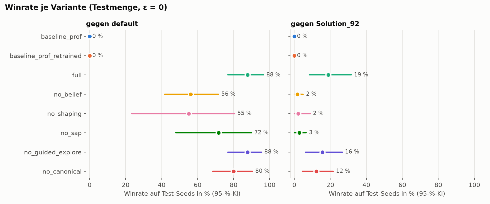
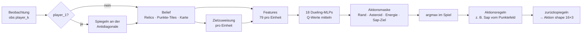

# Sherlock – RL-Agent für Lux AI Season 3

**HTW Berlin · Anwendungen der KI · WS 26/27**
Team 15 · Moodle-Gruppe `15` · Agent **Sherlock** (`agents/sherlock/`, Name `Sherlock Agent_X`)

**Team:** Mahmoud El-Hassan, Moayed Shawesh

Lux AI Season 3 ist ein Zwei-Spieler-Strategiespiel auf einer 24×24-Karte mit Nebel, driftenden Asteroiden und versteckten Punkte-Tiles rund um Relic-Nodes. Ein Spiel besteht aus 3 Matches à 100 Steps; jede Seite steuert bis zu 16 Einheiten.

Unser Agent ist ein **Double-DQN mit Dueling-Kopf**, das pro Einheit entscheidet. Die Eingabe kommt aus einem **Gedächtnis (Belief)**, das Relics über Matches behält und die unsichtbaren Punkte-Tiles aus dem Punktezuwachs ableitet. Dazu kommen **Reward Shaping** pro Einheit, **Aktionsmasken** und eine **Spiegelung in einen kanonischen Raum**, sodass ein Netz für beide Seiten genügt.

**Aktueller Abgabe-Stand (20.10.2026): `all18_v3`.** Beim Spielen werden die Q-Werte von 18 trainierten Netzen gemittelt (Gruppen `rules6`, `sol70`, `opp`). Gedächtnis, frühere Punktefeld-Inferenz, Zielzuweisung und Aktionsregeln ergänzen die Netze. V3 verwendet unter anderem `far_opp=10`, `far_cand` und `pt_sap`. Beide Spielseiten laden dasselbe Ensemble. [Übernahmevergleich und Prüfungen](experiments/analysis/autonomous_20261020/RELEASE.md) · [gesicherte alte Abgabe mit Rückweg](experiments/releases/20261020_old3_sym3/README.md).

**Ergebnisstand 21.10.:** V3 bleibt Abgabe. Die unabhängige V4-Bestätigung (2.400 Spiele) und 18.800 zusätzliche Trainingsspiele lieferten keinen weiteren qualifizierten Ersatz. [Morgenbericht mit Ergebnissen, Grenzen und Übergabe](docs/MORGENBERICHT_20261021.md) · [nächster begründeter Trainingsversuch](docs/NAECHSTER_TRAININGSVERSUCH_20261021.md).

**Zusammenarbeit:** [CLAUDE.md](CLAUDE.md) enthält die gemeinsamen Regeln für Claude Code und Codex; [AGENTS.md](AGENTS.md) verweist Codex darauf. Änderungen, Prüfungen und offene Aufgaben stehen im [gemeinsamen Arbeitsstand](docs/ARBEITSSTAND.md), Versuche weiterhin im [Experimentprotokoll](docs/EXPERIMENT_PROTOKOLL.md).

**Erste Präsentation am 16.10. abgeschlossen:** laut Moayed Note **1,3**. Nächster Termin ist die Zwischenpräsentation mit Battle am **06.11.** Die frühere [Review-Checkliste](docs/presentation/CHECKLISTE_REVIEW_1610.md) und Präsentation bleiben als historischer Stand erhalten.

**Foliensatz für das erste Review:** [PowerPoint mit Notizen](docs/presentation/Sherlock_Review_16-10-2026.pptx) · [PDF](docs/presentation/Sherlock_Review_16-10-2026.pdf) · [Vortragsplan und Lernhilfe](docs/presentation/VORTRAGSPLAN_1610.md). Diese Unterlagen beschreiben den damaligen Agenten und werden durch die neue Abgabe nicht nachträglich umgeschrieben.

## Inhalt

- [Ergebnisse](#ergebnisse)
- [Architektur](#architektur)
- [Projektstruktur](#projektstruktur)
- [Installation](#installation)
- [Nutzung](#nutzung)
- [Experimente](#experimente)
- [Abgabe (agent.zip)](#abgabe-agentzip)
- [Grenzen und nächste Schritte](#grenzen-und-nächste-schritte)
- [Quellen](#quellen)

## Ergebnisse

### Aktuelles Ensemble `all18_v3`

200 vorab reservierte neue Karten **502420–502619**, beide Seiten, je 400 Spiele
pro Agent und Gegner:

| Gegner | Alte Abgabe `old3_sym3` | Aktuelle Abgabe `all18_v3` | Differenz mit 95%-Kartenbootstrap |
|---|---:|---:|---:|
| `default` | 382/400 (95,50 %) | 400/400 (100 %) | +4,50 pp [2,00; 7,50] |
| `Solution_92_Kaggle` | 170/400 (42,50 %) | 313/400 (78,25 %) | +35,75 pp [29,00; 42,25] |

Direkt gegen die gesicherte alte Abgabe gewinnt V3 96/120 Spiele auf 60 bekannten
Entwicklungskarten; 95%-Intervall 70–90 %. Das ist eine zusätzliche Kontrolle,
keine zweite frische Stichprobe. [Rohdaten, Methode, technische Prüfungen und
Grenzen](experiments/analysis/autonomous_20261020/RELEASE.md). V3 ist Mahmouds
bereits entwickelter Kandidat; dieser Vergleich bestätigt den gesamten Stand
und isoliert keinen einzelnen Beitrag von Training, Netzanzahl oder Regeln.

### Historisches Review-Ensemble `old3_sym3`

| Gegner | Gewonnene Spiele | Siegquote |
|---|---|---|
| `default` | 60 von 60 | 100,0 % |
| `Solution_92_Kaggle` | 28 von 60 | 46,7 % |

Grundlage: **30 Karten-Seeds (900000–900029) × beide Seiten je Gegner**, ohne Lernen und mit ε = 0. Quelle: [gespeicherte Einzelspiele](experiments/compare/TEST_old3_sym3.csv). In der separaten Prüfung vom 14.10. wurden alle 120 Spiele mit den ausgelieferten Gewichten reproduziert. Das sind je Gegner 30 Karten, keine 60 unabhängigen Karten. 100 % gegen default gelten für diese Stichprobe, nicht für beliebige künftige Spiele. Die Karten wurden während der Entwicklung mehrfach ausgewertet; die Ergebnisse sind ein wiederholt verwendeter Benchmark, kein unberührter Abschlusstest.

**Messgrenzen:** Historische CSVs ohne `point_counting_version` lassen den letzten Zuwachs vor dem Match-Reset aus. Neue Messungen mit `point_counting_version=2` zählen ihn in Evaluation, Trainingsprotokollen und den beiden Diagnoseskripten mit. Siegquoten aus `team_wins` sind unverändert. Alte Punktzahlen und daraus abgeleitete Punkt-Siegquoten/Differenzen nicht mit Version 2 mischen; alte Dateien werden nicht nachträglich umgeschrieben. `compare_report.py` verwendet jetzt einen gepaarten Bootstrap über ganze Karten und weist gemeinsame Karten/Spiele aus. Frühere Konfidenzintervalle dieses Skripts sind historische Werte; [korrigierte Beispiele und Grenzen](docs/STATISTIK_20261014.md). Details und offene Korrekturen: [Arbeitsstand](docs/ARBEITSSTAND.md).

Die [neu gemessenen 120 Benchmarkspiele mit vollständigen Punkten](experiments/compare/TEST_old3_sym3_points_v2.csv) bestätigen dieselben Siege (60/60 und 28/60). Mittlere Gesamtpunkte je Spiel: **1076,25:120,47 gegen default**, **741,52:883,25 gegen Solution_92**. [Messumgebung und Prüfsummen](experiments/compare/TEST_old3_sym3_points_v2.json); unveränderte Gewichte, keine neue Modellauswahl.

### Historische Einzelnetz- und Ablationsstudie (10.10.)

Die folgende Tabelle und Grafik gehören zum ursprünglichen Einzelnetz-Batch. Sie beschreiben **nicht** das aktuelle 18er-Ensemble. Auch `scripts.report` erzeugt derzeit keinen vollständigen Bericht aller späteren Varianten.

<!-- ERGEBNISSE:START -->
Gemessen auf 30 Test-Seeds × 2 Seiten (60 Spiele pro Gegner und Trainingsstart), ε = 0, 3 Trainingsstarts à 3000 Spiele. Angegeben sind die Winrate mit 95-%-Bootstrap-KI und in Klammern die Standardabweichung über die Starts. Batch vom 10.10.2026.

| Agent | gegen `default` | gegen `Solution_92_Kaggle` |
|---|---|---|
| **`full` (früherer Einzelnetz-Ansatz, drei Starts)** | **87,8 %** [76,7; 96,7] (± 3,5) | **18,9 %** [8,3; 31,7] (± 3,5) |
| Prof-DQN, mitgelieferte Gewichte | 0,0 % [0; 0] | 0,0 % [0; 0] |
| Prof-DQN, gleich lang neu trainiert | 0,0 % [0; 0] | 0,0 % [0; 0] |



Wichtigste Erkenntnisse aus der Ablation ([Details und Einordnung](docs/ERGEBNISSE_20261010.md)):

- **Gedächtnis in den Netzmerkmalen** ist der größte Hebel: ohne diese Merkmale −32 Prozentpunkte gegen `default` und −17 gegen Solution_92. Bei `no_belief` verwenden Belohnungen, Masken und geführte Exploration weiterhin das Belief.
- **Reward Shaping** stabilisiert das Training: Ohne Shaping kollabiert einer von drei Starts.
- **Sap** bringt gegen Solution_92 +16 Prozentpunkte.
- Für **kanonische Koordinaten** und **geführte Exploration** ist in dieser Ablation kein eindeutiger Effekt nachgewiesen; die KIs schließen 0 ein. Das beweist keine Wirkungslosigkeit. Die spätere Symmetrie-Inferenz im Belief ist eine andere Änderung.
- Gleich langes Training brachte dem Prof-DQN in diesem Versuch keinen Sieg. Die Studie spricht für den Nutzen unserer Änderungen; sie beweist nicht, dass beliebiges längeres Training nutzlos wäre.

`full_s0` und danach `old3_sym3` waren frühere Abgabe-Stände. Die aktuellen Gewichte in `agents/sherlock/weights/` enthalten `all18_v3`; die Auswahl- und Übernahmevergleiche sind im Experimentprotokoll dokumentiert.
<!-- ERGEBNISSE:END -->

## Architektur

### Ablauf pro Step



### Pseudocode: Einzelnetz-Training

Dieser Ablauf erklärt das Training eines Mitglieds. Beim Spielen mit `all18_v3` werden die 18 Q-Vektoren gemittelt und die beste erlaubte Aktion gewählt; zusätzliche aktivierte Regeln können sie anpassen. Es gibt dann keine Lernschritte und keine ε-Exploration. Ein geladenes Ensemble gemeinsam weiterzutrainieren ist derzeit nicht implementiert.

```text
für jedes Spiel:
    belief <- leer
    für jeden Step t:
        belief.observe(obs_t)                       # Relics, Karte, Punkte-Tiles
        ctx   <- make_context(obs_t, belief)        # Zielzuweisung, Gegner, Karten
        für jede lebende Einheit u:
            s_u    <- build_features(ctx, u)
            mask_u <- legale Aktionen (Asteroid/Rand/Energie/Sap-Ziel)
            a_u    <- ε-greedy( argmax_a Q(s_u, a) über mask_u )
        env.step(actions)
        r_u <- shaped_reward(ctx, ctx')             # pro Einheit
        Buffer <- (s_u, a_u, r_u, s'_u, done_u, mask'_u)
        alle 2 Steps, sobald mindestens 5000 Einheiten-Übergänge im Buffer liegen:
            Batch ziehen
            y = r + γ (1-done) Q_target(s', argmax über erlaubte a von Q_online(s', a))
            minimiere Huber(Q_online(s,a), y); Target alle 500 Lernschritte syncen
```

### Bausteine

| Baustein | Datei | Kurz |
|---|---|---|
| Spiegelung | `agents/sherlock/geometry.py` | Die Karte ist symmetrisch zur Antidiagonale, `M(x,y) = (23-y, 23-x)`. player_1 wird so gespiegelt, dass der eigene Spawn immer bei (0,0) liegt. Dieselben Netze können auf beiden Seiten eingesetzt und mit Erfahrungen aus beiden Seiten trainiert werden. |
| Belief | `agents/sherlock/belief.py` | Merkt sich Relics über alle 3 Matches. Punkte-Tiles werden aus „Punktezuwachs vs. besetzte Tiles“ abgeleitet; `early_inference` erlaubt diese Inferenz schon vor Step 50. Weitere Regeln berücksichtigen mögliche Relic-Orte und spätere Spawns. Symmetrie ergänzt gespiegeltes Wissen; Erkundungsgedächtnis bleibt über Matches desselben Spiels erhalten. |
| Features | `agents/sherlock/features.py` | 79 Werte pro Einheit: eigene Lage und Energie, Punktestand, nächstes Punkte-, Kandidaten-, Relic-, unerkundetes und zugewiesenes Ziel, aktuelles Tile, 5 Nachbarfelder × 6 Kanäle, nächster Gegner, globale Zähler. Namen in `FEATURE_NAMES`. |
| Netz | `agents/sherlock/model.py` | MLP 79 → 256 → 256, dann Dueling: V (128 → 1) und A (128 → 6), `Q = V + A − mean(A)`. |
| Ensemble | `agents/sherlock/main.py`, `scripts/build_ensemble.py` | Mittelwert der Q-Werte aus 18 trainierten Netzen der Gruppen `rules6`, `sol70` und `opp`. Herkunft und gespeicherte Config: `experiments/candidates_20261020.json`. |
| Aktionen | `agents/sherlock/main.py` | 0 stay, 1–4 Bewegung, 5 Sap. Die Netze bewerten die Aktionen; Regeln ergänzen sie. Beispielsweise kann `pt_sap` Stehenbleiben auf einem Punktefeld durch Sap ersetzen. Das Ziel wählt eine Heuristik. Masken sperren Rand, Asteroiden, Züge ohne Energie und Sap ohne Ziel. |
| Reward | `agents/sherlock/reward.py` | Pro Einheit: + Eigentümer eines bewiesenen Punkte-Tiles, − Stacking, + Potential-Shaping zum zugewiesenen Ziel (Ng et al. 1999), + Erkundung und Entdeckung, + Energie, − Tod, ± Sap-Treffer, ± Matchergebnis (aus Δ `team_wins`). |
| Lernen | `agents/sherlock/main.py`, `replay_buffer.py` | Double DQN, Replay Buffer (300 000 Übergänge, je Einheit und Step einer), Target-Netz, Huber-Loss, Gradient Clipping, ε linear 1,0 → 0,05 über 60k Env-Steps. 70 % der Explorationszüge gehen heuristisch Richtung zugewiesenes Ziel (geführte Exploration, off-policy erlaubt). |

Die Standard-Hyperparameter stehen in `agents/sherlock/config.py` (`AgentConfig`). Beim Laden gelten die gespeicherten Einstellungen des Checkpoints; aktuelle Gewichte und Standardkonfiguration sind daher nicht automatisch gleichzusetzen.

## Projektstruktur

```text
.
├── AGENTS.md                     Einstieg für Codex → gemeinsame CLAUDE.md
├── CLAUDE.md                     gemeinsame Projektregeln und fachlicher Stand
├── agents/
│   ├── sherlock/                 unser Agent (Abgabe-Ordner)
│   │   ├── main.py               Klasse Agent_x: act/update/save/load, DQN-Lernschritt, Masken
│   │   ├── belief.py             Gedächtnis: Relics, Punkte-Tile-Inferenz, Karte
│   │   ├── features.py           Feature-Vektor pro Einheit + Zielzuweisung
│   │   ├── reward.py             Reward Shaping pro Einheit
│   │   ├── model.py              Dueling-Q-Netz
│   │   ├── replay_buffer.py      Ringpuffer mit Aktionsmasken
│   │   ├── geometry.py           Spiegelung echt ↔ kanonisch
│   │   ├── config.py             alle Hyperparameter und Ablations-Schalter
│   │   ├── agents.yaml           Import-/Lade-Pfade (Folie 51)
│   │   └── weights/              trainierte Gewichte agent_p0.pth / agent_p1.pth
│   ├── DQN/                      Baseline des Dozenten (unverändert)
│   ├── default/                  schwacher Benchmark-Gegner
│   └── Solution_92_Kaggle/       starker regelbasierter Gegner
├── scripts/
│   ├── train.py                  Agent trainieren (Env direkt, speichert korrekt)
│   ├── evaluate.py               Winrate gegen festen Gegner, beide Seiten
│   ├── experiment.py             ein Experiment-Lauf: Training → Lernkurve → Test → Manifest
│   ├── run_experiments.py        alle Varianten × Starts parallel
│   ├── report.py                 Tabellen, Bootstrap-KIs, Diagramme
│   ├── record_replay.py          bestimmtes Testspiel als Replay aufzeichnen
│   ├── build_submission.py       agent.zip bauen und prüfen
│   ├── set_match_count.py        params.py auf 3 Matches setzen
│   ├── protocol.py               Seed-Mengen und Curriculum
│   ├── variants.py               Varianten-Registry + Adapter für den Prof-DQN
│   ├── metrics.py                Kennzahlen pro Spiel (agentenunabhängig)
│   └── common.py                 Spiel-Schleife, Gegner-Fabrik
├── tests/                        pytest: Spiegelung, Maske, Belief, Reward, Persistenz, Runner
├── experiments/runs/             ein Ordner pro Lauf (CSV, manifest.json; .pth nicht versioniert)
├── docs/
│   ├── ARBEITSSTAND.md          Übergabe: Änderungen, Prüfungen, offene Aufgaben
│   ├── EXPERIMENT_PROTOKOLL.md   Versuchsplan, vor dem Training festgelegt
│   ├── ERGEBNISSE_*.md           Auswertung mit Einordnung
│   ├── report/                   von report.py erzeugte Tabellen und Diagramme
│   └── presentation/replays/     ausgewählte Replays für die Präsentation
├── lux/                          Runner + Spielregeln des Kurses (nicht ändern)
├── main.py                       ein Spiel über den Kurs-Runner (mit Replay)
├── Paths.csv                     Moodle-Gruppe → Import- und Lade-Pfade
└── requirements.txt
```

## Installation

Benötigt Python 3.10+ (getestet mit 3.14 auf macOS).

```bash
python3 -m venv .venv
source .venv/bin/activate              # Windows: .venv\Scripts\activate
python -m pip install -r requirements.txt
python -m scripts.set_match_count      # Kursregel: 3 Matches pro Spiel in luxai_s3/params.py
python -m pytest -q                    # alles grün?
```

`set_match_count` ändert `match_count_per_episode` in der installierten `luxai_s3/params.py` von 5 auf 3. Mit `--check` wird nur geprüft.

## Nutzung

Alle Befehle aus dem Projekt-Root mit aktiviertem venv.

| Zweck | Befehl |
|---|---|
| Ein Spiel mit Replay über den Kurs-Runner (Gruppe 15 vs. 2, siehe `main.py`) | `python main.py` → `replays/15_vs_2/*.json` |
| Neues Einzelnetz trainieren (automatisch neuer Run-Ordner) | `python -m scripts.train --games 400 --opponent default` |
| Ausgabeordner selbst benennen (muss neu sein) | `python -m scripts.train --games 400 --output-dir experiments/runs/mein_training` |
| Einzelnetz fortsetzen, Quelle erhalten und neue Ausgabe anlegen | `python -m scripts.train --games 300 --opponent solution92 --resume experiments/runs/mein_training/weights/agent_p0.pth` |
| Evaluation (N Seeds × beide Seiten, ε = 0) | `python -m scripts.evaluate --games 20 --opponent solution92` |
| Ein Experiment-Lauf | `python -m scripts.experiment --variant full --run-seed 0 --games 3000` |
| Kompletter Batch (alle Varianten × 3 Starts) | `python -m scripts.run_experiments --games 3000 --workers 11` |
| Report (Tabellen + Diagramme nach `docs/report/`) | `python -m scripts.report` |
| Replay eines Testspiels aufzeichnen | `python -m scripts.record_replay --run experiments/runs/<lauf> --pick best` |
| Tests | `python -m pytest -q` |
| Abgabe bauen | `python -m scripts.build_submission` |

### Sicher trainieren und fortsetzen

`scripts.train` legt für **jeden Aufruf einen neuen Ordner** unter `experiments/runs/train_<Zeitstempel>_<Kennung>/` an. Darin liegen `train.csv` und `weights/agent_p0.pth`, `agent_p1.pth` sowie gegebenenfalls `agent_best.pth` und `agent_selfplay_snapshot.pth`. Auch beim Abbruch wird ausschließlich dort gespeichert. Der konkrete Pfad wird beim Start ausgegeben. `--tag` ergänzt nur den Namen der CSV-Datei.

Mit `--output-dir` lässt sich der Run-Ordner benennen. Bereits vorhandene Ordner werden abgewiesen, damit auch ältere Versuche erhalten bleiben. Ziele im Abgabe-Gewichteordner und Verweise darauf über symbolische Links oder Hardlinks werden beim Schreiben geprüft. Ohne `--resume` beginnt ein neues Einzelnetz.

**Geänderter Aufruf:** `--resume` benötigt jetzt den Pfad zu einem vorhandenen **Einzelnetz-Checkpoint**. Der Checkpoint wird nur gelesen, seine Konfiguration wird übernommen, Ergebnisse landen wieder in einem neuen Run-Ordner. Der Replay Buffer wird in diesem einfachen Trainingsskript nicht wiederhergestellt. Ein Ensemble wie die aktuelle Abgabe `all18_v3` wird mit einer verständlichen Fehlermeldung abgewiesen: gemeinsames Weitertraining aller Mitglieder ist nicht implementiert. Dafür zunächst einen Einzelnetz-Checkpoint wählen und später ein neues Ensemble separat zusammenbauen.

**Geltungsbereich:** Dieser Schutz gilt für `scripts.train` und den Paketbau mit `scripts.build_submission`. Agenten-Speichermethode und Kurs-Runner bleiben unverändert. `main.py` für Vorführungen weiterhin mit `train=False` betreiben; direktes Runner-Training und andere Schreibwerkzeuge wie `set_cfg`/`build_ensemble` niemals auf die Abgabe-Gewichte richten. Das ist ein Schutz der genannten Arbeitsabläufe, keine allgemeine Dateisystemsperre. Für systematische Vergleichsläufe bleibt `scripts.experiment` mit eigenem Run-Namen vorgesehen.

**Replays ansehen:** <https://s3vis.lux-ai.org/> öffnen und die JSON-Datei hochladen, z. B. aus `replays/` oder `docs/presentation/replays/`.

> Warum ein eigenes `train.py`? Der Kurs-Runner (`lux/runner.py`) erzeugt die Agenten in jedem Spiel neu und ruft `save_agent()` vor dem Spiel auf. Gelerntes würde damit nie gespeichert. Unsere Skripte nutzen das Env direkt; zur Abgabe bleibt der Agent trotzdem voll runner-kompatibel (`tests/test_runner.py`).

## Experimente

Wir wollen belegen, welche Änderung wie viel bringt, und zwar im Vergleich zur DQN-Baseline des Dozenten. Kurzfassung des ursprünglichen Versuchsplans (vollständig mit späteren Erweiterungen und Abweichungen in [`docs/EXPERIMENT_PROTOKOLL.md`](docs/EXPERIMENT_PROTOKOLL.md)):

- **Varianten**:
  - `baseline_prof`: Prof-DQN mit mitgelieferter `agent.pth`
  - `baseline_prof_retrained`: Prof-Code unverändert, aber gleich lang trainiert wie unsere Varianten (trennt „mehr Training“ von „bessere Methode“)
  - `full`
  - fünf Ablationen, die sich jeweils in **genau einem** `AgentConfig`-Schalter von `full` unterscheiden: `no_belief`, `no_shaping`, `no_sap`, `no_guided_explore`, `no_canonical`
- **Seeds**: ursprünglich drei disjunkte Mengen (Training, 8 Validierungs-Seeds, 30 Test-Seeds). Geplant war ein Test am Ende; tatsächlich wurden die 30 Testkarten für mehrere Entwicklungsstände erneut ausgewertet. Spätere Auswahlrunden verwendeten neue Validierungskarten; verbrauchte Bereiche stehen im Protokoll.
- **Evaluation**: jedes Spiel von beiden Seiten, gegen `default` und `Solution_92_Kaggle`, ε = 0.
- **Statistik**: 3 Trainingsstarts pro Variante (Mittel ± SD). 95-%-Bootstrap-KIs mit zwei Ebenen (Starts × Seeds) und gepaarter Bootstrap für Differenzen zu `full`.
- **Reproduzierbarkeit**: Jeder Lauf schreibt `manifest.json` mit Config, Seeds, Git-Commit und Laufzeit.

Ergebnisse und ehrliche Einordnung: [`docs/ERGEBNISSE_20261010.md`](docs/ERGEBNISSE_20261010.md), automatisch erzeugte Tabellen: [`docs/report/tabellen.md`](docs/report/tabellen.md), Rohdaten: `experiments/runs/`.

Der ursprüngliche Batch umfasst 63.000 Trainingsspiele. Einschließlich späterem Weitertraining, Gegner-Pool und `full_sym` dokumentieren die 34 Manifeste insgesamt **99.000 Trainingsspiele**; Validierung, Tests und Buffer-Vorfüllung kommen zusätzlich hinzu. Ensemble-Vergleiche liegen in `experiments/compare/`. Diese historischen Trainingsläufe wurden bei der Prüfung vom 14.10. nicht erneut trainiert.

## Abgabe (agent.zip)

Das finale Paket ist für den 27.11. vorgesehen. Die Moodle-Aufgabe „Submission 1“ am 16.10. verlangt den Präsentationsupload; daraus ergibt sich keine zusätzliche Pflicht zum Agentenpaket an diesem Termin.

Vorgaben laut Kursfolie 51: Ordner mit Teamnamen, leere `__init__.py`, `main.py` mit Klasse `Agent_x` (`name='Team Name Agent_X'`), Methoden `act`, `update`, `set_to_eval_mode`, `set_env_cfg`, `save_agent`, `load_agent`, trainierte `.pth`, `agents.yaml` und `paths.csv`.

```bash
# Gewichte eines Runs direkt verpacken; Abgabe-Gewichte im Repository bleiben erhalten
python -m scripts.build_submission --from-run experiments/runs/<lauf> --team-name sherlock --group 15
# nur bauen mit den Gewichten aus agents/sherlock/weights/
python -m scripts.build_submission
```

Ergebnis ist `dist/agent.zip`. Das Skript entpackt das Zip anschließend in eine frische Kopie mit `lux/`. Dort lädt es den Agenten über `lux.runner.load_class_from_path`, prüft die Pflichtmethoden, lädt die Gewichte beider Seiten und führt einen Aktionsschritt aus. Weil das Paket relative Imports nutzt, funktioniert `--team-name` mit jedem Ordnernamen.

`--from-run` liest `weights/agent.pth` oder das Paar `weights/agent_p0.pth`/`agent_p1.pth` direkt aus dem angegebenen Lauf und verpackt beide Seiten. Es ersetzt **keine** Gewichte unter `agents/sherlock/weights/`. Ohne diese Option wird weiterhin der bestehende Abgabe-Stand verpackt. `--out` darf weder geschützte Gewichte noch einen verwendeten Eingabe-Checkpoint überschreiben. Für mehrere Kandidaten unterschiedliche ZIP-Namen wählen; eine vorhandene ZIP am erlaubten Ausgabeziel wird weiterhin ersetzt.

## Grenzen und nächste Schritte

Stand: **21.10.2026**. Trainingsausgaben und Paketbau sind gegen das Überschreiben der Abgabe-Gewichte geschützt. Eine geprüfte bessere Abgabe darf nach Moayeds Freigabe separat installiert werden; die alte bleibt gesichert.

- `all18_v3` erreicht 78,25 % gegen Solution_92 auf dem neuen 200-Karten-Block, verliert dort aber weiterhin 87/400 Spiele. Unbekannte Gegner und Karten bleiben eine eigene Robustheitsprüfung.
- Frühe Inferenz ist aktiviert. Aktive Zielbesitzer, freiere Sap-Geometrie, ein Potentialterm beim Einheitentod und längere Exploration wurden inzwischen kontrolliert untersucht; kein weiterer Kandidat erfüllte die Übernahmeregeln. Der [nächste Trainingsentwurf](docs/NAECHSTER_TRAININGSVERSUCH_20261021.md) verändert gezielt den Zeitpunkt des Gegnerkontakts bei gleichen Gesamtgegnerzahlen. Er ist noch nicht umgesetzt.
- Einheiten-Übergänge und Reward-Sonderfälle bleiben getrennte Diagnosefragen; keine ungeprüfte Reward-Reparatur mit dem neuen Curriculumvergleich vermischen. Die aktuelle Shaping-Implementierung rechtfertigt keine Garantie einer unveränderten optimalen Policy. Der Speicherschutz behebt diese Lernprobleme nicht.
- Vor neuen Schlussfolgerungen: historische Punktvergleiche mit Version 2 neu messen, alte Vergleichsintervalle mit der korrigierten Statistik neu berechnen, zeitlich ausgerichtete Erkundungsdiagnose und für November ein neuer zurückgehaltener Testsatz. Es gibt keine Korrektur für Mehrfachvergleiche.
- „Sap-Treffer“ sind Schätzungen anhand sichtbarer Gegner im Zielbereich, keine Messung des tatsächlichen Energieschadens. Sap-Ziel, Zielzuweisung und ergänzende Aktionsregeln sind heuristisch; die Netze bewerten den Aktionstyp.
- Weitertraining und Self-Play/Gegner-Pool wurden bereits untersucht und brachten in diesen Versuchen keinen klaren Gewinn. Das beweist keine allgemeine Grenze des Verfahrens.
- CNN und PPO wurden bereits untersucht; für eine lokale CNN3-Fortsetzung fehlen die Originalcheckpoints. Vor neuen Läufen Dateien und gespeicherte Config bereitstellen, Ergebnisse reproduzieren und die Konsistenz zwischen Aktionsauswahl und PPO-Update messen. Keine Pipeline blind duplizieren. Offene Aufgaben, Seedreservierungen und Freigabestand: [Arbeitsstand](docs/ARBEITSSTAND.md).

## Quellen

- Lux AI Season 3, Repository: <https://github.com/Lux-AI-Challenge/Lux-Design-S3>
- Spielregeln: [`lux/specs.md`](lux/specs.md) (Original: <https://github.com/Lux-AI-Challenge/Lux-Design-S3/blob/main/docs/specs.md>), Beobachtungen/Aktionen: [`lux/Instructions.md`](lux/Instructions.md)
- Sutton, R. S., & Barto, A. G. (2018). *Reinforcement Learning: An Introduction* (2. Aufl.). MIT Press.
- Mnih, V. et al. (2015). Human-level control through deep reinforcement learning. *Nature* 518, 529–533.
- van Hasselt, H., Guez, A., & Silver, D. (2016). Deep Reinforcement Learning with Double Q-learning. *AAAI*.
- Wang, Z. et al. (2016). Dueling Network Architectures for Deep Reinforcement Learning. *ICML*.
- Ng, A. Y., Harada, D., & Russell, S. (1999). Policy invariance under reward transformations: Theory and application to reward shaping. *ICML*.
- Kursmaterial HTW Berlin, Anwendungen der KI (Folien „Reinforcement Learning“, Interface-Beschreibung `Interface_runner_Agent.pdf`).
