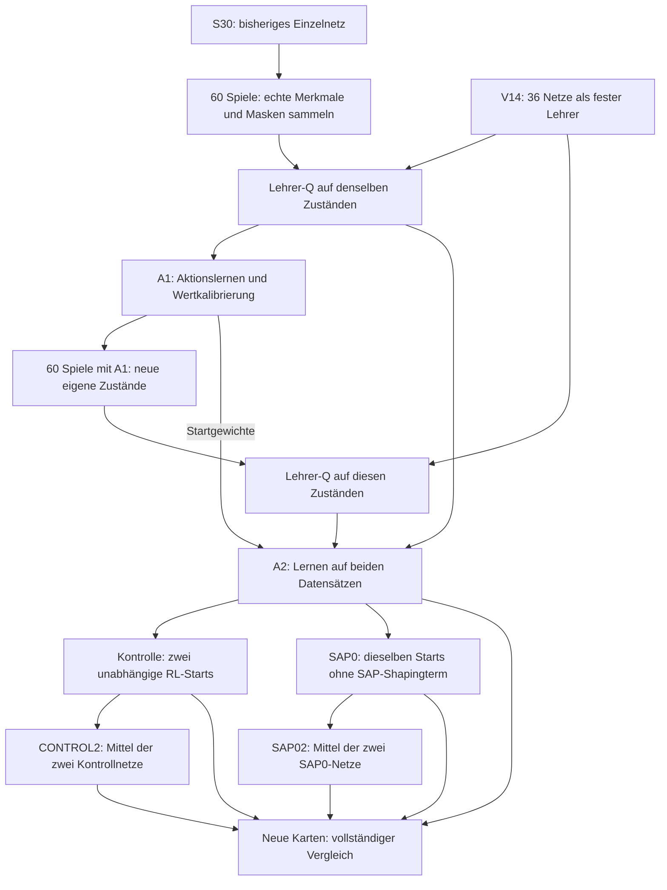

# Aktionsbezogener Schüler – 04.11.2026

**Das Einzelnetz ist deutlich stärker geworden; V14 bleibt die Abgabe.** A2 gewinnt auf den 20 neuen Solution-Karten 38/40 Spiele statt S30 16/40. V14 erreicht auf denselben Karten ebenfalls 38/40. Im Dreiergegner-Panel liegt A2 bei 94/120 statt V14 98/120 (−3,33 pp, 95-%-Intervall [−10,83; +4,17]); direkt gegen V14 bei 14/40 (35 %, Intervall [15; 55]). Kein nachgewiesener Vorteil gegenüber V14, keine Übernahme und keine erreichten 100 %. Alle 1.400 Diagnosepartien sind vollständig geprüft.

## Ergebnisse auf neuen Karten

W–R–N = Siege–Remis–Niederlagen. Je Gegner und Rolle 40 Spiele auf 20 Karten, beide Seiten. Die Direktduelle verwenden 20 andere Karten.

| Variante | Netze | Solution W–R–N | default W–R–N | V13 W–R–N | Direkt gegen V14 W–R–N |
|---|---:|---:|---:|---:|---:|
| V14 | 36 | 38–0–2 | 40–0–0 | 20–0–20 | – |
| S30 | 1 | 16–0–24 | 40–0–0 | 2–0–38 | 2–0–38 |
| A2 | 1 | 38–0–2 | 40–0–0 | 16–0–24 | 14–0–26 |
| CONTROL27 | 1 | 34–0–6 | 40–0–0 | 8–0–32 | 4–0–36 |
| CONTROL28 | 1 | 32–0–8 | 40–0–0 | 18–0–22 | 12–0–28 |
| SAP027 | 1 | 35–0–5 | 40–0–0 | 4–0–36 | 4–0–36 |
| SAP028 | 1 | 36–0–4 | 40–0–0 | 12–0–28 | 10–0–30 |
| CONTROL2 | 2 | 36–0–4 | 40–0–0 | 16–0–24 | 8–0–32 |
| SAP02 | 2 | 37–0–3 | 40–0–0 | 16–0–24 | 12–0–28 |

### Änderungen gegenüber V14

Panel = gleich gewichteter Vergleich gegen Solution, default und V13. Remis zählen halb. Werte sind Differenzen in Prozentpunkten mit 95-%-Intervall aus ganzen Karten.

| Variante | Paneländerung gegenüber V14 | Solution-Änderung gegenüber V14 |
|---|---:|---:|
| S30 | -33.33 pp [-40.00; -25.83] | -55.00 pp [-72.50; -37.50] |
| A2 | -3.33 pp [-10.83; +4.17] | +0.00 pp [+0.00; +0.00] |
| CONTROL27 | -13.33 pp [-20.00; -5.83] | -10.00 pp [-20.00; -2.50] |
| CONTROL28 | -6.67 pp [-16.67; +3.33] | -15.00 pp [-30.00; -2.50] |
| SAP027 | -15.83 pp [-22.50; -9.17] | -7.50 pp [-15.00; +0.00] |
| SAP028 | -8.33 pp [-15.83; +0.00] | -5.00 pp [-12.50; +0.00] |
| CONTROL2 | -5.00 pp [-11.67; +2.50] | -5.00 pp [-15.00; +5.00] |
| SAP02 | -4.17 pp [-12.50; +4.17] | -2.50 pp [-10.00; +5.00] |

### Welche Änderung hilft?

| Vorab festgelegter Vergleich | Paneländerung | Solution-Änderung |
|---|---:|---:|
| A2 gegenüber S30 | +30.00 pp [+19.15; +40.83] | +55.00 pp [+37.50; +72.50] |
| SAP0 gegenüber Kontrolle, Start 27 | -2.50 pp [-11.67; +6.67] | +2.50 pp [-10.00; +15.00] |
| SAP0 gegenüber Kontrolle, Start 28 | -1.67 pp [-12.50; +10.83] | +10.00 pp [-5.00; +25.00] |
| CONTROL2 gegenüber CONTROL27 | +8.33 pp [+2.50; +15.00] | +5.00 pp [-5.00; +15.00] |
| CONTROL2 gegenüber CONTROL28 | +1.67 pp [-10.00; +13.33] | +10.00 pp [-10.00; +27.50] |
| SAP02 gegenüber SAP027 | +11.67 pp [+2.50; +20.83] | +5.00 pp [-7.50; +17.50] |
| SAP02 gegenüber SAP028 | +4.17 pp [-3.33; +11.69] | +2.50 pp [-5.00; +10.00] |

Auch diese Intervalle sind explorativ und nicht für die vielen Vergleiche korrigiert. Einzelergebnisse der zwei Trainingsstarts werden nicht als große Zahl unabhängiger Trainingswiederholungen behandelt. Die vollständigen Direktintervalle und Werte je Startseite stehen im [unabhängigen Auswertungsbericht](../experiments/analysis/action_student_20261104/diagnostic/diagnostic_review.md).

## Entscheidung und Einordnung

- **A2 ist der Fortschritt dieses Versuchs:** Gegenüber dem gleichzeitig gemessenen Ausgangsnetz S30 steigt das Panel um +30,00 pp [19,15; 40,83], Solution um +55,00 pp [37,50; 72,50]. Das betrifft das kombinierte Lernpaket; keine isolierte Ursache für jeden einzelnen Bestandteil behaupten.
- **Das zusätzliche RL verbessert A2 in dieser Stichprobe nicht:** Alle vier nachtrainierten Einzelnetze liegen im Panel und gegen Solution unter A2. Die festen Zweierensembles helfen gegenüber manchen ihrer Mitglieder, bleiben aber ebenfalls unter A2 und V14. Dies ist kein Beweis, dass RL oder Ensembles generell nicht helfen können.
- **SAP0 nicht übernehmen:** Die gepaarten Panelunterschiede betragen −2,50 pp [−11,67; +6,67] und −1,67 pp [−12,50; +10,83]. Die numerischen Solution-Zuwächse gegenüber den jeweiligen Kontrollen reichen bei diesen unsicheren Intervallen nicht für eine allgemeine Reward-Empfehlung.
- **V14 bleibt für die Abgabe:** Kein Kandidat ist nachweislich besser. Die kleine Diagnose qualifiziert grundsätzlich keinen Ersatz; es wurde keine zusätzliche Bestätigung oder Paketfreigabe behauptet. A2 bleibt eine gesicherte Basis für spätere Einzelnetz-Forschung. Keine neue Variante nach Sichtung der Ergebnisse, keine Wiederholung zur Ergebnisverbesserung.

Das [0; 0]-Bootstrap-Intervall von A2 gegenüber V14 bei Solution entsteht durch null Differenz in allen 20 beobachteten Kartenmitteln. Resampling dieser Daten kann dann keine Variation erzeugen. Es beweist keine allgemeine Gleichwertigkeit auf beliebigen Karten.

## Was tatsächlich umgesetzt wurde

1. **Entscheidungen gezielter lernen.** Der Aktionsverlust verwendet die tatsächlich verwendete Netzmaske. Es lernt die Abstände und die Rangfolge der erlaubten Q-Werte des unveränderten V14-Lehrers, nicht nur rohe Zahlenwerte für alle Aktionen. Verbotene Aktionen tragen nicht zum Lernverlust bei. Der Lehrer ist das Mittel der 36 V14-Netze. Dies imitiert deren Netzbewertungen, nicht automatisch sämtliche nachgelagerten Regelentscheidungen.
2. **Eigene Spielsituationen verwenden.** Zwei Sammelrunden mit je 60 Spielen: erst S30, dann der daraus gelernte A1. Der Beobachter kopiert die tatsächlich verwendeten 79 Merkmale, sechs Q-Werte, Masken und endgültigen Aktionen. Vier technische Kontrollspiele bestätigten identische Aktionen und Resultate mit/ohne Beobachter. A2 lernt anschließend aus beiden Runden. Die letzten fünf der 30 Entwicklungskarten bleiben vollständig vom Lernen ausgeschlossen.
3. **Danach eigenständig mit RL lernen.** Vier Läufe ab demselben A2: je zwei unabhängige Starts mit ursprünglicher Belohnung und ohne den geschätzten SAP-Treffer-/Fehlschussterm. Innerhalb jedes Starts identische Anfangsnetze, Gegnerpläne, frische Optimierer und Replay-Puffer. Je 40 Vorlauf-, 160 Lern- und 32 bekannte Validierungsspiele; genau 24.000 Updates. Die beiden vorab festgelegten Zweierensembles mitteln anschließend jeweils die zwei Kontroll- beziehungsweise SAP0-Netze.

Jedes Einzelnetz bleibt ein Dueling-Netz mit 79 Eingaben, einem gemeinsamen Rumpf mit zweimal 512 Einheiten, einem Wertkopf 512→128→1 und einem Vorteilskopf 512→128→6. Zusammen entstehen sechs Q-Werte aus 435.847 Parametern; beide Köpfe gehören zu demselben Netz. In der Schüler-Inferenz bleiben Belief, Zuordnung, Masken und nachgelagerte V14-Regeln aktiv. Beim RL bleiben die vorhandenen trainingsspezifischen Abläufe unverändert; nicht jede nur in der Inferenz aktive Regel wurde dadurch auch ins Training verlegt. Die Laufzeitlogik des abgegebenen Agenten wurde nicht geändert. Zusätzliche neue Regeln wurden ohne konkrete Fehlerursache nicht eingeführt. SAP0 entfernt genau einen vorzeichenbehafteten Shapingterm: den Bonus für geschätzte Treffer und die Strafe für geschätzte Fehlschüsse. Es schaltet weder die restliche Belohnung noch SAP-Aktionen oder Regeln ab.

Die sechs Ausgaben bewerten Warten, vier Bewegungsrichtungen und SAP; sie sind Q-Werte, keine Gewinnwahrscheinlichkeiten. SAP-Zielkoordinaten und spätere Regelkorrekturen gehören zum umgebenden Agenten. Deshalb unterscheiden die neuen Daten ausdrücklich die beste maskierte Netzaktion von der tatsächlich ausgeführten Aktion. In den beiden Sammlungen lagen 776 beziehungsweise 801 finale Aktionen außerhalb der Netzmaske. Das allein bedeutet keine ungültige Spielaktion: Die Netzmaske enthält auch Heuristiken, die nachgelagerte Regeln übergehen können. Diese Zeilen wurden transparent behalten, nicht verworfen.

## Was das Lernsignal zeigt

Die Diagnosekarten innerhalb der gesammelten Entwicklungsdaten werden in keiner Lernphase verwendet. Der abschließende Spielvergleich benutzt zusätzlich andere Karten.

Runde 1: 213.244 Merkmalszeilen, davon 178.651 zum Lernen. A1 verwendet 30 Aktions- und fünf Wertkopf-Epochen, 6.125 Updates. Auf den zurückgehaltenen Entwicklungszeilen steigt die Übereinstimmung der besten erlaubten Netzaktion von 72,08 auf 82,93 %.

Runde 2: 211.858 zusätzliche Zeilen. A2 lernt auf insgesamt 356.415 Lernzeilen; 68.687 Entwicklungs-Diagnosezeilen bleiben ausgeschlossen. Weitere 12.215 Updates. Auf den zusammengeführten Diagnosezeilen steigt die Übereinstimmung von 81,99 auf 86,70 %, der mittlere legale Q-Regret sinkt von 0,04125 auf 0,02339. Diese Werte wurden unabhängig aus allen gespeicherten Zeilen nachgerechnet. Sie sind keine Gewinnquoten und messen nicht die gesamte finale Agentenaktion.

Vor RL werden fünf Epochen ausschließlich zur Kalibrierung des Wertkopfes verwendet. Rumpf und Vorteilskopf bleiben dabei gleich. A2 hatte genau einen numerischen Nahtie-Paarwechsel, keine Änderung einer deutlich getrennten Rangfolge. Der gespeicherte Startwert `env_steps=60000` steuert die Exploration und zählt nicht 60.000 tatsächlich neu gespielte Schritte.

## Vergleichsplan und Grenzen

Vor den Ergebnissen festgelegt: neun Rollen auf 20 lokal bisher unbenutzten Karten 866000–866019, beide Seiten gegen Solution_92, default und V13: 1.080 Spiele. Acht Schülerrollen zusätzlich direkt gegen V14 auf 20 separaten Karten 866100–866119: 320 Spiele. Diese Diagnose wird nicht mit der vorigen 864000-Studie vermischt. Alle Spiele umfassen die drei Kursmatches/303 Aufrufe und Punktezählung v2. Evaluierte eigene Rollen laufen mit `frozen=false`, damit Fehler sichtbar werden; der eigentliche Spielcode bleibt derselbe.

Intervalle verwenden 5.000 Bootstrap-Ziehungen ganzer Karten mit beiden Seiten gemeinsam. Beim Dreiergegner-Panel bleiben auch alle Gegner derselben Karte zusammen. Zwei Trainingsstarts werden getrennt ausgewiesen; sie reichen nicht für eine präzise Aussage über die Schwankung durch Training. Viele explorative Vergleiche, nur 20 Karten und keine Korrektur für Mehrfachvergleiche: Ein positiver Einzelwert ist keine Abgabefreigabe. Ein negatives Ergebnis beweist keine grundsätzliche Grenze eines Einzelnetzes. Auch 40/40 wären keine Garantie für jede neue Karte.

A2 gegenüber S30 misst das gemeinsame Paket aus aktionsbezogenem Lernziel, neuen selbst besuchten Zuständen und Kalibrierung. Es trennt deren Einzelbeiträge nicht. Innerhalb eines RL-Starts ist dagegen nur der SAP-Shapingkoeffizient unterschiedlich; diese Paarvergleiche erlauben eine gezieltere Aussage für genau die beiden geprüften Starts. Historische beste Schüler auf anderen Karten ersetzen keinen gleichzeitig gemessenen Vergleichspartner.

## Reproduktion und Übergabe

Laufquelle `96b524b4fe70a0008e5cee2244dae6d74195f209`; Sammlung 1 noch unter `280a297`, danach derselbe eingefrorene Stand für restliches Lernen und Diagnose. Hauptwerkzeuge: `scripts.student_collect`, `scripts.student_action_distill`, `scripts.student_reward_train`. Die genauen Aufrufe, Quellen-/Modellhashes, Datensätze und Ergebnisse liegen im Studienarchiv. Bereits belegte Ausgabepfade werden nicht überschrieben; für eine neue Studie neue Pfade und eine neue Zeitplanung verwenden. Nicht einfach die alten Deadline-Aufrufe erneut starten.

Originale Replay-Puffer bleiben lokal im Studienworktree. Die beiden gesammelten Datensätze und fertigen experimentellen Modelle werden versioniert. Originalmanifeste enthalten absolute Entstehungspfade; die zusätzlich gespeicherten Archivzuordnungen und Hashes erlauben die Prüfung der kopierten Dateien. Das Archiv ist keine Behauptung, dass alle historischen Originalpfade auf einem anderen Rechner existieren.

Neu vorbereitete RL-Manifeste binden `--run-seed` ausdrücklich an den gesamten Lauf (unterstützt: 0 bis 29). Ältere Manifeste ohne dieses Feld werden klar abgewiesen. Historische Läufe mit ihrem damaligen Quellstand prüfen; alte Metadaten nicht nachträglich passend umschreiben.

136 gezielte Tests sowie unabhängige Implementierungs-, Lerndaten- und Modellprüfungen bestanden. Alle 1.400 Spiele wurden anschließend unabhängig geprüft; der zusätzliche Root-Abgleich bestätigt 288 numerische Gleichheiten mit dem bestehenden Vergleichswerkzeug sowie separaten Panel-/Direktrechnungen. Alle 91 Quellen und 33 gepinnten Eingaben bleiben gleich, alle 17 Jobs enden mit Exit 0, keine abgefangenen Fehler in den Protokollen. Frühere Vollsuite nicht erneut ausgeführt; Agentenlaufzeit unverändert. Die Abgabe und vorhandene ZIP werden per Hash gegen den vorherigen V14-Stand geprüft. Eine etwaige spätere Übernahme benötigt den vollständigen unabhängigen Bestätigungs- und Paketprüfweg.

## Umfang, Abgabe und offene Punkte

Insgesamt **2.452 neue Spielausführungen**: vier technische Kontrollspiele, 120 Sammelspiele, 928 Vorlauf-/Lern-/bekannte Validierungsspiele und 1.400 Diagnosepartien. Das sind nicht 2.452 unabhängige Karten. Dazu 18.340 neue überwachte Optimierungsschritte und 96.000 RL-Updates. Die vorige Schülerstudie mit 1.064 Spielen bleibt getrennt.

Die Modelljobs endeten am **04.11.2026 um 17:33:47 Berlin**, vor der Grenze 17:40. Es wurden keine weiteren Experimente gestartet. [Originalbelege und Übersicht](../experiments/analysis/action_student_20261104/README.md) · [experimentelle Modelle](../experiments/candidates/action_student_20261104/README.md) · [Root-Gegenprüfung](../experiments/analysis/action_student_20261104/diagnostic/root_crosscheck.json).

Beide aktiven V14-Dateien in Hauptcheckout und Studienarbeitskopie bleiben SHA256 `98a0735005926ecd47b52f9c290110069893e4a44c2304b063f1551ffd96d3d8`. Bestehende `Gruppe15.zip`: `88dfbe320cc1df076366e43d928f76a230690d6b96b573eefd583d7979dff9d6`. Heute keine neue ZIP oder neue Laufzeitfreigabe des Pakets; frühere konkrete Prüfungen gelten für dieselben unveränderten Bytes. Kein Moodle-Upload.

Offen bleibt, ob A2 auf einer größeren unabhängigen Stichprobe das Niveau von V14 erreicht und wie anschließendes RL seine guten imitierten Entscheidungen bewahren kann. Beides benötigt eine neue, vor Ergebnissen festgelegte Studie; es wird hier nicht als laufende oder erfolgreiche Arbeit ausgegeben. Für die anstehende Abgabe weiter V14 verwenden. Veröffentlichung und Betriebsabschluss stehen im jüngsten [Arbeitsstand](ARBEITSSTAND.md).
