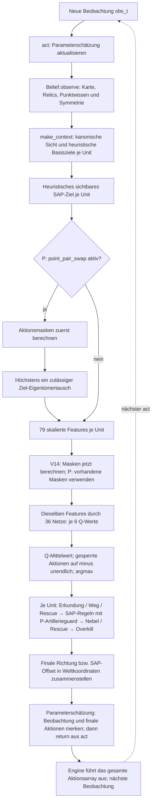

# Entscheidungsablauf: V14 und P-only

Stand 03.11.: P hat die frische Bestätigung verfehlt. Aktiv bleibt V14; P-Zweige
in dieser Notiz beschreiben den ausgeschalteten Forschungsprototyp.
[Daten und Entscheidung](../experiments/analysis/continuation_20261102/performance/study_P_only_20261102/README.md).

Technische Notiz für Mahmoud · Quellstand `03e54e267242ff642c126313fe5f512ed9d959ac` · 02.11.2026

Sherlock verbindet regelbasierte Zustandsaufbereitung und Zielzuweisung mit einer gelernten Bewertung von sechs Aktionsklassen. **Die Regeln wirken vor und nach dem Netz.** Der Belief liefert Wissen über die bisher beobachtete Welt; er gibt selbst keine vollständige Aktion aus. Das Netz liefert Q-Werte; die endgültige Aktion entsteht erst nach Maskierung und den nachfolgenden Regelstufen.

Diese Notiz beschreibt die tatsächlich konfigurierte V14-Inferenz und den P-only-Kandidaten. P verwendet **dieselben 36 geordneten Netze** und ergänzt `point_pair_swap=true` sowie `art_move_guard=true`. Weitere Komponenten werden nicht ersetzt. Referenz: V14-SHA `98a0735005926ecd47b52f9c290110069893e4a44c2304b063f1551ffd96d3d8`; P-SHA `dbb15222848b9ce8530080e128fa9ca66309c9900e98f50de5cce1d73e5b7f5a`. Das ist eine Beschreibung des Ablaufs, keine Aussage über einen gemessenen Spielstärkegewinn. Die Herkunft belegen [P-Manifest](../experiments/analysis/continuation_20261102/performance/review/P_candidate_manifest.json) und [tatsächlicher Vorladecheck](../experiments/analysis/continuation_20261102/performance/review/P_actual_load_preflight.json).

Die Quelllinks führen zu Dateien im Repository; die Zeilen beziehen sich auf den oben genannten Commit. Die laufende Leistungsstudie behält diesen Quellstand unverändert.

## 1. Gesamtfolge eines normalen Aktionsschritts



Die Pfeile zeigen die **Aufrufreihenfolge**. Die Aktionsmaske ist ein separates Hilfsarray und kein zusätzlicher Teil des 79er-Netzeingangs. Sonderausstiege: Bei `match_steps==0` gibt `_act` nach dem Belief-Aufruf ein Null-/STAY-Array zurück; wenn keine eigene Unit aktiv ist, erfolgt ebenfalls kein Netzvorlauf. [Aufrufkette und Sonderausstiege](../agents/sherlock/main.py#L300-L345)

## 2. Was schon vor den 79 Zahlen feststeht

**Parameterschätzung zuerst:** `_act_est` verarbeitet die neue Beobachtung anhand der zuletzt gemerkten Beobachtung und eigenen finalen Aktionen. Aktiv sind die Schätzung für Nebelvermeidung und die Streuschadenbedingungen von Artillerie/Halter-SAP. `est_censor` verwirft gekappte Energiebeobachtungen bei 0. Die Schätzung ist eine eigene Beobachtungsroutine in Weltkoordinaten und greift nicht auf versteckte Enginezustände zu. Nach der Aktionsentscheidung speichert `remember` die tatsächlich ausgegebenen Aktionen für den nächsten Schritt. [Aufruf](../agents/sherlock/main.py#L300-L308), [Estimator: Eingang und Filter](../agents/sherlock/param_est.py#L69-L132), [Merken](../agents/sherlock/param_est.py#L134-L147)

**Belief danach:** `_act` ruft `belief.observe(obs)` auf. Er hält Kartenwissen, sichtbare Relics, Kandidaten, bewiesene Punktfelder und Erkundungshistorie. Aktiv sind u. a. Symmetrie, Drift-/Nebelverarbeitung, früher zulässige Punktinferenz, Relic-Filter und Teilmengendifferenzen. Punktwissen entsteht aus dem beobachteten eigenen Punktzuwachs und den besetzten Feldern, mit Stabilitätsprüfung; unbekannte Felder werden dadurch nicht einfach als sicher bekannt behandelt. Der Belief-Aufruf ist anhand von `obs['steps']` idempotent: Eine Wiederholung im selben Schritt verarbeitet die Beobachtung nicht doppelt. [Beobachtung und Inferenzreihenfolge](../agents/sherlock/belief.py#L220-L300), [Stabilität und Punktgleichungen](../agents/sherlock/belief.py#L535-L598)

**Kanonische Sicht und Laufziele:** Für `player_1` werden Positionen/Karte in eine Sicht mit eigenem Spawn bei `(0,0)` gespiegelt. `make_context` verbindet die Beobachtung mit dem Belief und erstellt `assigned[uid]`. `assign_targets` ist eine **heuristische Greedy-Zuweisung**, keine Netzausgabe und keine globale Optimallösung: Punktfelder, Kandidaten und nötigenfalls Erkundungsziele bekommen priorisierte Kosten; `reach_assign` nutzt BFS-Erreichbarkeit/-Distanz, `far_opp=10` und `far_cand` verteuern bestimmte entfernte Ziele auf der Gegnerhälfte. Die Zuweisung nimmt jeweils das kleinste verbleibende Unit-Ziel-Paar und streicht die entsprechende Unit und Zielspalte. Erkundungsraster und Erkundungshistorie wirken bereits hier. [Kontext](../agents/sherlock/features.py#L602-L712), [Zielpools](../agents/sherlock/features.py#L289-L331), [Kosten](../agents/sherlock/features.py#L348-L368), [Greedy-Zuweisung](../agents/sherlock/features.py#L393-L402), [Spiegelung](../agents/sherlock/geometry.py#L1-L16)

### P-Eingriff 1: `point_pair_swap` verändert den Netzeingang

In `_decide` ist die Reihenfolge ausdrücklich:

1. Basis-Kontext/Zuweisung und sichtbare SAP-Vorschläge berechnen.
2. **Bei P die Masken vorab berechnen.**
3. `improve_point_assignment` aufrufen und `ctx['assigned']` ersetzen.
4. Erst dann `build_features` ausführen. `fctx` verweist bei aktiviertem vollständigem Belief auf denselben Kontext und sieht daher die geänderte Zuweisung.

Der Tausch betrifft höchstens **zwei Eigentümer bereits ausgewählter eigener, bekannter Punktziele**. Die Zielmenge bleibt bestehen. Produktive Halter sind ausgeschlossen; Energie, Erreichbarkeit und zulässige erste Schritte müssen passen. Aus maximal 120 Paaren wird höchstens eines mit strikt kürzerer BFS-Gesamtlänge gewählt. Das ist ein lokales Wegpotenzial, kein garantierter Punkte-/Energiegewinn. Es werden keine bisher unzugewiesenen Ziele hinzugefügt. [Exakte Einbaustelle](../agents/sherlock/main.py#L247-L268), [Zulassung, Suche und Austausch](../agents/sherlock/assignment.py#L11-L72)

Die Routine verändert damit vor allem die vier `assigned_*`-Features und spätere Regeln, die das zugewiesene Ziel lesen. Sie berechnet keine neuen Netzgewichte und gibt an dieser Stelle noch keinen Fahrbefehl aus.

## 3. Was genau das Netz bekommt und ausgibt

Jede aktive Unit bekommt denselben Featuretyp, abhängig von ihrer eigenen Lage und dem gemeinsamen Kontext. Es ist kein rohes Kartenbild und kein CNN-Eingang. Die 79 Werte sind skaliert, teilweise vorzeichenbehaftet; sie liegen nicht pauschal alle zwischen 0 und 1.

| Featuregruppe | Anzahl | Beispiele |
|---|---:|---|
| Eigene Lage und bekannte Spielparameter | 10 | Position, Energie, Bewegungskosten, SAP-Reichweite |
| Spiel-/Matchstand | 4 | Punkte, Punktdifferenz, Matchsiege |
| Nächstes Ziel pro Klasse und eigenes zugewiesenes Ziel | 20 | Je `dx,dy,dist,exists` für Punkt, Kandidat, Relic, unerkundet, `assigned` |
| Aktuelles Feld | 5 | Punkt/Kandidat/Nebel, eigene Belegung |
| Lokale Umgebung in STAY + vier Richtungen | 30 | Passierbarkeit, Feldenergie, Punkt/Kandidat, unerforscht, eigene Belegung |
| Sichtbare Gegner | 6 | Nächster Gegner, Energievergleich, Anzahl in SAP-Reichweite |
| Globale Zähler | 4 | Eigene Units, bekannte Punkte, Erkundungs-/Kandidatenanteil |
| **Summe** | **79** | |

[Featurelayout](../agents/sherlock/features.py#L24-L51), [tatsächliche Befüllung](../agents/sherlock/features.py#L715-L808). Die zusätzliche Gefahrmerkmals-Erweiterung ist in der tatsächlichen P-Konfiguration ausgeschaltet; für diese Notiz gelten 79 Merkmale.

Alle Units werden als Stapel `N×79` verarbeitet. Jedes der 36 MLPs liefert `N×6` Q-Werte. Beim aktuellen Dueling-Netz entsteht der Vektor aus `V + A − mean(A)`; eine Softmax wird hier nicht angewendet. Die 36 Ausgaben werden komponentenweise mit gleichem Gewicht gemittelt:

`Q̄_u(a) = (1/36) · Σ_m Q_m(x_u,a)`

Die sechs Indizes sind `0=STAY`, `1=UP`, `2=RIGHT`, `3=DOWN`, `4=LEFT`, `5=SAP`. **Q-Werte sind gelernte Schätzungen eines diskontierten Reward-Rückflusses, keine Aktionswahrscheinlichkeiten.** Sie müssen sich weder zu 1 summieren noch positiv sein. [Netz und Dueling-Ausgabe](../agents/sherlock/model.py#L50-L72), [Ensemble und Argmax](../agents/sherlock/main.py#L331-L345), [Aktionsindizes](../agents/sherlock/geometry.py#L22-L29), [TD-Lernziel](../agents/sherlock/main.py#L1540-L1557)

## 4. SAP-Ziel, Maske und NN-Auswahl sind drei verschiedene Dinge

`_best_sap_target` bestimmt **vor dem Netz** einen Vorschlag `(dx,dy,hits)` für jede Unit. Im aktiven V14/P-Pfad prüft es sichtbare Gegnerfelder innerhalb der quadratischen SAP-Reichweite und maximiert

`Summe sichtbarer Gegnerenergien auf dem Zieltile + 0,5 · Summe der Gegnerenergien auf den acht Nachbarfeldern`.

Die 0,5 ist hier die feste Annahme `SAP_DROPOFF_ASSUMED`: `sap_dropoff_est` ist in der tatsächlichen Konfiguration aus. Die Parameterschätzung kann trotzdem die Artillerie-/Halter-SAP-Regeln beeinflussen; sie ersetzt deshalb nicht automatisch diese Zielrangfolge. Der Rückgabewert `hits` zählt direkte und benachbarte sichtbare gegnerische Units, nicht unterschiedliche Positionen und nicht die Höhe des oben genannten Scores. Gestapelte Gegner zählen dabei mehrfach. Es werden in diesem Pfad keine beliebigen freien Zielfelder als sichtbares SAP-Zentrum durchsucht. [SAP-Zielvorschlag](../agents/sherlock/main.py#L1433-L1480), [feste Annahme](../agents/sherlock/main.py#L52)

Die **Maske** sperrt Bewegungen ohne Energie, außerhalb der Karte oder auf unpassierbare Felder. `safe_moves` und `collision_guard` sperren zusätzlich bestimmte gefährliche Kollisionen mit sichtbaren Gegnern. SAP wird für die normale NN-Auswahl nur zugelassen, wenn ein sichtbarer SAP-Vorschlag und genügend Energie vorhanden sind. STAY bleibt erlaubt. Die aktuelle Nebelregel ist `soft`, also kein pauschales Nebelverbot in der Maske. [Maske](../agents/sherlock/main.py#L1380-L1431)

**Die spätere Fog-SAP-Regel benutzt eigene Zulassungsbedingungen.** Sie kann SAP setzen, obwohl die NN-Maske SAP mangels sichtbaren Ziels gesperrt hatte: Der Aufruf prüft nicht `masks[k][SAP]`, sondern erzeugt unter seinen Energie-/Sicht-/Punktbedingungen einen Vorschlag für ein unsichtbares Ziel. Die endgültige Aktion wird deshalb nicht pauschal erneut an dieselbe NN-Maske gebunden. [Fog-SAP-Aufruf](../agents/sherlock/main.py#L423-L429), [eigene Bedingungen](../agents/sherlock/main.py#L622-L642)

Erst nach dem Ensemble werden gesperrte Q-Einträge auf `−∞` gesetzt und der größte verbleibende Wert gewählt. `raw_greedy` davor dient nur der Diagnose, wie oft die unmaskierte Bestaktion gesperrt war. Das NN wählt damit zunächst eine der sechs Aktionsklassen, **keine SAP-Koordinate**. Nachfolgende Regeln dürfen SAP zusätzlich erzwingen, sein Ziel ersetzen oder SAP verwerfen. [Auswahl](../agents/sherlock/main.py#L334-L348)

## 5. Die aktiven Änderungen nach dem NN — in ihrer tatsächlichen Reihenfolge

Alle Q-Werte sind bereits berechnet, bevor die Unit-Schleife beginnt. Darin werden die späteren Regeln je Unit nacheinander ausgeführt. `planned_dmg` und `planned_fog` enthalten **geplante**, noch nicht von der Engine ausgeführte Aktionen früher bearbeiteter Units dieses Schritts. Das gesamte Aktionsarray geht erst anschließend an die Engine. [Initialisierung und Schleife](../agents/sherlock/main.py#L350-L391), [Engine-Aufruf](../scripts/common.py#L130-L146)

| Reihenfolge | Aktive Stufe | Was sie an der bisherigen Aktion ändern kann | Quelle |
|---:|---|---|---|
| 1 | `scripted_explore`, dann `path_fix`, ggf. Rescue-Zielbindung | Eine nicht-SAP-Erkundungsaktion durch einen maskenerlaubten Schritt zum Erkundungsziel ersetzen; danach eine Luftlinien-Sackgasse per BFS korrigieren. Im Rescuefall kann eine vom Punkt-/Kandidatenziel wegführende Bewegung korrigiert werden. | [Aufrufreihenfolge](../agents/sherlock/main.py#L399-L411), [Erkundung](../agents/sherlock/main.py#L610-L620), [BFS-Korrektur](../agents/sherlock/main.py#L1318-L1342), [Rescue-Zielbindung](../agents/sherlock/main.py#L1289-L1316) |
| 2 | `fog_sap`/`fog_v2` | Aus STAY kann SAP auf einen **anderen, heuristisch erschlossenen** unsichtbaren Halter werden: nur mit passender Sichtweite, auf einem eigenen bekannten Punktfeld, mit Energiereserve und ohne vorhandenes sichtbares Ziel im v2-Pfad. | [Einbau](../agents/sherlock/main.py#L423-L429), [Unitbedingungen](../agents/sherlock/main.py#L622-L642), [Fog-Zielwahl](../agents/sherlock/rules.py#L187-L255) |
| 3 | `pt_sap` mit `sap_still`/`sap_still_splash` | STAY des ersten eigenen Halters auf einem bekannten Punktfeld kann zu SAP werden. Ziel, Maske, Energie und Stationaritäts-/Streuschadenbedingung müssen passen. | [Halter-SAP](../agents/sherlock/main.py#L437-L454), [Stationarität/Streuung](../agents/sherlock/main.py#L1129-L1141) |
| 4 | `art_sap`/`art_splash`, **P: `art_move_guard`** | Eine bisherige Nicht-SAP-Aktion kann zum Artillerie-SAP werden. P kann genau diese Umwandlung für einen bereits vorhandenen legalen Bewegungszug verhindern; Details unten. | [Artilleriestufe](../agents/sherlock/main.py#L455-L465), [Lohn-/Energie-/Sicherheitsprüfung](../agents/sherlock/main.py#L703-L734) |
| 5 | Weiche Nebelvermeidung mit `neb_cross` | Eine Bewegung in schädlichen Nebel kann umgeleitet oder zum Energiesammeln ersetzt werden. Nach Möglichkeit wird eine erlaubte nebelfreie Alternative gewählt; sonst wird die Energie für die vollständige Durchquerung geprüft. | [Aufruf](../agents/sherlock/main.py#L476-L482), [Soft-Nebel](../agents/sherlock/main.py#L797-L832), [Durchquerungsbudget](../agents/sherlock/main.py#L896-L922) |
| 6 | Bedingtes `cand_rescue`; sonst ggf. Nebelausgang | Aus STAY kann ein erlaubter Annäherungsschritt zu einem nahen Kandidaten werden. Bei schädlichem Nebel kann anschließend eine wartende Unit außerhalb bekannter Punktfelder einen nebelfreien Ausgang wählen; Rescue-Kandidaten haben eine Ausnahme. | [Rescue/Exit-Reihenfolge](../agents/sherlock/main.py#L483-L499), [Kandidatenschritt](../agents/sherlock/main.py#L924-L945), [Ausgang](../agents/sherlock/main.py#L947-L964) |
| 7 | `sap_no_overkill`; danach Schadensplanung und Ausgabe | Ein noch vorgesehener SAP kann zu STAY werden, wenn nach dem internen Modell kein durch diesen Vorschlag direkt/benachbart betroffener Gegner nach früher geplanten Treffern mehr lebt. Verbleibende SAPs ergänzen die Schadensplanung für spätere Units. | [Veto und Planung](../agents/sherlock/main.py#L542-L574), [Overkillmodell](../agents/sherlock/main.py#L1212-L1237) |

Der Rescuezustand ist nicht ständig aktiv: Bekanntes Relic, weiterhin **kein** bekanntes Punktfeld, `match_step≥10` und mindestens `rescue_after=30` Schritte seit der ersten Relic-Beobachtung sind gemeinsam nötig. Erst dann schaltet `cand_rescue` zusätzliche Ziel-/Kandidatenhilfen zu. [Rescue-Gate](../agents/sherlock/main.py#L383-L390)

Bei Artillerie sind im Grundfall mindestens drei sichtbare gegnerische Units im direkten oder benachbarten Trefferbereich, Energie und die dort implementierte Manhattan-Sicherheitsprüfung gegenüber sichtbaren SAP-fähigen Gegnern nötig. Eine hinreichend sichere Streufaktorschätzung ab 0,5 reduziert die Grenze auf zwei Units; ab `splash_safe_below=1,0` wird die betreffende Artillerie-Sicherheitsprüfung aufgehoben. Die Maske und alle späteren Stufen bleiben bestehen. [Exakte Artilleriebedingungen](../agents/sherlock/main.py#L703-L734)

Die im Aufruf sichtbare allgemeine Funktion `_rule_override` erzwingt im hier aktiven Stand **kein pauschales Punktlaufen oder Punkthalten**: `pt_walk` und `pt_hold` sind beide aus. Die tatsächlichen aktiven Eingriffe stehen in den oben genannten separaten Stufen. [Funktionsgate](../agents/sherlock/main.py#L1101-L1119), [tatsächliche Konfiguration](../experiments/analysis/continuation_20261102/performance/review/P_actual_load_preflight.json)

### P-Eingriff 2: `art_move_guard` liegt zwischen Artillerieprüfung und späterem Overkill-Veto

Der Guard wirkt nur, wenn die bestehende Artilleriestufe sonst SAP wählen würde und bereits eine **erlaubte Bewegung `1..4`** vorliegt. Wenn `sap_no_overkill` denselben sichtbaren SAP-Vorschlag anhand von `planned_dmg` schon als verschwendet einstuft, behält P die derzeitige Bewegung. Das kann bereits eine von Erkundung, BFS oder Rescue korrigierte Bewegung sein — es ist nicht zwingend die rohe NN-Bestaktion. Danach laufen Nebel-, Rescue- und die übrigen normalen Folgestufen unverändert weiter. [Guard](../agents/sherlock/main.py#L455-L465)

Ohne diesen Guard kann die Kette lauten: Bewegung → Artillerie-SAP → späteres Overkill-Veto → STAY. **Nach einem solchen Veto wird kein zweiter Argmax und keine neue SAP-Zielsuche ausgeführt.** P verhindert an dieser engen Stelle den vorherigen Verlust der Bewegung. Der Guard garantiert weder eine bestimmte Zielrichtung noch einen tatsächlichen Punktegewinn. Das Overkillmodell rechnet mit aktuellen sichtbaren Positionen und intern geplantem Schaden, nicht mit bereits geschehenen Treffern. [Veto/Output](../agents/sherlock/main.py#L542-L574), [Modellannahmen](../agents/sherlock/main.py#L1212-L1237)

## 6. Kurzer Pseudocode des aktiven Inferenzpfads

```text
act(obs):
    Parameterschätzung.observe(obs, vorherige finale Aktionen)
    Belief.observe(obs)                         # idempotent pro obs.steps
    falls Match-Reset: Aktionen = nur STAY
    sonst:
        ctx = Kontext + heuristische Basisziele
        sap[unit] = bester sichtbarer SAP-Vorschlag
        falls P: masks = Masken(ctx, sap); ctx.assigned = zulässiger Paar-Tausch
        x[unit] = 79 Features(ctx, unit)
        falls V14: masks = Masken(ctx, sap)
        Q[unit, :] = Mittel der 36 Netz-Ausgaben auf x[unit]
        a[unit] = argmax(Q mit gesperrten Einträgen auf -unendlich)
        für jede aktive Unit in der bestehenden Schleifenreihenfolge:
            a = Erkundungs-/BFS-/bedingte Rescue-Korrektur(a)
            a, sap = Fog-SAP, Halter-SAP, Artillerie-SAP prüfen
                     # P: legalen Move behalten, wenn Artillerie-SAP bereits Overkill wäre
            a = Soft-Nebel, bedingte Rescue-Annäherung und Nebelausgang prüfen
            falls SAP und Overkill: a = STAY      # kein erneuter NN-Vorlauf/Argmax
            falls weiterhin SAP: geplanten Schaden ergänzen
            Aktionen[unit] = in Weltkoordinaten zurückgespiegelte Endaktion
    Parameterschätzung.remember(obs, Aktionen)
    return Aktionen
```

Die finale SAP-Ausgabe ist `[5,dx,dy]`, eine Bewegung/STAY ist `[Richtung,0,0]`. Bei `player_1` werden Richtung bzw. SAP-Delta aus dem kanonischen Raum zurückgespiegelt. Nicht aktive Units behalten die mit null initialisierte Aktion. [Ausgabe](../agents/sherlock/main.py#L562-L577), [Richtungen und Delta-Spiegelung](../agents/sherlock/geometry.py#L55-L62)

## 7. Wann Belief-Aktualisierung und Lernen passieren

| Modus/Aufruf | Tatsächliches Verhalten |
|---|---|
| Studie mit `par_eval` | Erzeugt `Agent_x(..., train=False)`, setzt Eval-Modus und schaltet Autosave aus. `epsilon` ist deshalb 0, die 36-Netz-Mittelung ist aktiv. `common.play_game(..., train=False)` ruft `update` gar nicht auf; neue Beobachtungen gelangen im nächsten `act` in den Belief. [Worker](../scripts/par_eval.py#L80-L102), [Spielschleife](../scripts/common.py#L130-L146), [Epsilon](../agents/sherlock/main.py#L230-L235) |
| `update` wird trotzdem vom Kurs-Runner aufgerufen | `_update` erhöht zunächst `env_steps` und verarbeitet `next_obs` im Belief. Ohne vorherigen Kontext oder bei `training=False` folgt unmittelbar die Rückkehr: keine Replay-Transitions und kein Optimiererschritt. Der folgende `act` verarbeitet dieselbe Beobachtung dank Belief-Idempotenz nicht doppelt. [Update-Gate](../agents/sherlock/main.py#L1483-L1501), [Idempotenz](../agents/sherlock/belief.py#L220-L226) |
| Tatsächliches Training, nur zur Abgrenzung | Nur bei `training=True` entstehen danach Reward-/Replay-Transitions. Ein Lernschritt braucht zusätzlich `learn_enabled`, mindestens `learn_start=5000` Buffer-Einträge und den `train_every`-Takt. `_learn` optimiert das einzelne Online-Q-Netz mit Double-DQN-Ziel und synchronisiert periodisch `target_q`; das 36er-Ensemble wird nur bei `not training` gemittelt. [Replay/Lerngates](../agents/sherlock/main.py#L1501-L1527), [Lernschritt](../agents/sherlock/main.py#L1529-L1564), [Ensemblegate](../agents/sherlock/main.py#L334-L339) |
| Battle-Paket mit `cfg.frozen=True` | Der Paketbauer setzt dieses Flag in den verpackten Gewichten. Der Konstruktor erzwingt dann `training=False`, auch wenn der Kurs-Runner `train=True` als Standard verwendet; `set_to_train_mode` schaltet es nicht zurück. Implizites Speichern ohne expliziten Zielpfad wird blockiert. Bei abgefangenen `act`-Fehlern wird ein STAY-Array ausgegeben. [Paketierung](../scripts/build_submission.py#L136-L155), [Konstruktor](../agents/sherlock/main.py#L109), [Trainmodus](../agents/sherlock/main.py#L222-L227), [Speichergate](../agents/sherlock/main.py#L1574-L1579), [Fehlerpfad](../agents/sherlock/main.py#L271-L298) |

`frozen`, `training`, `learn_enabled` und der `train`-Parameter der Spielschleife sind somit verschiedene Gates. Der separate P-Vorladecheck dokumentiert den effektiven Wert `frozen=false`, `training=false`, `epsilon=0`, zusätzlich `learn_enabled=false` und Autosave aus. Im rohen V14-/P-Checkpoint fehlt der gespeicherte `frozen`-Schlüssel; `false` kommt aus dem Konfigurationsstandard. Das Battle-Paket fügt ausdrücklich `frozen=True` hinzu. Der normale `par_eval`-Quellpfad deaktiviert Lernen bereits durch `train=False` und den ausbleibenden `update`-Aufruf; seine Sicherheit hängt nicht davon ab, dass jeder dieser Schalter denselben Wert hat. [Vorladebeleg](../experiments/analysis/continuation_20261102/performance/review/P_actual_load_preflight.json#L217-L223)

Auch die Regelgates sind zu unterscheiden: `rules_in_training` erlaubt u. a. Reach-/Pfad-/Paar-/Kollisions-/Overkill-Regeln im Training; `rules_in_training_all` erlaubt dort zusätzlich Parameterschätzung/Nebel- und Halter-SAP-Bedingungen. Im tatsächlichen Inferenzmodus greifen diese Regeln wegen `not training`. Einige Zweige sind ausdrücklich eval-only, insbesondere die Artillerie-Streuschadenabsenkung und Rescue. Ein aktiviertes Flag allein bedeutet deshalb nicht, dass jeder Trainingspfad identisch zum hier beschriebenen Inferenzpfad ist. [Reach-Gate](../agents/sherlock/features.py#L659-L680), [Paar-Gate](../agents/sherlock/main.py#L255-L256), [Estimator-Gate](../agents/sherlock/main.py#L300-L308), [Halter-SAP-Gate](../agents/sherlock/main.py#L449-L452), [Artillerie eval-only](../agents/sherlock/main.py#L717-L720), [Rescue eval-only](../agents/sherlock/main.py#L388-L390)

Bei der Erstellung dieser Notiz wurden ausschließlich Quelltext und vorhandene JSON-Belege gelesen. Dabei wurden keine Modelle oder Spiele gestartet und keine eingefrorenen Quellen verändert.
