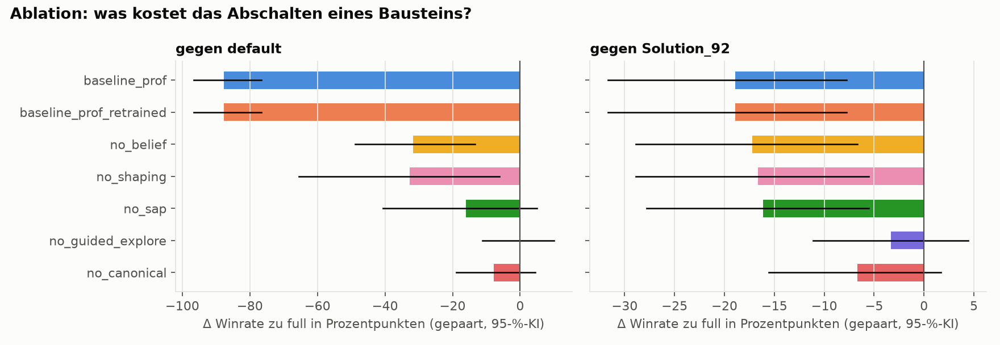
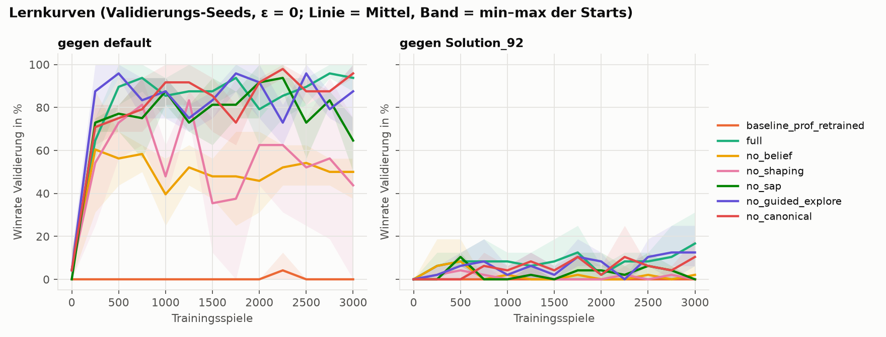
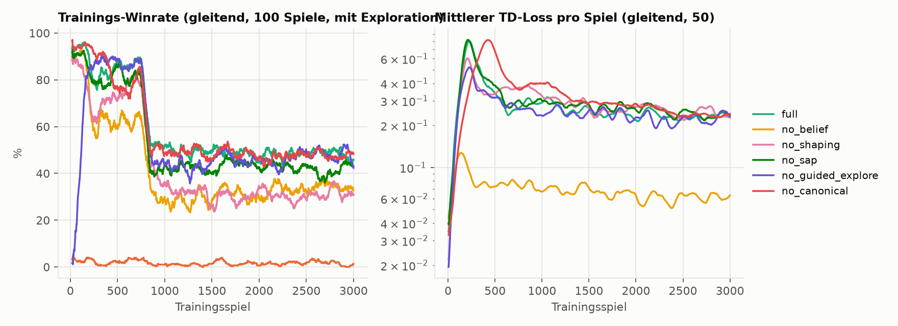

# Ergebnisse – Experiment-Batch vom 10.10.2026

Das Protokoll wurde vor dem Training festgelegt: [`EXPERIMENT_PROTOKOLL.md`](EXPERIMENT_PROTOKOLL.md). Die vollständigen, automatisch erzeugten Tabellen stehen in [`report/tabellen.md`](report/tabellen.md), die Rohdaten in `experiments/runs/20261010_*` (`train.csv`, `val.csv`, `eval.csv`, `manifest.json`).
Neu erzeugen mit `python -m scripts.report --prefix 20261010`.

## Versuchsaufbau in Kürze

- **Läufe**: 8 Varianten. `baseline_prof` ist eingefroren und läuft einmal, die übrigen 7 trainieren mit je 3 Starts. Zusammen sind das **22 Läufe**, alle erfolgreich.
- **Training**: 3000 Spiele pro Lauf. Die ersten 25 % laufen gegen `default`, danach abwechselnd gegen `default` und `Solution_92_Kaggle`.
- **Test**: 30 Test-Seeds × 2 Seiten × 2 Gegner = 120 Spiele pro Lauf, mit ε = 0 und den finalen Gewichten.
- **Laufzeit**: 11 Prozesse parallel, insgesamt ≈ 2 h 15 min, pro Lauf 58–72 min. Das liegt unter der Schätzung von ≈ 2,7 h.
- **Code-Stand**: Git-Commits stehen in jeder `manifest.json`. Zwischen Welle 1 und Welle 2 kam nur der verhaltensneutrale Umbau auf relative Imports dazu (`051cf57`).

## 1. Hauptergebnis: Winrate auf der Testmenge

| Variante | gegen `default` | 95-%-KI | gegen `Solution_92` | 95-%-KI | Punkte vs. default | Punkte vs. Solution_92 |
|---|---:|---|---:|---|---|---|
| `baseline_prof` | 0,0 % | [0,0; 0,0] | 0,0 % | [0,0; 0,0] | 5 : 268 | 4 : 1655 |
| `baseline_prof_retrained` | 0,0 % | [0,0; 0,0] | 0,0 % | [0,0; 0,0] | 4 : 269 | 3 : 1654 |
| **`full`** | **87,8 %** (± 3,5) | [76,7; 96,7] | **18,9 %** (± 3,5) | [8,3; 31,7] | 541 : 142 | 497 : 993 |

In Klammern steht ± die Standardabweichung über die 3 Trainingsstarts. Die KIs kommen aus dem zweistufigen Bootstrap über Starts und Seeds.

**Einordnung**

- `full` schlägt beide Prof-Baselines deutlich, gegen beide Gegner. Der gepaarte Unterschied gegen `default` liegt bei +87,8 Prozentpunkten, KI [+76,7; +96,7].
- **Mehr Training allein hilft dem Prof-DQN nicht.** Mit 3000 Spielen in unserer Trainingsschleife bleibt `baseline_prof_retrained` bei 0 % und 4 Punkten pro Spiel. Der Vorsprung kommt also von der Methode, nicht von der Trainingsmenge.
  - *Hypothese:* Der Prof-DQN bekommt als Reward den Env-Reward, und der ist bis zum ersten Matchsieg konstant 0 (siehe Abschnitt 4). Ohne Lernsignal sammelt das Netz nur Bootstrapping-Fehler und kollabiert auf eine Richtung. Das passt zu **87 % wirkungslosen Zügen** (gegen Rand oder Asteroid) und **92 % Stacking**.
- Gegen `Solution_92_Kaggle` gewinnt `full` knapp jedes fünfte Spiel und holt etwa halb so viele Punkte wie der Gegner (497 : 993). Das ist mehr, als wir vorab erwartet hatten (Protokoll: „Winraten nahe 0“), aber Solution_92 bleibt klar stärker.
- Die drei `full`-Starts liegen eng beieinander (SD 3,5 Prozentpunkte). Das Ergebnis hängt also kaum vom Trainingsstart ab.

## 2. Ablation: Was bringt welcher Baustein?

Δ ist die Winrate der Variante minus die von `full`, in Prozentpunkten, mit gepaartem Bootstrap über gleichen Seed und gleiche Seite. Fett: KI schließt 0 aus.

| Ablation | Δ vs. `default` | 95-%-KI | Δ vs. `Solution_92` | 95-%-KI | Bewertung |
|---|---:|---|---:|---|---|
| `no_belief` | **−31,7** | [−48,9; −13,3] | **−17,2** | [−28,9; −6,7] | wichtigster Baustein, belegt |
| `no_shaping` | **−32,8** | [−65,6; −6,1] | **−16,7** | [−28,9; −5,6] | belegt, aber sehr instabil (s. u.) |
| `no_sap` | −16,1 | [−40,6; +5,0] | **−16,1** | [−27,8; −5,6] | gegen Solution_92 belegt |
| `no_canonical` | −7,8 | [−18,9; +4,4] | −6,7 | [−15,6; +1,7] | Tendenz negativ, **nicht belegt** |
| `no_guided_explore` | ±0,0 | [−11,1; +10,0] | −3,3 | [−11,1; +4,4] | **kein Effekt messbar** |

**Einordnung, auch der Ergebnisse gegen unsere Erwartung**

- **Gedächtnis (Belief) als Netz-Eingabe** ist der größte Hebel. Ohne Gedächtnis findet der Agent im Schnitt 2,7 statt 5,6 Punkte-Tiles und holt gegen `default` nur halb so viele Punkte (267 statt 541). Dabei laufen Reward und geführte Exploration in `no_belief` mit dem vollen Belief weiter. Das Gedächtnis zählt also *als Information für das Netz*.
- **Reward Shaping** stabilisiert vor allem. Zwei der drei `no_shaping`-Starts kommen auf 72–73 % gegen `default`, also etwas unter `full`. **Start 0 kollabiert** dagegen: 72 % Stacking, nur 1 bewiesenes Punkte-Tile, 20 % Winrate. Daher die SD von 30 Prozentpunkten und das breite KI.
  - *Hypothese:* Ohne Stack-Strafe und Potential gibt es keinen Druck, die Einheiten zu verteilen. Ob die Einheiten sich verteilen, hängt dann vom Zufall des Trainings ab.
- **Sap** hilft gegen den kampfstarken Gegner Solution_92 deutlich (−16 Prozentpunkte ohne Sap). Gegen `default` ist der Effekt nicht belegt: Auch dort streut ein Start nach unten (47 % statt 83–85 %).
- **Spiegelung (`no_canonical`)**: Mit getrennten Netzen pro Seite, die jeweils nur die halbe Erfahrung bekommen, verliert der Agent im Mittel 7–8 Prozentpunkte. Das KI schließt aber 0 ein. Wir können also **nicht** behaupten, dass die Spiegelung die Winrate verbessert. Belegt ist nur, dass ein Netz für beide Seiten mindestens gleich gut ist. Dazu passt: Der Agent spielt auf beiden Seiten gleich stark (`full`, player_0 vs. player_1: 83–90 % vs. 87–93 % gegen `default`).
- **Geführte Exploration bringt nichts Messbares**, entgegen unserer Erwartung und entgegen der Begründung im Docstring von `config.py`.
  - *Hypothese:* Die Zielzuweisung steckt schon in den Features (`assigned_dx/dy`), und das Potential-Shaping belohnt Schritte zum Ziel. Damit lernt das Netz den Weg zum Ziel auch bei uniformer Exploration schnell.
  - *Konsequenz:* Die Heuristik ist entbehrlich. Weniger Heuristik ist für die Präsentation sogar die sauberere Geschichte.
- Mehrfachvergleiche (5 Ablationen × 2 Gegner) sind nicht korrigiert. `no_shaping` gegen `default` (obere KI-Grenze −6,1) wäre nach einer Korrektur nicht mehr sicher.

## 3. Lernkurven und Training

- Gegen `default` erreichen fast alle Varianten nach ≈ 250–500 Spielen ihr Niveau. Danach schwankt die Validierungs-Winrate stark, weil es nur 16 Spiele pro Punkt sind. Einen klaren Zugewinn durch die Spiele 1000–3000 zeigen die Kurven gegen `default` nicht.
- Gegen Solution_92 steigt `full` dagegen langsam bis zum Ende (Validierung ≈ 0 % → 17 %). Länger zu trainieren könnte dort noch etwas bringen. Das prüft die Verbesserungsrunde in Abschnitt 6.
- `baseline_prof_retrained` bleibt die ganze Zeit bei 0.
- Die Trainings-Winrate wird mit Exploration gemessen (ε = 0,05 plus geführte Exploration) und liegt deshalb anders als die Validierung. Aussagekräftig ist nur die Validierung bzw. der Test mit ε = 0.

## 4. Verhalten im Test (beide Gegner zusammen)

| Variante | Warten | wirkungslose Aktionen | Stacking | Saps/Spiel | Relics | bewiesene Punkte-Tiles |
|---|---:|---:|---:|---:|---:|---:|
| `baseline_prof` | 0 % | 86,5 % | 91,3 % | 0 | 0,2 | – |
| `full` | 47 % | 0,0 % | 28 % | 123 | 2,7 | 5,6 |
| `no_belief` | 45 % | 0,0 % | 38 % | 85 | 2,0 | 2,7 |
| `no_shaping` | 35 % | 0,0 % | 45 % | 6 | 1,9 | 4,3 |

Die vollständige Tabelle steht in `report/tabellen.md`. Anmerkungen:

- **47 % Warten** ist gewollt: Einheiten bleiben auf Punkte-Tiles stehen.
- **„Sap-Treffer 100 %“** in der Tabelle ist **keine Leistung**, sondern folgt aus der Konstruktion. Die Sap-Maske erlaubt Sap nur, wenn die Heuristik ein sichtbares Ziel gefunden hat. Ob Saps wirklich Energie abziehen, misst die Kennzahl nicht. Das ist eine Lücke für den nächsten Schritt.
- **„Maske griff“ ≈ 50 %**: Das unmaskierte argmax wäre oft illegal, meist Sap ohne Ziel. Die Q-Werte illegaler Aktionen werden nie trainiert und driften frei. Für die Entscheidung spielt das keine Rolle, weil die Maske vor dem argmax wirkt.

## 5. Funde unterwegs (durch Tests entdeckt, vor dem Batch behoben)

1. **Env-Reward ≠ Folie 45.** Laut Folie ist der Reward nur am Matchende ungleich 0. Tatsächlich liefert `LuxAIS3GymEnv` in **jedem Step** die kumulierten `team_wins` (`luxai_s3/env.py`: `reward[player_k] = state.team_wins[k]`). Unser Reward hat dadurch nach einem Matchsieg in jedem Step +2 pro Einheit vergeben. Jetzt nutzen wir die Änderung von `team_wins` (`reward.match_outcome`, Test `test_match_reward_only_when_wins_change`).
2. **Falsche Tod-Strafe an der Matchgrenze.** Bei `match_step 0` sind noch die Einheiten des alten Matches sichtbar, im nächsten Step sind sie weg. Das wurde als Tod aller Einheiten bestraft. Jetzt gibt es dort einen No-op ohne Lern-Übergang, und das Matchende beendet die Episode der Einheiten.
3. **Target-Netz beim Laden überschrieben.** Der Konstruktor hat das geladene `target_q` mit `q` überschrieben (Test `test_save_load_gives_identical_q_and_counters`).
4. **Seeds in Hilfsskripten.** `train.py` hat für Zwischen-Evaluationen die Test-Seeds benutzt. Das ist nach dem Batch behoben; der Batch selbst nutzt `train.py` nicht und ist nicht betroffen.

## 6. Verbesserungsrunde (nach dem Batch)

<!-- FINETUNE:START -->
*Läuft noch.* Die drei `full`-Starts werden 3000 weitere Spiele trainiert, zu 70 % gegen Solution_92 (`scripts/finetune.py`). Den Checkpoint wählen wir **nur nach Validierung**; danach wird einmal getestet. Die Entscheidung, Solution_92 stärker zu gewichten, folgt aus den Testergebnissen oben. Sie ist deshalb im Protokoll unter *Änderungen* vermerkt.
<!-- FINETUNE:END -->

## 7. Grenzen

- **Stichprobe**: 30 Test-Seeds × 2 Seiten und 3 Starts. Unterschiede unter ≈ 10 Prozentpunkten (z. B. `no_canonical`) lassen sich damit nicht auflösen.
- **Nur zwei Gegner.** Wie gut der Agent gegen andere Gruppen spielt, ist offen. `default` ist schwach, Solution_92 ist eine einzelne regelbasierte Strategie, auf die das Curriculum zum Teil schon hintrainiert.
- **Heuristiken im Agenten**: Sap-Zielwahl und Zielzuweisung. Gelernt wird, *was* eine Einheit tut, nicht *wohin* sie zielt.
- **Die Spielparameter** (Sap-Streuung, Nebel-Effekte usw.) werden nicht geschätzt.

## 8. Nächste Schritte

1. Die Verbesserungsrunde gegen Solution_92 auswerten (Abschnitt 6).
2. **Geführte Exploration entfernen** (`guided_prob = 0`) als einfachere Standardkonfiguration. Laut Ablation kostet das nichts.
3. Stack-Strafe bzw. Shaping-Gewichte auf **Validierung** tunen, um Kollapse wie bei `no_shaping` s0 auch für `full` auszuschließen.
4. Eine Kennzahl für den echten Sap-Schaden (Energieverlust des Gegners) ergänzen.
5. Phase 3: CNN auf Kartenkanälen und Self-Play bzw. Gegner-Pool.
