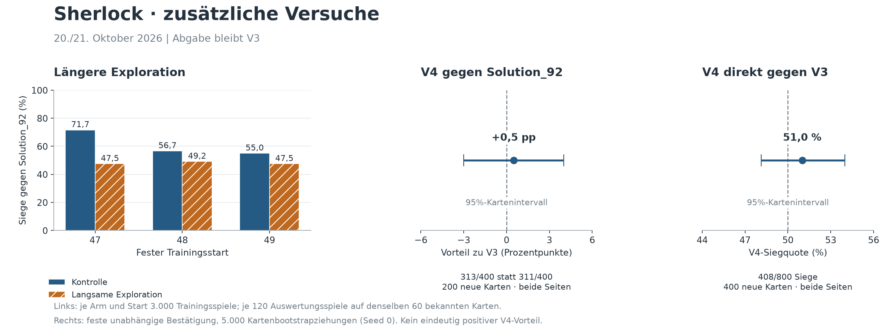

# Sherlock – Ergebnisbericht 20./21.10.2026

**Stand 21.10.2026, 09:00 Berlin. Auftrag bis 09:00 abgeschlossen.**

## Ergebnis für Moe und Mahmoud

Mahmouds bereits entwickelter Kandidat **all18_v3** wurde auf vorab zurückgehaltenen Karten gegen die frühere Sechser-Abgabe bestätigt und nach technischer Prüfung installiert. Auf 200 neuen Karten mit beiden Seiten gewann er gegen Solution_92 **313/400 statt 170/400**; gegen default **400/400 statt 382/400**. Die beiden eigenen neuen Trainingsversuche lieferten dagegen keinen weiteren zur Übernahme qualifizierten Kandidaten. Diese beiden Aussagen sind auseinanderzuhalten. Auch die unabhängige neue V4-Bestätigung mit 2.400 Spielen erfüllt die vorher festgelegten Vorteils-Gates nicht. **V3 bleibt die Abgabe.**

[Übernahmeprüfung V3](../experiments/analysis/autonomous_20261020/RELEASE.md). Die Verbesserung ist ein Vergleich ganzer Agentenstände; sie beweist nicht, welcher einzelne Bestandteil verantwortlich war.

Die Grafik zeigt die zusätzlichen Versuche; die zuvor bestätigte V3-Übernahme steht in der ersten Tabellenzeile.

## Durchgeführte Arbeit

| Untersuchung | Umfang und Karten | Tatsächliches Ergebnis | Entscheidung |
|---|---|---|---|
| V3 gegenüber alter Abgabe | 200 neue Karten 502420–502619, beide Seiten, default/Solution_92: 1600 Spiele; zusätzlich 120 direkte Spiele auf 500720–500779 | Solution_92 +35,75 Prozentpunkte, 95%-Kartenintervall [+29,00; +42,25]; default +4,50; direkt 96/120 | V3 übernommen, technisch geprüft, alte Abgabe gesichert |
| Reserveenergie 30/60, Gegnerdistanz 6/14 | 5 Arme einschließlich V3, 60 bekannte Karten 500720–500779, beide Seiten/Gegner: 1200 Spiele | Kein Arm erfüllt Auswahlregel | Keine Übernahme |
| V4 erster Direktvergleich | 60 bekannte Karten 500720–500779, beide Seiten: 120 Spiele | 61/120 gegen V3, Intervall [43,33; 58,33] % | Vorteil nicht eindeutig; Intervall des V4-Scores |
| V4 unabhängige Bestätigung | 400 neue direkte Karten 510400–510799: 800 Spiele; 200 neue Gegnerkarten 510800–510999, beide Seiten/default und Solution_92 je V3/V4: 1600 Spiele | Direkt 408/800 = 51,0 %, KI [48,125; 54,0] %; Sol V4 313/400 statt V3 311/400, Δ +0,5 pp [−3,0; +4,0]; default beide 400/400 | Beide Vorteils-Gates verfehlt; V3 bleibt installiert |
| Potentialterm beim Einheitentod (`terminal_death_potential`) | 2 × 400 neue Trainingsspiele auf Karten 460000–460199; 480 Evalspiele auf 500720–500779 | Solution_92 15/120 statt 43/120; −23,33 pp [−34,17; −13,33] | Pilotpaar mit Start 46 beendet, Schalter aus; kein allgemeines Urteil über Reward Shaping |
| Vorbereitende Ziel-/Sap-Beobachtung | V3, 20 bekannte Karten 500720–500739, beide Seiten gegen Solution_92: 40 Spiele | Schattenzuweisung betrifft 38/40 Spiele; freies Sap-Zentrum mit höherem heuristischem Score in 32/40 | Begründet die getrennten Varianten, kein Nachweis von Zusatzpunkten oder Siegen |
| Nur aktive Zielbesitzer / freiere Sap-Geometrie | Je Variante und V3 240 Spiele, zusammen 720, bekannte Karten 500720–500779 | Solution_92 +1,67 / +0,83 pp; beide Intervalle enthalten null; default jeweils 120/120 | Beide Schalter aus |
| Längere Exploration im Training | 3 gepaarte Starts 47/48/49, jeweils 2 × 3000 Spiele: **18.000 Trainingsspiele**; je Start Karten 470000–471499 / 480000–481499 / 490000–491499; insgesamt 1440 Evalspiele auf 500720–500779, beide Seiten/default und Solution_92 | Mittlere Solution_92-Leistung 48,06 % statt 61,11 %, −13,06 pp [−19,17; −6,94]; 0/3 Starts positiv | Kein weiterer Lauf dieses Designs |
| Feste Ensembles aus diesen Starts | 5 feste Arme einschließlich V3, je 240 Evalspiele auf 500720–500779, beide Seiten/default und Solution_92: 1200 | Solution_92: V3 102/120; control3 90/120; slow3 80/120; V3+control3 102/120; V3+slow3 98/120. Kein ausgewählter Gewinner | Keine frische Bestätigung, keine Gewichtsübernahme |
| Punktefeld-Diagnose | V3/V4, zehn bekannte Karten 500720–500729, beide Seiten gegen Solution_92: 40 Beobachtungsspiele | Unerreichbare Nahziele 6,20 % / 7,62 % freier eigener Feld-Schritte; unter dem 10%-Arbeitsfilter; kein Segment nach der engen Stay-Definition im Primärfenster | Kein Policy-Patch |
| Passive Aktionsfluss-Beobachtung | V3, zehn bekannte Karten 500720–500729, beide Seiten gegen Solution_92: 20 Spiele | Bei mindestens zwei legalen Aktionsklassen blieb die maskierte Greedyklasse in 56.352/61.880 = 91,07 % erhalten; sämtliche Referenzergebnisse reproduziert | Deskriptive Diagnose, keine neue Ablation oder Stärkeauswahl |

Die vorbereitende [Ziel-/Sap-Beobachtung](../experiments/analysis/autonomous_20261020/DIAGNOSIS.md) und die spätere Punktefeld-Diagnose sind unterschiedliche 40-Spiel-Reihen.

Die beiden eigenen Trainingsversuche umfassen zusammen **18.800 Trainingsspiele**. Das sind Spielausführungen, nicht unterschiedliche Karten und nicht das gesamte historische Trainingsbudget von Sherlock. Mahmouds separate Läufe werden nicht als eigene Arbeit mitgezählt. Kurze Funktions-/Runner-/Reproduktionsprüfungen stehen separat in den jeweiligen Prüfberichten; die Tabelle zählt sie nicht als zusätzliche unabhängige Stärkenachweise.

Die 95%-Intervalle stammen aus 5.000 Bootstrapziehungen mit Seed 0; beide Seiten derselben Karte bleiben zusammen. Bei Differenzen werden Kandidat und Referenz auf derselben Karte gepaart. Die Intervalle beschreiben Kartenstreuung für feste Agenten bzw. drei feste Trainingsstarts; sie ersetzen keinen unabhängigen Test nach Variantenwahl. Mehrfach genutzte Entwicklungskarten sind kein neuer Generalisierungsnachweis. Intervalle mehrerer Entwicklungsvarianten sind nicht für Mehrfachvergleiche korrigiert. Die Default-Grenze von zwei Prozentpunkten ist eine beobachtete Toleranz, kein formaler Nichtunterlegenheitstest.

## Explorationsversuch im Detail

Nur der Epsilon-Abfall wurde geändert: 60.000 → 454.500 Umgebungsschritte. Je Paar gleiche Anfangstensoren, gleiche Gegner-/Kartenfolge, 3.000 volle Spiele. Alle drei finalen Paare ausgewertet, keine Auswahl eines besten Starts oder Zwischencheckpoints. Gegen Solution_92 fiel Start 47 von 86 auf 57 Siege/120, Start 48 von 68 auf 59, Start 49 von 66 auf 57. Default im Mittel 97,78 % → 93,89 %. Die Bootstrapintervalle erfassen Kartenstreuung bei diesen drei festen Starts, nicht die gesamte Unsicherheit zukünftiger Trainingsstarts.

[Aggregation](../experiments/analysis/autonomous_20261020/exploration_aggregate.md), [Archivprüfung](../experiments/analysis/autonomous_20261020/historical_exploration_tools_20261021/exploration_archive_check.json), [feste Ensembleauswertung](../experiments/compare/autonomous_20261020/exploration_ensemble_development/state.json).

## Unabhängige V4-Bestätigung

V4 nutzt dieselben 18 trainierten Netze wie V3 und ergänzt die zwei Spielregeln `contest_sap` und `opp_infer`; es handelt sich dabei nicht um neu trainierte Netzgewichte.

Die vorher festgelegten 2.400 Spiele wurden am 21.10. von 07:35 bis 08:04 vollständig gespielt. Root und ein unabhängiger Reviewer kontrollierten Rohzahlen, Spielschlüssel, Kartenpaarung, Quellen-/Gewichtshashes, unveränderten HEAD und die Bootstraprechnung. Beide geforderten positiven Vorteilsnachweise fehlen. Keine früheren Daten gepoolt, keine zusätzlichen Karten nach schwachem Ergebnis angehängt, keine Gewichte ausgetauscht. V4 könnte einen kleinen Vorteil haben; diese Stichprobe bestätigt ihn unter den festgelegten Kriterien nicht. Sie beweist auch keine Gleichwertigkeit.

[Ergebnisse und prüfbares Archiv](../experiments/compare/autonomous_20261020/v4_independent_20261021/README.md). Die technische Übernahmeprüfung wurde mangels qualifizierten Kandidaten nicht erneut gestartet. Die bestehende V3-Kursprüfung bleibt dokumentiert.

## Diagnose und Grenzen

Alle 40 Beobachtungsspiele reproduzierten die bekannten Referenzergebnisse. Primär betrachtet wurden Match 3, Schritte 20–95 und bekannte Punktefelder strikt in der eigenen Hälfte. Der Nenner sind freie Feld-Schritte in diesem Fenster. Einheiten pendeln gelegentlich neben blockierten Punktefeldern. Der vorab gewählte enge Häufigkeitsfilter wurde trotzdem nicht erfüllt; eine breitere Kategorie nachträglich zu verwenden wäre keine saubere Begründung. Außerdem können bereits besetzte Asteroidenfelder weiter punkten. Ein künftiger Filter müsste direkte aktuelle Sicht, Belegung und alternative Ziele berücksichtigen; veraltetes Belief allein reicht nicht. Zehn bekannte Kartenpaare und viele korrelierte Feld-Schritte belegen noch keinen möglichen Stärkegewinn eines Filters.

[Diagnosebericht](../experiments/analysis/autonomous_20261020/post_exploration_point_flow/point-flow-final-review.md). Rohdaten sind verlustfrei komprimiert und mit SHA-256 versioniert. Historische Werkzeuge als Textsnapshots erhalten; absolute Pfade und alte Fristen sind keine allgemeine neue Ausführungsanleitung.

## Wo die Netzentscheidung erhalten bleibt

Die zusätzliche passive Beobachtung von 20 bekannten Spielen erfasst den Entscheidungsfluss des aktuellen V3: 70.200 aktive Unitentscheidungen, davon 8.320 mit nur einer legalen Klasse und 61.880 mit Wahlmöglichkeit. In **91,07 % der Entscheidungen mit Wahlmöglichkeit** blieb die maskierte Greedyklasse bis zur Ausgabe erhalten. Erkundung änderte 3.702 Klassen, späte Nachbearbeitung 1.826; keine Rückänderungen in dieser Stichprobe. Matchstart-No-ops und negative Energieslots sind getrennt.

Das zeigt, dass die Netzausgabe nicht pauschal durch nachgeschaltete Regeln ersetzt wird. Es beweist keinen kausalen Netzanteil: Gedächtnis, Features, Zielzuweisung, Masken und Sap-Ziele sind bereits regelgestützt. Keine Gegenfaktik ohne Netze oder Regeln gespielt. Alle 23 nichtzeitlichen Kennzahlen je Spiel stimmen mit zwei vorhandenen Referenzen überein; Zähler und Nenner wurden unabhängig nachgerechnet. [Beobachtung, Prüfbelege und Grenzen](../experiments/analysis/autonomous_20261020/v3_action_source_observation/README.md).

## Einordnung für die Rückfragen aus dem Review

Sherlock ist ein hybrider Agent. Die DQN-Netze bewerten Aktionen innerhalb einer durch Gedächtnis, Zielzuweisung, Aktionsmasken und weitere Regeln vorbereiteten Situation. Im Training helfen dichte Belohnungen und die wiederholte Nutzung gespeicherter Erfahrungen. Die bestätigte V3-Stärke kann deshalb nicht allein DQN oder der Spielzahl zugeschrieben werden. Die damaligen 18.000 Spiele bezeichneten sechs historische Basisläufe; die hier ausgewiesenen 18.800 sind zusätzliche lokale Versuche mit zwei getrennten Fragestellungen. Die heutigen 18 V3-Quellläufe haben dagegen **66.000 dokumentierte abgeschlossene Trainingsspiele** (6 × 3.000 + 12 × 4.000). Alle 18 Manifeste und die lückenlosen Logzeilen wurden geprüft. Das ist ein Quelllaufbudget, nicht die gesamte Projektentwicklung und wegen lokal fehlender Einzelcheckpoints kein neuer Nachweis ihres genauen Auswahlzeitpunkts. Die Quellgruppen haben teilweise verschiedene Reward- und Gegnerkonfigurationen; das heutige Inferenzconfig beschreibt nicht jeden ursprünglichen Trainingsreward.

DQN und PPO sind Lernverfahren; CNN bezeichnet eine Architektur. Der vorhandene CNN/PPO-Zweig kombiniert räumliche Darstellung, Nachahmung und anschließendes RL. In der bisherigen frischen Auswertung lag er beobachtet ungefähr auf Lehrerniveau; ein zusätzlicher PPO-Gewinn oder formale Gleichwertigkeit sind damit nicht nachgewiesen. Ein fairer Vergleich der Lernverfahren müsste Architektur, Daten und Rechenbudget berücksichtigen.

## Aktuelle Abgabe und Rückweg

Unverändert nach der letzten V4-Prüfung: **V3**, beide Dateien SHA-256 `aac1c9101c6639e3e085398267d0bc448a4e47b482e68bfe8b01374d5288d935`. Alte Sechser-Abgabe dauerhaft unverändert in `experiments/releases/20261020_old3_sym3/`, SHA-256 `3788fb721d1873b74ec666df34da92eb6af311eed1d8fff6e03b71e59346d158`. Die alte Sechser-Sicherung blieb bytegleich. Die Abgabedateien wurden ausschließlich im dokumentierten, freigegebenen Übernahmeschritt durch V3 ersetzt; Trainingsläufe schrieben in eigene Experimentverzeichnisse.

## Was die Nacht unterbrochen hat

Um etwa 03:03 wurde das Nutzungslimit erreicht. Bereits gestartete lokale Programme liefen selbstständig fertig; aktive LLM-Koordination, Reviews und Pushes liefen während der Unterbrechung nicht weiter. Nach Moayeds Fortsetzung und Verlängerung bis 09:00 wurden Ergebnisse geprüft und archiviert. Codex hat selbst kein Reset-Ticket eingelöst.

## Gepushte Arbeit und Abschluss

Wesentliche getrennte Commits dieser Fortsetzung:

- `ffcc394`: vollständige Explorationsdaten, Audits und historische Werkzeuge archiviert.
- `d51a790`: unabhängige V4-Bestätigung vorab festgelegt.
- `6ab3109`: Punktefeld-Diagnose und verlustfreie Rohdaten archiviert.
- `c682fde`: 2.400-Spiele-V4-Vergleich, unabhängige Prüfungen und Entscheidung gegen Austausch.
- `f4b93b1`: Trainingsdiagnose, Herkunftsprüfung und nächster Curriculum-Entwurf.
- `fd5b350` und `e831f08`: passive Beobachtung und Trennung erzwungener Aktionen vorab festgelegt.
- `5dda0a3`: vollständige Aktionsfluss-Beobachtung und unabhängige Prüfungen archiviert.
- `07dbe71`: Morgenbericht, Ergebnisgrafik und abgeglichene gemeinsame Dokumentation.
- `34fc59f`: unabhängig geprüfter künftiger Curriculumplan samt Kartenreservierung; keine Implementierung oder Trainingsausführung.

Frühere zentrale Arbeiten: `9d657dc` V3-Übernahme; `0a07481` negativer Reward-Pilot; `2e56dce` zwei Inferenzvarianten ohne Gewinner; `c0f9c15` Explorationsplan und Ablaufwerkzeug; `8517f88` erstes Trainingspaar. Die Git-Historie enthält die weiteren sinnvollen Prüfschritte und Mahmouds eigene Beiträge; sie sind nicht alle neue Trainingsgewinne.

Vor dem neuen V4-Lauf bestanden **223 Tests plus 14 Subtests**. Seitdem keine Pythonquellen geändert. Zusätzlich sieben Tests des einmaligen Vergleichsablaufs und vier Tests der unabhängigen Auditberechnung; alle 2.400 Datensätze anschließend erfolgreich geprüft. Die Aktionsbeobachtung bestand zusätzlich 13 isolierte Tests und beide vollständigen Datenaudits. CSV-Rohbytes bleiben erhalten; CRLF wird bei der Formatprüfung ausdrücklich als Zeilenende behandelt.

Die [Abschlussprüfung](../experiments/analysis/autonomous_20261020/closing_checks_20261021.json) und der jüngste [Arbeitsstand](ARBEITSSTAND.md) belegen Gewichtsidentität, Remote-Abgleich vor dem Abschlusscommit, beendete eigene Modelljobs und Wachhaltung sowie deaktivierte Nacht-Automationen. Der Commit dieses Berichts ist über die Git-Historie nachvollziehbar. Fremde ungesicherte Dateien bleiben erhalten; lokale neue Trainingsgewichte und Replay Buffer sind weiterhin nicht Teil des Git-Uploads.

## Nächster sinnvoller Schritt

[Vorbereiteter Trainingsentwurf für Mahmoud](NAECHSTER_TRAININGSVERSUCH_20261021.md): Früher begrenzter Kontakt mit Solution_92 bei identischen Gesamtgegnerzahlen, ursprünglichem schnellen Epsilon-Abfall und drei gepaarten Trainingsstarts. Gegnerfolge rechnerisch geprüft; noch nicht implementiert oder trainiert. Die bisherigen sechs Vergleichsläufe benötigten zusammen rund 5,2 Stunden reines Training. Für die neue Studie ist das ein Planungswert, keine gemessene Dauer; Auswertung und Reserve kommen hinzu. Der [konkrete Implementierungs- und Studienplan](superpowers/plans/2026-10-21-early-opponent-curriculum.md) legt inzwischen Starts, Karten, Auswertung und Übernahmebedingungen fest; seine Software ist noch nicht implementiert. Die jetzige Diagnose spricht gegen eine blinde Wiederholung langsamer Exploration, gleichartiger Zusatznetze oder einer Kombination der beiden unbestätigten Inferenzschalter.

CNN3 bleibt eine alternative Richtung. Lokal fehlen dessen Originalgewichte; cnn2 ist kein Ersatz. Vor PPO-Fortsetzung Originalcheckpoint, Hash und gespeicherte Konfiguration von Mahmoud bereitstellen, reproduzieren und die Konsistenz zwischen Aktionsauswahl und PPO-Update prüfen. Kartenebenen werden im Recorder quantisiert; der tatsächliche Einfluss auf die PPO-Ratio ist bisher ungemessen. Kein behaupteter Reparaturerfolg ohne Messung.
