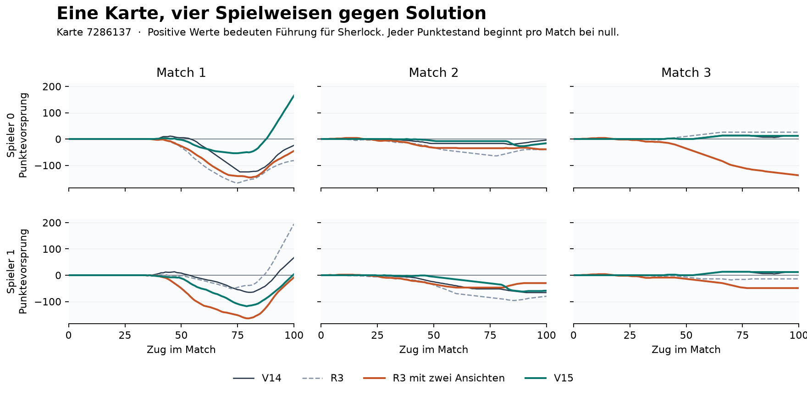

# V15 gewinnt auf der Karte mit beiden Diagonal-Niederlagen

Auf Karte 7286137 verlor der Zwei-Ansichten-Berater als Spieler 0 und 1 jeweils alle drei Matches. Alle anderen 118 Solution-Partien im unabhängigen Vergleich gewann er. Acht neue instrumentierte Partien auf dieser einzelnen Karte zeigen, wie sich die Alternativen auf denselben beiden Startplätzen verhalten. Die vier Referenzpartien von V14 und dem Zwei-Ansichten-Berater reproduzierten sämtliche archivierten Match- und Punktergebnisse.

**Punktevorsprung Sherlock minus Solution am Matchende.** Jedes der drei Matches beginnt bei null. Die drei Zahlen pro Spalte stehen für die drei Einzelmatches in zeitlicher Reihenfolge.

| Spielweise | Spieler 0 | Spieler 1 | Gewonnene Partien |
|---|---|---|---:|
| V14 | −24 / −4 / +12 | +67 / −66 / +11 | 1/2 |
| R3 | −82 / −40 / +26 | +195 / −80 / −14 | 0/2 |
| R3 mit zwei Ansichten | −45 / −39 / −138 | −8 / −30 / −49 | 0/2 |
| V15 | +165 / −16 / +12 | +4 / −59 / +12 | 2/2 |
| Zwei Ansichten, nach M1-Niederlage V14 | −45 / +6 / +11 | −8 / −21 / +12 | 1/2 |

V15 gewinnt auf beiden Sitzen Match 1 und 3. Match 2 geht bei allen vier unveränderten Agenten an Solution. Die separat geprüfte Rückschaltung holt auf Spieler 0 Match 2 mit sechs Punkten Vorsprung. Auf Spieler 1 reicht der Zugewinn dort noch nicht. Der ursprüngliche R3 als Spieler 1 sammelt insgesamt 101 Punkte mehr als Solution und verliert trotzdem zwei von drei Matches. Für den Spielsieg zählt, wie viele einzelne Matches gewonnen werden.

Die Kurven stammen aus 303 tatsächlich ausgeführten Übergängen je Partie. Der Beobachter erfasst die gewerteten Felder nach dem Zug. Die Agenten sehen weiter ihre eigenen Spielbeobachtungen. Eine Ursache für die Unterschiede einzelner Befehle lässt sich aus den Kurven allein nicht ableiten. [13er-Versuch zur Rückschaltung](../../diagonal_after_loss_20261115/BEKANNTE_KARTEN.md) · [Plan der acht Partien](PLAN.md) · [Spielprotokolle](run/).
