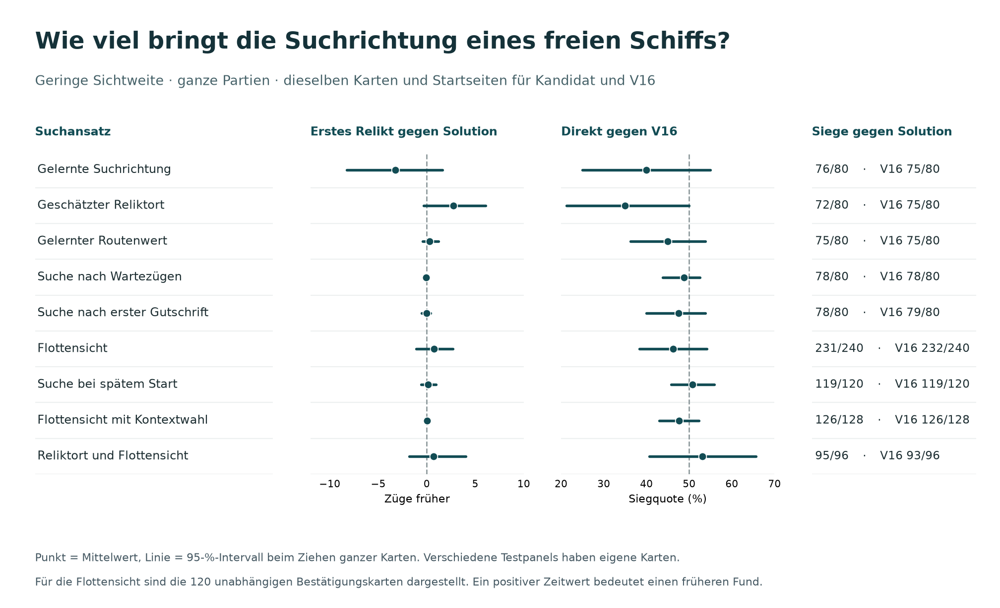

# Suchrichtung bei geringer Sicht

**V16 bleibt die Abgabe.** Das neu trainierte Reliktort- und Flottenmodell kann genau ein freies Schiff bei Sichtweite eins auf einen anderen Suchweg schicken. Es schätzt zuerst, wo das erste Relikt wahrscheinlich liegt und welche Felder die anderen Schiffe in den nächsten acht Zügen ohnehin sehen werden. Für die Ortsverteilung wurden 49.152 erzeugte Karten verwendet. Die zusätzliche Bewegung ist nur vor dem ersten Sichtkontakt oder der ersten eigenen Gutschrift möglich. Im größten ungefilterten Vergleich erreichte der Sucher 319 von 320 Siegen gegen Solution. Auf einem neuen Kartensatz mit durchweg geringer Sicht brachte er einen zusätzlichen Sieg in 192 Spielen. Ein verlässlicher Vorteil für eine Ablösung ist damit offen.

## Derselbe Kundschafter auf getrennten Karten

Jeder Eintrag zählt ganze Spiele über drei Matches. Jede Karte wird von beiden Startseiten gespielt. Die dritte Zeile stammt aus einer separaten Kombinationsstudie, die den reinen Kundschafter ebenfalls gegen Solution geprüft hat.

| Stichprobe | Kundschafter gegen Solution | V16 gegen Solution | Kundschafter direkt gegen V16 |
|---|---:|---:|---:|
| 48 neue Karten mit geringer Sicht, Vorauswahl | 95/96 | 93/96 | 51/96 |
| 160 neue Karten mit allen Sichtweiten | 319/320 | 316/320 | 161/320 |
| 32 weitere Karten mit geringer Sicht | 61/64 | 61/64 | nicht erhoben |
| 96 neue Karten mit geringer Sicht, letzte Wiederholung | 178/192 | 177/192 | 102/192 |
| 32 weitere Sicht-1-Karten, Kontrollarm im Ein-Schritt-Test | 63/64 | 64/64 | 34/64 |

Auf den 38 Karten mit geringer Sicht innerhalb der 160-Karten-Reihe gewann der Sucher alle 76 Spiele, V16 gewann 73. Diese 76 Spiele gehören bereits zur zweiten Tabellenzeile. In der letzten Wiederholung rettete Sherlock vier Verlustsitze und gab drei bisherige Siege ab. Gegen Solution liegt die geschätzte Differenz bei +0,52 Prozentpunkten (95-%-Kartenintervall −2,60 bis +3,65). Direkt liegt die Schätzung bei 53,13 % (43,75 bis 61,98 %). [Vorauswahl](ortundflotte/ERGEBNIS.md) · [Ungefilterter Vergleich](abschlusspruefung/ERGEBNIS.md) · [Kombinationsstudie](kundschafter_feldwissen/ERGEBNIS.md) · [Wiederholung mit unabhängiger Nachrechnung](sicht1_wiederholung/ERGEBNIS.md)

**Kam das Schiff früher ans Relikt?** Auf den letzten 96 Karten sah das Team den ersten Reliktknoten im Mittel in Zug 45,81 statt 46,71. Dem Vorteil von 0,91 Zügen stehen ein 95-%-Intervall von −0,92 bis +2,89 und 37 Sitze mit späterer Sicht gegenüber. Die erste Gutschrift kam 0,73 Züge früher (−0,45 bis +1,99). Im ungefilterten Vergleich war der erste Punkt bei niedriger Sicht deutlicher vorgerückt, um 2,57 Züge (+1,04 bis +4,39). Die Uhr für einen ersten Punkt und die für den ersten Blick beantworten verschiedene Fragen. Auf zwei zusätzlich gewonnenen Sitzen derselben Karte kamen die ersten Punkte früher, obwohl das Team den Knoten im ersten Match gar nicht sah. [Zeitverläufe und Zählweise](fundzeiten/ERGEBNIS.md) · [Karten und Punktstände der Wiederholung](sicht1_wiederholung/ERGEBNIS.md)

**Was einen Sieg erklärt.** Auf einem Pilotsitz genügte das Wissen über vier zusätzliche Punktefelder, um den Ausgang von Match 2 in einem kontrollierten Nachspiel von 183:197 auf 190:186 zu drehen. In anderen Fällen spielte die Reaktion des Gegners eine eigene Rolle. Auf 164300158/P0 gewann sogar der gewöhnliche V16 Match 3, als allein Solution die Vorgeschichte aus der Begegnung mit dem Kundschafter hatte. Auch der knappe direkte Vorteil auf den 38 Sicht-1-Karten kam aus 17 dazugewonnenen und 16 abgegebenen Sitzen. [Grafik für die Präsentation](fallgrafik/schiff_0_vier_punktefelder.pdf) · [Kreuzversuch beider Spielgedächtnisse](gedaechtnistausch/ERGEBNIS.md) · [Direkte Gewinne und Verluste](direkte_wirkung/ERGEBNIS.md)

**Wer fand das Relikt tatsächlich?** Auf 57 der letzten 192 Sitze sah das Team den Knoten früher. In 18 dieser Partien konnte nur das umgelenkte Schiff ihn am Fundzug sehen. In den übrigen 39 kam die erste Sicht jeweils von einem anderen Schiff. [Gegenprobe mit den tatsächlichen Sensoren aller Schiffe](fundtraeger/ERGEBNIS.md)

**Reicht ein einzelner abweichender Befehl?** Auf sieben gezielt nachgespielten Sitzen reichte er für drei der vier zuvor zusätzlichen Siege und erhielt zwei der drei abgegebenen Siege. Im eigenen Entwicklungstest auf 32 weiteren Sicht-1-Karten gewann diese kurze Variante 64/64 gegen Solution, ebenso wie V16. Der volle Sucher holte 63/64. Beide Sucher gewannen jeweils 34/64 direkt gegen V16. Der einzelne Eingriff fand das Relikt im Mittel 2,41 Züge **später** als der volle Sucher (95-%-Kartenintervall 0,09 bis 5,11 später), auch später als V16. Das feste Ziel wurde verfehlt. Eine separat auf 96 Karten trainierte Entscheidung über die Rückgabe nach dem ersten Schritt war auf 48 Prüfkarten beim Fundzug im Mittel genauso schnell wie die ständige Fortsetzung. [Ein-Schritt-Prüfung](ein_suchschritt/NACHRECHNUNG.md) · [Gelernte Rückgabe](rueckgabe_nach_schritt/ERGEBNIS.md) · [Nachspiele der sieben geänderten Sitze](sieben_eroeffnungen/ERGEBNIS.md)

**Wo weitere Siege liegen könnten.** Im neuen Wiederholungstest verloren V16 und der Kundschafter elf identische Sitze gegen Solution. In *jedem* darauf verlorenen zweiten oder dritten Match erzielte Solution auf den später aktivierten Reliktgruppen mehr Punkte (18/18 für V16, 19/19 für den Kundschafter). In 14 Niederlagen je Spieler war Sherlock auf Gruppe 1 sogar gleichauf oder voraus. Der nächste aussichtsreiche Versuch wäre, auf neuen Trainingskarten aus öffentlichen Beobachtungen die Besetzung des zweiten Gebiets zu lernen und die Wirkung an zusätzlichen tatsächlich gehaltenen Punktefeldern sowie ganzen Siegen zu prüfen. [Einzelnachweis für alle 66 Matchstände](gemeinsame_niederlagen/ERGEBNIS.md)

Auf drei getrennt untersuchten Verlustsitzen führte Sherlock an der zuerst aktiven Reliktgruppe in Match 2 um 31 bis 125 Punkte. Auf der zweiten Gruppe verlor er im selben Match 127 bis 320 Punkte. Auf der einzigen normal sichtbaren Verlustkarte der großen Abschlussprüfung wiederum erzielte Solution alle 779 Punkte der beiden verlorenen Matches in Sherlock bereits bekannten Gebieten. Ein allgemeines Modell für das frühere Betreten eines gegnerseitigen Felds brachte auf einer separaten Archivprüfung keinen belastbaren Vorteil. [Bilanz nach Reliktgruppe](punkte_nach_gebiet/ERGEBNIS.md) · [Normal sichtbare Verlustkarte](normallicht_verlust/ERGEBNIS.md) · [Prüfung auf 132 anderen Karten](gegnerhaelfte/ERGEBNIS.md)

## Weitere getrennt geprüfte Varianten

Zusätzliche sichere Punkteinformationen brachten 315/320 gegen Solution statt 314/320 sowie 162/320 direkt gegen V16. Eine frühere Feldprobe holte 28 zusätzliche Sofortpunkte auf 120 Karten, gewann aber 231/240 gegen Solution gegenüber 232/240 für V16. Der gelernte zusätzliche Haltezug erzielte 90/96 statt 89/96 und 43/96 direkt. Die Korrektur falscher positiver Punktefelder endete bei 127/128 extern für beide und 64/128 direkt. [Punktewissen](punktwissen/ERGEBNIS.md) · [Feldprobe](feldprobe/bestaetigung/sicht1/ergebnis.json) · [Haltezug](halteprobe/ERGEBNIS.md) · [Fehlmarkierungen](fehlmarkierung/ERGEBNIS.md)

## Welche Suchrichtung hilft?

Die Grafik zeigt vollständige Drei-Match-Partien auf beiden Startseiten. Je nach Versuchsreihe sind es 40, 48, 60, 64 oder 120 neue Karten mit Sichtweite eins. Die folgende Tabelle enthält die ersten Auswahlreihen auf jeweils 40 Karten. Alle Varianten dürfen in der Eröffnung nur die Bewegung eines freien Schiffes ändern. Die ersten drei Zeilen teilen sich dieselben Karten und dieselbe V16-Kontrolle. Jede weitere Zeile hat eigene Karten. Ein positiver Zeitgewinn heißt, dass Sherlock das Relikt bzw. den ersten Punkt früher erreichte.

| Ansatz | Erstes Relikt, Züge früher | Erster Punkt, Züge früher | Siege gegen Solution | V16 auf denselben Sitzen | Siege direkt gegen V16 |
|---|---:|---:|---:|---:|---:|
| Gelernte Richtungsbewertung | −3,24 | +0,62 | 76/80 | 75/80 | 32/80 |
| Gelernter wahrscheinlicher Reliktort | +2,73 | +4,30 | 72/80 | 75/80 | 28/80 |
| Lernen aus echten Alternativwegen | +0,31 | +0,12 | 75/80 | 75/80 | 36/80 |
| Aufbruch nach Wartezügen | −0,08 | +0,15 | 78/80 | 78/80 | 39/80 |
| Nach dem ersten eigenen Punkt suchen | −0,04 | 0,00 | 78/80 | 79/80 | 38/80 |
| Künftige Sicht der übrigen Flotte | +1,76 | 0,00 | 77/80 | 76/80 | 40/80 |

Beim Flottenblick kann der gemessene Sichtvorteil auf diesen 40 Karten auch durch die Kartenwahl entstanden sein (95-%-Intervall −1,06 bis +5,13 Züge). Der zusätzliche ganze Sieg stammt von einer Karte, Startseite 1. Die eigens gebaute Versuchs-ZIP reproduziert die Befehle im Kursrunner auf zwei Python-Versionen. Die anschließende Bestätigung auf 120 zusätzlichen Sicht-1-Karten verfehlte die vorher festgelegten Bedingungen. Der ungefilterte Folgetest entfiel. [Erste drei Modelle](vergleich/ERGEBNIS.md) · [Aufbruch](standsuche/duelle/ERGEBNIS.md) · [Erster Punkt](punktsicht/ERGEBNIS.md) · [Flottenblick](flottenblick/ganzspiel/ERGEBNIS.md) · [Kursrunner](flottenkurs/ERGEBNIS.md)

## Was aus den Spielzügen folgt

- Auf 28 der 80 Sitze kam der frühe Zielschätzer früher zum ersten Relikt. Elfmal kam die entscheidende Sicht vom umgeleiteten Schiff selbst, 17-mal von einem anderen Schiff. [Sicht in der echten Spielumgebung](fundursache/ERGEBNIS.md)
- Die vier verlorenen früheren Siege des Zielschätzers kippten alle in Match 3. Der größte zusätzliche Punkterückstand entstand jeweils außerhalb der Sherlock damals bekannten Reliktgebiete. Eine eigene passive Untersuchung zeigte, dass sich solche Gebiete teilweise allein aus der öffentlichen Punkteanzeige und der Sicht beweisen lassen. [Vier verlorene Spiele](uebergang/ERGEBNIS.md) · [88 überprüfte Partien](spaetgebiet/ERGEBNIS.md)
- Wenn bis Zug 55 sowohl die erste Sicht als auch die erste eigene Gutschrift fehlen, holte eine späte Richtungswahl beides auf 64 anderen, gezielt schwierigen Karten um gut vier Züge vor. Die Zahl der gewonnenen **ersten Matches** blieb bei 43/64. Auf 60 neuen Sicht-1-Karten mit beiden Sitzen und beiden Gegnern ergaben 420 vollständige Spiele +0,70 Züge früher im Mittel (95-%-Intervall −0,04 bis +1,89). Gegen Solution 119/120 wie V16 und direkt 61/120. [Schwierige Starts](spaetsuche/OFFLINE.md) · [Vollständige Partien](spaetsuche/ERGEBNIS.md)

Die drei übrigen ganzen Flottenblick-Niederlagen entstanden nach eigener Gutschrift in Zug 11 oder 20. Alle drei reproduzieren V16 exakt. Auf zwei Karten blieben einzelne bereits vom eigenen Team genutzte Punktefelder über längere Zeit unbestimmt oder fälschlich als leer eingestuft. Zwei nachfolgende Versuche untersuchten, ob Sherlock aus dem öffentlichen Punktestand sichereres Feldwissen oder eine sinnvolle einzelne Bewegung ableiten kann. [Vier Nachspiele mit allen Gutschriften](fruehepunkte/ERGEBNIS.md)

Das gesondert trainierte späte Ortsmodell erkannte mögliche fehlende Reliktorte in zurückgehaltenen Beobachtungen genauer. In 288 ganzen Spielen brachte das keine frühere Sicht oder weiteren Sieg gegen Solution (94/96 für beide, 47/96 direkt). Beim frühen Zielschätzer ließ sich im Direktvergleich rekonstruieren, wo die stärkere Eröffnung ihren Vorteil verlor. Die erste Gutschrift kam 5,08 Züge früher. Zwischen Zug 71 und 100 des ersten Matches verlor die eigene Punktedifferenz gegenüber dem ursprünglichen V16-Selbstspiel im Mittel 30,45 Punkte. Den größten Anteil hatten Felder, auf denen das jeweilige Team zuvor schon gepunktet hatte. [Spätes Ortsmodell](spaetgebiet/ortsmodell/ERGEBNIS.md) · [Direkter Vergleich der Punkterennen](reliktrennen/ERGEBNIS.md)

Von 776 eindeutigen ursprünglichen Solution-Spielen auf 388 Sicht-1-Karten gingen 29 verloren. 14 davon trotz gewonnenem ersten Match. Deshalb untersuchten wir nach dem Erreichen der Reliktregion auch die Nutzung der daraus gewonnenen Information. [Zeitpunkt der Niederlagen](niederlagen/ERGEBNIS.md) · [Neue Punktefelder aus öffentlichen Angaben](punktspeicher/ERGEBNIS.md). Für das gezielte Zusammenlegen mehrerer Sensoren hat sich auf 40 neuen Karten kein früherer Blick ergeben. Bei erneut erscheinenden Relikten könnte eine frühere Sicht das gespeicherte Feldwissen verbessern, doch der vorab festgelegte öffentliche Suchweg fand die richtige Stelle zu selten. [107 nachgespielte Nebelbewegungen](nebelsicht/ERGEBNIS.md) · [Zweites und drittes Reliktpaar](zweiterfund/ERGEBNIS.md)

Der Spieler, der vor der ersten Sicht zwischen keinem, einem oder drei abweichenden Suchschritten wählen durfte, erreichte auf getrennten Karten 45/48 statt 46/48 gegen Solution und 24/48 direkt. Die beiden ursprünglichen externen Niederlagen verloren alle Suchlängen trotz gewonnenem Match 1. Ein Wechsel nach diesem exakt reproduzierten Auftakt zu R3 rettete in einer gezielten Gegenprobe beide. Auf einer der beiden Karten genügte das erweiterte Feldwissen, auf der anderen kam die erste durch diese Information veränderte Aktion erst in Zug 286. [288 getrennte Pilotpartien](spielwert/ERGEBNIS.md) · [Zehn vollständige Fortsetzungen der beiden Niederlagen](entscheidende_matches/ERGEBNIS.md)

## Welcher Befehl änderte sich tatsächlich?

Auf der einzigen zusätzlich gegen Solution gewonnenen Auswahlpartie erkannte Sherlock im zweiten Match, Zug 10, das symmetrische Punktefeld (22,21). Drei Züge später blieb Schiff 3 dort stehen, während V16 nach Norden gefahren wäre. Original-V16 verlor dieses Match 524:564. Nur mit dem ersten zusätzlichen Hinweis gewann Sherlock 598:580, mit allen Hinweisen 619:606. Weitere Hinweise alleine reichten auf derselben Karte für einen anderen Gewinnweg über Match 3. Die Forschungs-ZIP reproduzierte die geprüften Befehle auf zwei Python-Versionen. [Vollständiges Spielbeispiel mit Grafik](beispiel/ERGEBNIS.md) · [Prüfung im Kursrunner](wissenskurs/ERGEBNIS.md)

Die ersten Feldproben brachten auf dem getesteten Feld und dessen Spiegel auch bis zum Matchende mehr Punkte. Auf 16 geprüften Sitzen wollte der Sammler ein gerade erfolgreich besetztes, nach V16s Kartenwissen aber weiter unbekanntes Feld bereits im Folgezug verlassen. Daraus entstand der oben ausgewertete Lernversuch zum einmaligen Halten. Die Anfahrt mit mehreren Schritten hat sich unterdessen nicht bestätigt. Auch ein vor dem Erscheinen des Relikts gezielt wartendes Schiff fand die richtige Gelegenheit mit der geprüften öffentlichen Regel zu selten. [Feldbesetzung](feldbindung/ERGEBNIS.md) · [Mehrzügige Anfahrt](beweisfahrt/ERGEBNIS.md) · [Warten auf das erste Relikt](zeitfenster/ERGEBNIS.md)
