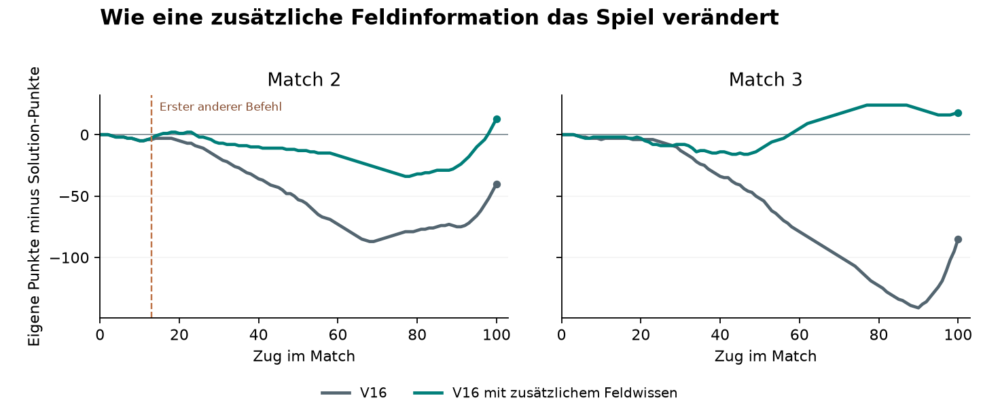

# Ein Feld, ein anderer Fahrbefehl, ein gewonnenes Match

Auf Karte **162640213, Player 1** gewannen beide Agenten gegen Solution das erste Match 144:142. Im zweiten Match erkannte das zusätzliche Gedächtnis ein Punktefeld, das dem ursprünglichen V16 an diesem Zug noch unbekannt war. Drei Züge später stand Schiff 3 auf diesem Feld. V16 wollte nach Norden fahren. Mit derselben Netzarchitektur und denselben Gewichten, aber dem ergänzten Feldwissen, ließ Sherlock das Schiff stehen.

## Woher wusste Sherlock das?

Bei der Beobachtung in Match 2, Zug 7 punktete Sherlock zweimal. Eigene Schiffe belegten die drei verschiedenen Felder (21,20), (22,21) und (23,23). In Zug 10 bekam er wieder zwei Punkte. Die Felder (21,20) und (23,23) waren wieder besetzt. Gegenüber der ersten Beobachtung fehlte **(22,21)**, dafür waren **(21,19)** und **(21,23)** besetzt. Sherlock konnte aus früheren Gutschriften bereits nachweisen, dass (21,23) punktete. Da aktivierte Punktefelder im Spiel erhalten bleiben, musste das weggefallene Feld (22,21) den fehlenden Beitrag geliefert haben. Die Symmetrie macht damit auch (2,1) bekannt.

Die Änderung erfolgte zuerst im Gedächtnis, bevor V16 seine Entscheidungsmerkmale bildete. Der erste andere **ausgeführte Befehl** folgte erst in Zug 13. Bis dahin waren alle Einheitenbefehle beider Spieler identisch. Die nachfolgenden Befehle spielten beide Agenten aus den jeweils tatsächlich entstandenen Situationen. Die vier Varianten ergeben unterschiedliche Gewinnwege.

| Tatsächlich ausgespielte Fortsetzung | Match 1 | Match 2 | Match 3 | Ganze Partie |
|---|---:|---:|---:|---:|
| Original-V16 | 144:142 | 524:564 | 632:717 | 1:2 |
| Nur der erste Zusatzhinweis | 144:142 | 598:580 | 723:736 | **2:1** |
| Ersten Zusatzhinweis auslassen, spätere zulassen | 144:142 | 524:561 | 859:733 | **2:1** |
| Alle Zusatzhinweise | 144:142 | 619:606 | 782:764 | **3:0** |

Alle Werte nennen Sherlock zuerst. Nur der erste Hinweis genügte, um auf dieser Karte das zweite Match zu drehen. Ohne ihn führten die späteren Hinweise zu einem Sieg im dritten Match. Der erste abweichende Zug allein erklärt deshalb den gesamten Spielausgang nicht. Dieses Beispiel wurde anhand des bereits bekannten Siegerwechsels ausgesucht. Für die allgemeine Spielstärke zählen die getrennten Prüfserien. [Vier komplette Verläufe, Befehlsprüfsummen und Summenbeweise](verlaeufe.json) · [Auswahlvergleich](../punktwissen/ERGEBNIS.md)

