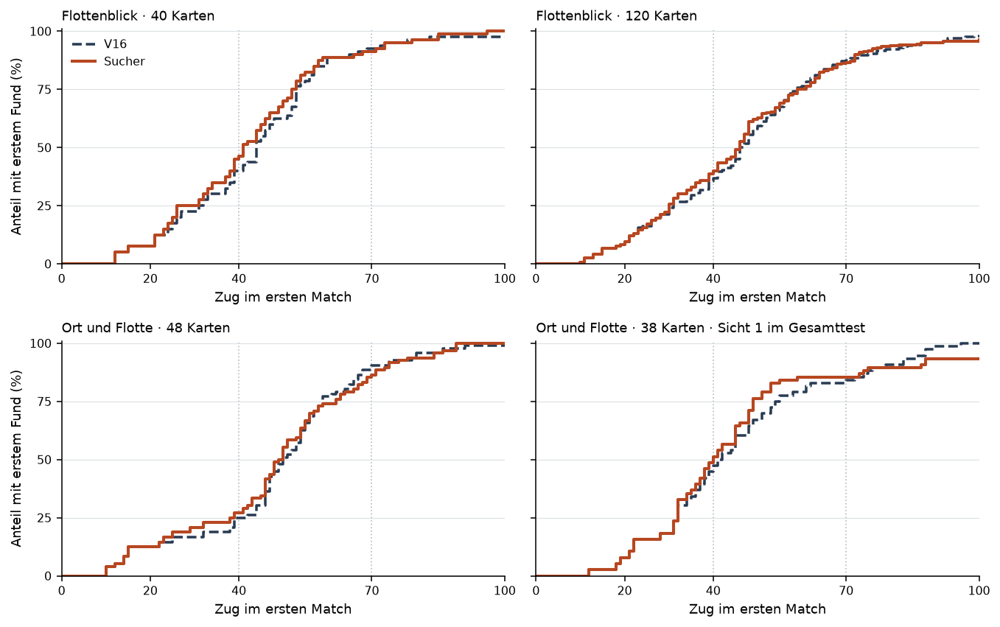

# Wann sehen wir das erste Relikt?

Im Pilot mit 48 Karten und Sichtweite eins brauchte **Ort und Flotte im Median 49,5 Züge**, Original-V16 50. Bis Zug 40 sah der Sucher das erste Relikt in 26 von 96 Spielen, V16 in 24. Bis Zug 70 lagen die Zahlen bei 83 und 87. Der Sucher erreichte in allen 96 Spielen noch vor Matchende einen Fund, V16 in 95. Beide Startplätze jeder Karte zählen je einmal.

**Die getrennte ungefilterte Prüfung enthielt 38 Sicht-1-Karten mit 76 Sitzen je Spieler.** Bis Zug 40 fand Ort und Flotte 39/76 erste Relikte und V16 36/76, bis Zug 70 waren es 65/76 und 64/76. Ohne Fund blieben 5 bzw. 0 Sitze. Das begrenzte Mittel betrug 44,51 bzw. 45,47 Züge. Der mittlere Vorteil des Suchers von 0,96 Zügen hat bei 20.000 gepaarten Ziehungen ganzer Karten ein 95-%-Intervall von -1,75 bis 3,91 Zügen. [Gegenrechnung des fertigen Gesamtarchivs](mit_gesamt.json)

Die 5 Spiele ohne Fund verteilen sich auf 3 Karten. In 4 dieser Spiele sammelte der Sucher im ersten Match trotzdem Punkte. Er gewann 5 dieser ganzen Spiele, davon 2 auf Sitzen, die V16 verlor. Sicht misst das Entdecken des Reliktknotens. Ein Schiff kann früher zufällig auf einem zugehörigen Punktefeld stehen. Die Fundzeiten und ihre eigenen Unsicherheiten ergänzen die vorab festgelegte Gesamtentscheidung. [Ergebnis der Gesamtprüfung](../abschlusspruefung/ergebnis.json)

Als Fund zählt das erste Relikt in der öffentlichen Beobachtung des eigenen Teams. Das erste Match umfasst die Beobachtungen in den Zügen 0 bis 100. „Bis“ schließt den genannten Zug ein. Das begrenzte Mittel rechnet eine Partie ohne Fund mit 100 und lässt sie im Nenner. Das ursprüngliche Spielarchiv verwendet für einen ausgebliebenen Fund den technischen Wert 101. Bei der Gegenrechnung des ursprünglichen Pilotwerts bleibt dieser Wert erhalten.

## Gegen denselben Gegner auf denselben Karten

| Reihe | Spieler | Bis Zug 40 | Bis Zug 70 | Ohne Fund im ersten Match | Median, Zug | Mittel bis Zug 100 |
| --- | --- | --- | --- | --- | --- | --- |
| Flotte · 40 | V16 | 32/80 (40,0 %) | 74/80 (92,5 %) | 2/80 (2,5 %) | 44,0 | 44,06 |
| Flotte · 40 | Flottenblick | 37/80 (46,2 %) | 73/80 (91,2 %) | 0/80 (0,0 %) | 41,0 | 42,33 |
| Flotte · 120 | V16 | 88/240 (36,7 %) | 210/240 (87,5 %) | 5/240 (2,1 %) | 46,5 | 47,32 |
| Flotte · 120 | Flottenblick | 96/240 (40,0 %) | 208/240 (86,7 %) | 9/240 (3,8 %) | 46,0 | 46,55 |
| Ort + Flotte · 48 | V16 | 24/96 (25,0 %) | 87/96 (90,6 %) | 1/96 (1,0 %) | 50,0 | 49,01 |
| Ort + Flotte · 48 | Ort und Flotte | 26/96 (27,1 %) | 83/96 (86,5 %) | 0/96 (0,0 %) | 49,5 | 48,31 |
| Ort + Flotte · 160 alle | V16 | 184/320 (57,5 %) | 306/320 (95,6 %) | 0/320 (0,0 %) | 38,0 | 38,21 |
| Ort + Flotte · 160 alle | Ort und Flotte | 187/320 (58,4 %) | 307/320 (95,9 %) | 5/320 (1,6 %) | 38,0 | 37,98 |
| Ort + Flotte · Sicht 1 im 160er-Test | V16 | 36/76 (47,4 %) | 64/76 (84,2 %) | 0/76 (0,0 %) | 41,5 | 45,47 |
| Ort + Flotte · Sicht 1 im 160er-Test | Ort und Flotte | 39/76 (51,3 %) | 65/76 (85,5 %) | 5/76 (6,6 %) | 40,0 | 44,51 |

Die beiden Flottenblick-Reihen prüften denselben Spieler mit gelernter Flottenvorhersage. Die erste Reihe wählte sie aus, die folgenden 120 Karten prüften sie unabhängig. Der gemeinsame Orts- und Flottensucher ergänzt den Flottenblick um die gelernte Wahrscheinlichkeit des Reliktorts. Die historischen Reihen haben jeweils eigene Karten.

## Sitze mit tatsächlichem Eingriff

Diese Aufteilung nutzt den ausgeführten Befehl. In den unveränderten Sitzen stimmten der vollständige gemeinsame Befehlsverlauf beider Spieler, Fundzug und Matchergebnisse überein. Die geänderten Sitze sind eine nachträgliche Auswahl. Der Sucher durfte bis zur ersten Sicht oder Gutschrift eingreifen. Frühe Funde können deshalb schon die Gelegenheit zum Eingriff beenden. Die zugehörigen Mittel beschreiben diese Sitze bei beiden Spielweisen.

| Reihe | Sucher | Unverändert | Gemeinsames Mittel | Geändert | V16 auf diesen Sitzen | Sucher auf diesen Sitzen |
| --- | --- | --- | --- | --- | --- | --- |
| Flotte · 40 | Flottenblick | 22 | 25,95 | 58 | 50,93 | 48,53 |
| Flotte · 120 | Flottenblick | 44 | 26,34 | 196 | 52,03 | 51,08 |
| Ort + Flotte · 48 | Ort und Flotte | 18 | 20,50 | 78 | 55,59 | 54,73 |
| Suchwege · 40 | Routenlernen | 4 | 25,00 | 76 | 44,20 | 47,61 |
| Suchwege · 40 | Routenwert | 52 | 42,77 | 28 | 44,11 | 43,21 |
| Suchwege · 40 | Ortsprior | 4 | 12,50 | 76 | 44,86 | 41,99 |
| Ort + Flotte · 160 alle | Ort und Flotte | 254 | 35,41 | 66 | 48,97 | 47,86 |
| Ort + Flotte · Sicht 1 im 160er-Test | Ort und Flotte | 10 | 22,40 | 66 | 48,97 | 47,86 |

## Gegen Original-V16 im direkten Spiel

Die Zeiten gehören zur Seite des jeweiligen Suchers im tatsächlichen Duell gegen V16. Für die Vergleiche mit einem V16-Kontrollsitz gegen denselben Gegner dient die erste Tabelle.

| Reihe | Spieler | Bis Zug 40 | Bis Zug 70 | Ohne Fund im ersten Match | Median, Zug | Mittel bis Zug 100 |
| --- | --- | --- | --- | --- | --- | --- |
| Flotte · 40 | Flottenblick | 36/80 (45,0 %) | 70/80 (87,5 %) | 4/80 (5,0 %) | 42,0 | 44,73 |
| Flotte · 120 | Flottenblick | 100/240 (41,7 %) | 208/240 (86,7 %) | 6/240 (2,5 %) | 44,5 | 46,36 |
| Ort + Flotte · 48 | Ort und Flotte | 30/96 (31,2 %) | 84/96 (87,5 %) | 4/96 (4,2 %) | 48,0 | 47,44 |
| Suchwege · 40 | Routenlernen | 24/80 (30,0 %) | 68/80 (85,0 %) | 4/80 (5,0 %) | 45,5 | 48,77 |
| Suchwege · 40 | Routenwert | 32/80 (40,0 %) | 76/80 (95,0 %) | 0/80 (0,0 %) | 44,0 | 43,83 |
| Suchwege · 40 | Ortsprior | 40/80 (50,0 %) | 74/80 (92,5 %) | 0/80 (0,0 %) | 41,5 | 41,33 |
| Ort + Flotte · 160 alle | Ort und Flotte | 180/320 (56,2 %) | 306/320 (95,6 %) | 2/320 (0,6 %) | 38,5 | 38,69 |
| Ort + Flotte · Sicht 1 im 160er-Test | Ort und Flotte | 38/76 (50,0 %) | 68/76 (89,5 %) | 2/76 (2,6 %) | 40,0 | 43,11 |

## Weitere historische Suchwege

Die 40 Karten des früheren Vergleichs dreier Richtungsregeln bilden eine eigene Stichprobe. Alle drei Sucher teilen sich dieselben 80 V16-Kontrollsitze gegen Solution.

| Reihe | Spieler | Bis Zug 40 | Bis Zug 70 | Ohne Fund im ersten Match | Median, Zug | Mittel bis Zug 100 |
| --- | --- | --- | --- | --- | --- | --- |
| Suchwege · 40 | V16 | 30/80 (37,5 %) | 76/80 (95,0 %) | 0/80 (0,0 %) | 45,0 | 43,24 |
| Suchwege · 40 | Routenlernen | 29/80 (36,2 %) | 72/80 (90,0 %) | 0/80 (0,0 %) | 45,0 | 46,48 |
| Suchwege · 40 | Routenwert | 33/80 (41,2 %) | 76/80 (95,0 %) | 0/80 (0,0 %) | 44,0 | 42,92 |
| Suchwege · 40 | Ortsprior | 38/80 (47,5 %) | 77/80 (96,2 %) | 0/80 (0,0 %) | 41,5 | 40,51 |

## Gegenrechnung

Das bekannte 48er-Panel enthält genau 288 vollständige Partien. V16 gewann 93/96 gegen Solution, der gemeinsame Sucher 95/96 und direkt gegen V16 51/96. Gepaarte Fundzeiten aller Sitze einschließlich der technischen 101 ergeben 68 Züge Vorsprung, also 0,7083 pro Sitz. Die erste eigene Gutschrift rückte insgesamt um 143 Züge vor. Die Identität der ursprünglichen Serie, die Sitzzuordnung an beiden Kartenenden und alle fünf Summen wurden gegen das veröffentlichte Ergebnis geprüft. [Pilotbilanz](../ortundflotte/duelle.json)

Die Daten pro Reihe enthalten die vollständigen Schwellenwerte von Zug 0 bis 100 sowie den SHA-256-Abdruck des gelesenen Spielarchivs. [Historische Gegenrechnung](historisch.json) · [Berechnung](auswerten.py)

## Führte ein früher Blick auch zum Spielgewinn?

Die vier Serien des vollen Kundschafters bis einschließlich der 96-Karten-Wiederholung liefern gegen Solution zusammen 428 paarweise verglichene Sitze auf 214 verschiedenen Karten mit Sichtweite eins. Jede Karte wurde nur einmal in diese Beschreibung aufgenommen. Das Ergebnis der separaten Übernahmeprüfungen bleibt jeweils auf deren vorab festgelegten Karten.

| Erste Sicht des Teams | Sitze | Früher verlorenes Spiel gewonnen | Gleicher Gewinner | Früheren Sieg abgegeben |
|---|---:|---:|---:|---:|
| Früher als V16 | 103 | 3 | 100 | 0 |
| Gleicher Zug | 240 | 2 | 238 | 0 |
| Später als V16 | 85 | 4 | 78 | 3 |

Von neun zusätzlichen Siegen traten sechs mit gleicher oder späterer Sicht ein. Alle drei abgegebenen Siege gehörten zu den 85 Sitzen mit späterer Sicht. Damit sind die erste Sicht und der Spielgewinn auch unter derselben Suchpolitik unterscheidbare Lernziele. Aus der nachträglichen Gruppierung lässt sich vor dem Zug noch keine Entscheidungsregel gewinnen. [Gepaartes Ergebnis für erste Sicht und erste Gutschrift](zeit_und_siege.json)
